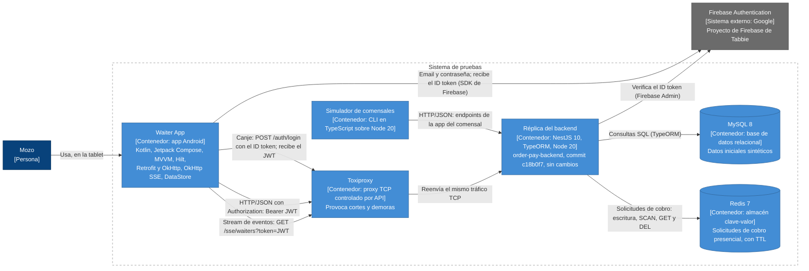
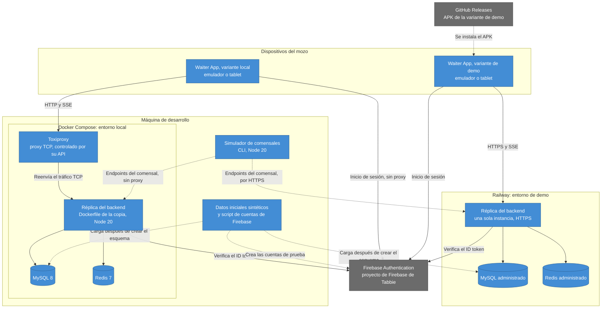

## Índice

0. [Ficha del proyecto](#0-ficha-del-proyecto)
1. [Descripción general del producto](#1-descripción-general-del-producto)
2. [Arquitectura del sistema](#2-arquitectura-del-sistema)
3. [Modelo de datos](#3-modelo-de-datos)
4. [Especificación de la API](#4-especificación-de-la-api)
5. [Historias de usuario](#5-historias-de-usuario)
6. [Tickets de trabajo](#6-tickets-de-trabajo)
7. [Pull requests](#7-pull-requests)

---

## 0. Ficha del proyecto

### **0.1. Tu nombre completo:**

Mauro Cocaro

### **0.2. Nombre del proyecto:**

Tabbie Waiter App

### **0.3. Descripción breve del proyecto:**

Tabbie Waiter App es una app Android para tablet con la que el mozo opera el salón durante todo el turno: ve las mesas ocupadas y sus pedidos, los manda a cocina, atiende los pedidos de ayuda, cobra en persona y cierra la mesa. Reemplaza al panel de mozos que hoy es una sección de la app de comensales de Tabbie, y usa el mismo backend sin modificarlo.

### **0.4. URL del proyecto:**

> Puede ser pública o privada, en cuyo caso deberás compartir los accesos de manera segura. Puedes enviarlos a [alvaro@lidr.co](mailto:alvaro@lidr.co) usando algún servicio como [onetimesecret](https://onetimesecret.com/).

Pendiente.

### 0.5. URL o archivo comprimido del repositorio

> Puedes tenerlo alojado en público o en privado, en cuyo caso deberás compartir los accesos de manera segura. Puedes enviarlos a [alvaro@lidr.co](mailto:alvaro@lidr.co) usando algún servicio como [onetimesecret](https://onetimesecret.com/). También puedes compartir por correo un archivo zip con el contenido

Pendiente.


---

## 1. Descripción general del producto

> Describe en detalle los siguientes aspectos del producto:

### **1.1. Objetivo:**

> Propósito del producto. Qué valor aporta, qué soluciona, y para quién.

Tabbie es una plataforma de pedidos y pagos para restaurantes: el comensal escanea el QR de la mesa, pide y paga desde su celular. El mozo atiende el salón con una herramienta que es una sección de esa misma app de comensales. Ese acoplamiento hace que lo que se cambia para uno afecte al otro, y ya tiene efectos en el turno: cobros que pueden quedar registrados dos veces, pedidos de ayuda que no se pueden dar por atendidos o pedidos ya cobrados que se pueden cancelar.

- **Para quién:** el mozo, único usuario de la app, que la usa durante todo el turno en una tablet que entrega el restaurante, en modo kiosco. No toma pedidos: los crea y confirma el comensal.
- **Qué aporta al mozo:** una app propia, separada de la app de comensales, que cubre el turno completo, con cobros que se registran una sola vez, avisos que se pueden atender, el salón al día aunque se corte la conexión y menos errores de operación.
- **Qué aporta al restaurante:** reemplaza el panel actual sin cambiar el resto del sistema. Usa las mismas operaciones y los mismos datos, y el backend no se modifica.

Documentos de referencia:

- [PRD del MVP](docs/prd/tabbie-waiter-mvp.md): problema, usuarios, propuesta de valor, alcance y no-alcance, requisitos funcionales y no funcionales, métricas, restricciones y supuestos.
- [Contexto del panel de mozos actual](docs/context/panel-mozos-actual.md): qué hace hoy el mozo (capacidades C1 a C14) y qué endpoints, eventos SSE, tablas y almacenamiento usa el panel, con trazabilidad hasta el código.

### **1.2. Características y funcionalidades principales:**

> Enumera y describe las características y funcionalidades específicas que tiene el producto para satisfacer las necesidades identificadas.

El MVP incluye lo necesario para que un restaurante opere un turno completo sin usar el panel web. Se organiza en siete épicas, priorizadas como Must o Should. El detalle está en el [alcance](docs/prd/tabbie-waiter-mvp.md#4-alcance-del-mvp) y los [requisitos funcionales](docs/prd/tabbie-waiter-mvp.md#6-requisitos-funcionales) del PRD.

| Épica | Prioridad | Qué hace el mozo |
|---|---|---|
| E1. Acceso del mozo | Must | Inicia sesión con email y contraseña. Solo entran mozos y la sesión se renueva sola. Cerrar sesión es Should. |
| E2. Vista del salón en tiempo real | Must | Ve las mesas ocupadas con sus pedidos, comensales, total, lo pagado y un cronómetro de demora, y recibe un aviso por cada pedido confirmado. |
| E3. Gestión de pedidos | Must | Manda a cocina los pedidos confirmados de una mesa y cancela pedidos que no tengan nada cobrado. |
| E4. Pedidos de ayuda | Should | Da por atendido un pedido de ayuda en su tablet. |
| E5. Cobros | Must | Registra cobros manuales, ve las solicitudes de cobro presencial, las confirma o elimina, y ve los cobros de cada mesa. |
| E6. Cierre de mesa | Must | Cierra la mesa, con una advertencia si queda saldo pendiente. |
| E7. Impresora virtual de comandas | Should | Consulta los pedidos confirmados que todavía no se mandaron a cocina. |

Además:

- **Requisitos no funcionales** ([sección 7 del PRD](docs/prd/tabbie-waiter-mvp.md#7-requisitos-no-funcionales)): tiempos máximos para que los cambios lleguen a la tablet, recuperación sola tras un corte de conexión, ninguna acción que cambie datos se repite sola, aislamiento por restaurante, confirmación de las acciones que cierran la sesión, la mesa o un cobro, y tablet en horizontal y en español.
- **Fuera del alcance** ([sección 5 del PRD](docs/prd/tabbie-waiter-mvp.md#5-no-alcance)): entre otros, tomar pedidos (los hace el comensal), cobrar con MercadoPago, imprimir en una impresora Bluetooth, operar sin conexión, avisos con la pantalla bloqueada y cualquier cambio en el backend.
- **Restricciones** ([sección 9 del PRD](docs/prd/tabbie-waiter-mvp.md#9-restricciones-y-supuestos)): app nativa Android para tablet, el mismo backend sin cambios y la misma autenticación que el panel actual.

### **1.3. Diseño y experiencia de usuario:**

> Proporciona imágenes y/o videotutorial mostrando la experiencia del usuario desde que aterriza en la aplicación, pasando por todas las funcionalidades principales.

Se completa con el desarrollo.

### **1.4. Instrucciones de instalación:**
> Documenta de manera precisa las instrucciones para instalar y poner en marcha el proyecto en local (librerías, backend, frontend, servidor, base de datos, migraciones y semillas de datos, etc.)

Se completa con el desarrollo.

---

## 2. Arquitectura del Sistema

### **2.1. Diagrama de arquitectura:**
> Usa el formato que consideres más adecuado para representar los componentes principales de la aplicación y las tecnologías utilizadas. Explica si sigue algún patrón predefinido, justifica por qué se ha elegido esta arquitectura, y destaca los beneficios principales que aportan al proyecto y justifican su uso, así como sacrificios o déficits que implica.

La vista general está en [docs/architecture/README.md](docs/architecture/README.md), con el diagrama de contexto (C4, nivel 1), el patrón y la tabla completa de beneficios y sacrificios. Es una arquitectura propuesta: todavía no hay código, y los diagramas se regeneran desde él cuando exista.

Diagrama de contenedores (C4, nivel 2) del sistema de pruebas: la app contra la réplica del backend, con el simulador en lugar del comensal y Toxiproxy en el medio para provocar cortes.



**Patrón:** un cliente nativo sobre un backend existente con contrato fijo, probado contra una réplica idéntica. La app usa los mismos endpoints y eventos que el panel actual y rodea los huecos del backend con su propio comportamiento; como la réplica es una copia sin cambios, pasar al backend real es cambiar la URL base.

**Beneficios principales:**

- la herramienta del mozo se separa de la app de comensales sin tocar el backend;
- pasar al backend real es cambiar la URL base;
- la plataforma admite lo que viene después: impresora Bluetooth, operación sin conexión y avisos con la pantalla bloqueada;
- pruebas reproducibles, con datos sintéticos y fallos provocados;
- una sola fuente de verdad, y ningún cobro duplicado por reintentos.

**Sacrificios principales:**

- la app hereda los huecos del backend (O1 a O4): los rodea, no los resuelve;
- no hay renovación del JWT: renovar es volver a canjear el ID token de Firebase;
- los eventos no tienen replay ni heartbeat, así que hace falta consulta periódica;
- el backend corre en una sola instancia;
- la réplica puede quedar atrás del backend real, y lo vigila la predicción del límite del ADR 0002;
- las cuentas de prueba viven en el proyecto de Firebase de Tabbie.

**Decisiones de arquitectura** ([índice y formato](docs/adr/README.md)):

- [0001 · App nativa Android para tablet](docs/adr/0001-app-nativa-android.md)
- [0002 · Réplica del backend: copia sin cambios y simulador de comensales](docs/adr/0002-replica-del-backend.md)
- [0003 · Stack](docs/adr/0003-stack.md)
- [0004 · Autenticación y renovación de la sesión](docs/adr/0004-autenticacion-y-renovacion.md)
- [0005 · Estado de la app sin base de datos local](docs/adr/0005-estado-sin-base-local.md)
- [0006 · Tiempo real: eventos más consulta periódica](docs/adr/0006-tiempo-real.md)
- [0007 · Acciones que cambian datos](docs/adr/0007-acciones-que-cambian-datos.md)

### **2.2. Descripción de componentes principales:**

> Describe los componentes más importantes, incluyendo la tecnología utilizada

El detalle de cada componente (responsabilidad, tecnología, RF y RNF que atiende y endpoints que usa), el diagrama de componentes de la app y el de secuencia del flujo principal están en [docs/architecture/componentes.md](docs/architecture/componentes.md).

- **App** (Kotlin y Jetpack Compose, MVVM con flujo de datos unidireccional y Hilt):
  - **Sesión:** inicio de sesión en Firebase, canje por el JWT del backend, renovación, control del rol y cierre de sesión.
  - **Cliente HTTP** (Retrofit y OkHttp): agrega el JWT y no reintenta las acciones que cambian datos.
  - **Eventos** (OkHttp SSE): la única conexión al stream de mozos, con reconexión.
  - **Monitor de conexión:** detecta los cortes y muestra el aviso de que no hay conexión.
  - **Salón** y **Cobros:** mesas activas y pedidos, y solicitudes y cobros de cada mesa, en memoria.
  - **Acciones:** mandar a cocina, cancelar, cobrar, confirmar o eliminar una solicitud y cerrar la mesa, con revisión previa y sin reintentos.
  - **Marcas de "Atendido"** (DataStore).
  - **Pantallas:** inicio de sesión, navegación principal, "Órdenes", "Pagos" e impresora virtual.
- **Réplica** (NestJS 10, TypeORM, MySQL 8, Redis 7 y Node 20): copia sin cambios del backend. La app y el simulador usan sus módulos de autenticación y Firebase Admin, los guards, restaurantes, pedidos, sesiones de mesa, pagos (solicitudes en Redis) y el stream de eventos.
- **Simulador de comensales** (TypeScript sobre Node 20): una línea de comandos con escenarios que hacen lo que hace el comensal (ocupar una mesa, confirmar pedidos, pedir ayuda, pedir un cobro presencial y cancelar), un registro del turno y la medición de las métricas.

El [walking skeleton](docs/architecture/walking-skeleton.md) es la épica facilitadora que conecta de punta a punta la app, la réplica y el simulador antes de HU-01: inicio de sesión, eventos, consulta periódica, aviso sin conexión y recuperación después de un corte, con sus propios criterios de aceptación.

### **2.3. Descripción de alto nivel del proyecto y estructura de ficheros**

> Representa la estructura del proyecto y explica brevemente el propósito de las carpetas principales, así como si obedece a algún patrón o arquitectura específica.

Es un monorepo, para que un cambio y su spec entren en el mismo commit. La estructura es una propuesta: las carpetas fuera de `docs/` se crean al armar el proyecto.

```text
tabbie-waiter/
├── backend/      Copia sin cambios del backend de Tabbie; nada propio entra acá
├── replica/      Lo propio de la réplica: datos sintéticos, cuentas de prueba, Toxiproxy y perfiles de entorno
├── android/      La app del mozo, organizada por funcionalidad y por capas
├── simulator/    El simulador de comensales
├── docs/         PRD, contexto, backlog, ADRs, arquitectura y API
├── compose.yaml  MySQL, Redis y Toxiproxy del entorno local
├── Readme.md
└── Prompts.md
```

El árbol hasta el segundo nivel, el patrón de cada parte y qué carpetas toca cada tipo de ticket están en [docs/architecture/estructura.md](docs/architecture/estructura.md).

### **2.4. Infraestructura y despliegue**

> Detalla la infraestructura del proyecto, incluyendo un diagrama en el formato que creas conveniente, y explica el proceso de despliegue que se sigue



- **Local:** Docker Compose con la réplica, MySQL 8, Redis 7 y Toxiproxy; la app, en un emulador o una tablet, llega a la réplica a través de Toxiproxy, y el simulador va directo.
- **Demo:** la réplica en Railway, con MySQL y Redis administrados y HTTPS, sin Toxiproxy; el APK de la variante de demo se publica en GitHub Releases.

**Una sola instancia:** el backend real y la réplica corren en una sola instancia, porque los eventos salen de la memoria del proceso y con dos un evento no llega a los mozos conectados a la otra. Cada despliegue corta todas las conexiones, y la app se recupera sola.

Cada entorno, el proceso de despliegue de la demo, los requisitos de prueba y las variables de entorno de la réplica están en [docs/architecture/infraestructura.md](docs/architecture/infraestructura.md).

### **2.5. Seguridad**

> Enumera y describe las prácticas de seguridad principales que se han implementado en el proyecto, añadiendo ejemplos si procede

- **App:**
  - solo entra el rol `waiter`;
  - usa un único restaurante, el del inicio de sesión, en todas las llamadas;
  - en la tablet solo quedan la sesión, cifrada con una clave del Android Keystore, y las marcas de "Atendido";
  - ninguna acción que cambia datos se repite sola;
  - no muestra ni registra datos sensibles: emails de comensales, credenciales del restaurante ni el JWT;
  - solo HTTPS, salvo en la variante de réplica local;
  - cada renovación de la sesión vuelve a pasar por Firebase y por el control del rol.
- **Réplica y repo:**
  - los secretos son variables de entorno y nunca entran al repo;
  - los datos iniciales son sintéticos;
  - las cuentas de prueba usan un dominio reservado para ejemplos.

**Riesgos aceptados**, porque el backend no se modifica: los huecos O1 a O4, que se comprueban contra la réplica; las carreras entre dos tablets; el JWT en la URL del stream de eventos, y las cuentas de prueba en el proyecto de Firebase de Tabbie.

Cada práctica con su porqué, cada riesgo con lo que hace la app para acotarlo, y el criterio que prueba cada uno están en [docs/architecture/seguridad.md](docs/architecture/seguridad.md).

### **2.6. Tests**

> Describe brevemente algunos de los tests realizados

---

## 3. Modelo de Datos

### **3.1. Diagrama del modelo de datos:**

> Recomendamos usar mermaid para el modelo de datos, y utilizar todos los parámetros que permite la sintaxis para dar el máximo detalle, por ejemplo las claves primarias y foráneas.


### **3.2. Descripción de entidades principales:**

> Recuerda incluir el máximo detalle de cada entidad, como el nombre y tipo de cada atributo, descripción breve si procede, claves primarias y foráneas, relaciones y tipo de relación, restricciones (unique, not null…), etc.

---

## 4. Especificación de la API

> Si tu backend se comunica a través de API, describe los endpoints principales (máximo 3) en formato OpenAPI. Opcionalmente puedes añadir un ejemplo de petición y de respuesta para mayor claridad

---

## 5. Historias de Usuario

> Documenta 3 de las historias de usuario principales utilizadas durante el desarrollo, teniendo en cuenta las buenas prácticas de producto al respecto.

El backlog completo tiene 11 historias (8 Must y 3 Should) y se ve en [docs/backlog/README.md](docs/backlog/README.md), con la cobertura de los RF, la matriz impacto/complejidad, el orden del backlog y los riesgos aceptados.

**Historia de Usuario 1**

**[HU-02. Ver las mesas activas y sus pedidos](docs/backlog/historias/HU-02-mesas-activas.md)**

- **Épica:** E2. Vista del salón en tiempo real
- **Prioridad:** Must
- **Estimación:** 5 puntos

**Como** mozo,
**quiero** ver las mesas ocupadas con sus pedidos, sus comensales, el total, lo pagado, cuánto tiempo lleva ocupada cada una y la demora,
**para** saber en todo momento qué mesa necesita atención y darle prioridad a la que más espera.

Criterios de aceptación del camino feliz:

**HU-02.c1 · Navegación principal**

- **Dado** que el mozo inició sesión
- **Cuando** mira la pantalla de la operación
- **Entonces** ve la navegación principal con "Órdenes" y "Pagos"

**HU-02.c2 · Una tarjeta por mesa ocupada**

- **Dado** que el restaurante tiene tres mesas ocupadas, cada una con pedidos sin mandar a cocina, y dos libres
- **Cuando** el mozo abre la pestaña "Pendientes" de "Órdenes"
- **Entonces** ve tres tarjetas, una por cada mesa ocupada, y ninguna de las mesas libres
- **Y** en cada tarjeta los pedidos aparecen agrupados por categoría

**HU-02.c3 · Pestañas "Pendientes" e "Ingresadas"**

- **Dado** que una mesa tiene un pedido confirmado que no se mandó a cocina y otro que ya se mandó
- **Cuando** el mozo mira las dos pestañas de "Órdenes"
- **Entonces** en "Pendientes" ve solo el primero
- **Y** en "Ingresadas" ve solo el segundo

**HU-02.c4 · Datos de la tarjeta**

- **Dado** que una mesa está ocupada hace 25 minutos, tiene dos comensales, un total de $5000, $2000 pagados y un pedido de ayuda
- **Cuando** el mozo mira su tarjeta
- **Entonces** ve los dos comensales, el total de $5000, $2000 pagados, 25 minutos de ocupación y el ícono de ayuda

**HU-02.c5 · Color según la demora**

- **Dado** que el restaurante configuró sus tres umbrales de demora
- **Cuando** el pedido confirmado más antiguo de la mesa supera cada umbral
- **Entonces** la tarjeta pasa a amarillo al superar el primero, a rojo al superar el segundo y a rojo parpadeante al superar el tercero
- **Y** el cronómetro muestra el tiempo transcurrido desde ese pedido

Tiene 8 criterios más para los huecos (HU-02.h1 a HU-02.h8), que se ven en [su archivo](docs/backlog/historias/HU-02-mesas-activas.md).

**Historia de Usuario 2**

**[HU-04. Mandar a cocina y cancelar pedidos](docs/backlog/historias/HU-04-cocina-y-cancelacion.md)**

- **Épica:** E3. Gestión de pedidos
- **Prioridad:** Must
- **Estimación:** 8 puntos

**Como** mozo,
**quiero** mandar a cocina los pedidos confirmados de una mesa y cancelar los que no van,
**para** que la cocina reciba a tiempo lo que tiene que preparar y la cuenta de la mesa refleje solo lo que se sirve, sin descuadrar lo ya cobrado.

Criterios de aceptación del camino feliz:

**HU-04.c1 · Mandar a cocina**

- **Dado** que la mesa 4 tiene tres pedidos en "Pendientes" y la mesa 5 tiene uno
- **Cuando** el mozo aprieta "Mandar a cocina" en la tarjeta de la mesa 4
- **Entonces** los tres pedidos de la mesa 4 dejan de verse en "Pendientes" y aparecen en "Ingresadas"
- **Y** el pedido de la mesa 5 sigue en "Pendientes"

**HU-04.c2 · Cancelar pedidos**

- **Dado** que una mesa tiene pedidos sin nada cobrado
- **Cuando** el mozo elige uno, varios o todos con la acción para eliminar pedidos y los cancela
- **Entonces** los pedidos cancelados dejan de verse
- **Y** el total de la mesa baja en la suma de sus importes
- **Y** la app no pide confirmación antes de cancelar

**HU-04.c3 · No se cancela lo que tiene algo cobrado**

- **Dado** que un pedido tiene algo cobrado, total o parcialmente
- **Cuando** el mozo intenta cancelarlo
- **Entonces** la app no lo cancela
- **Y** le explica que ese pedido ya tiene algo cobrado

Tiene 8 criterios más para los huecos (HU-04.h1 a HU-04.h8), que se ven en [su archivo](docs/backlog/historias/HU-04-cocina-y-cancelacion.md).

**Historia de Usuario 3**

**[HU-07. Confirmar o eliminar una solicitud de cobro](docs/backlog/historias/HU-07-confirmar-o-eliminar-solicitud.md)**

- **Épica:** E5. Cobros
- **Prioridad:** Must
- **Estimación:** 5 puntos

**Como** mozo,
**quiero** confirmar las solicitudes de cobro que cobro en persona y eliminar las que no corresponden,
**para** que cada cobro quede registrado una sola vez, sin errores, y la lista de lo que falta cobrar esté al día.

Criterios de aceptación del camino feliz:

**HU-07.c1 · Diálogo de confirmación**

- **Dado** que una solicitud presencial identifica al comensal
- **Cuando** el mozo aprieta "Confirmar pago" en su ítem
- **Entonces** aparece un diálogo de confirmación con el comensal, el monto, la propina y el tipo de pago de la solicitud

**HU-07.c2 · Confirmar el pago**

- **Dado** que el diálogo de confirmación está abierto
- **Cuando** el mozo confirma
- **Entonces** el ítem queda marcado como pagado
- **Y** lo pagado de la mesa sube en el monto de la solicitud sin la propina

**HU-07.c3 · Eliminar una solicitud**

- **Dado** que una solicitud no corresponde
- **Cuando** el mozo aprieta "Eliminar"
- **Entonces** la solicitud desaparece de la tarjeta de su mesa
- **Y** el número de "Pagos" baja en uno
- **Y** la app no pide confirmación antes de eliminarla

**HU-07.c4 · Solicitudes de MercadoPago**

- **Dado** que una mesa tiene una solicitud de MercadoPago
- **Cuando** el mozo mira su tarjeta en "Pagos"
- **Entonces** ve la solicitud
- **Y** la solicitud no tiene el botón "Confirmar pago"

Tiene 5 criterios más para los huecos (HU-07.h1 a HU-07.h5), que se ven en [su archivo](docs/backlog/historias/HU-07-confirmar-o-eliminar-solicitud.md).

---

## 6. Tickets de Trabajo

> Documenta 3 de los tickets de trabajo principales del desarrollo, uno de backend, uno de frontend, y uno de bases de datos. Da todo el detalle requerido para desarrollar la tarea de inicio a fin teniendo en cuenta las buenas prácticas al respecto. 

**Ticket 1**

**Ticket 2**

**Ticket 3**

---

## 7. Pull Requests

> Documenta 3 de las Pull Requests realizadas durante la ejecución del proyecto

**Pull Request 1**

**Pull Request 2**

**Pull Request 3**

