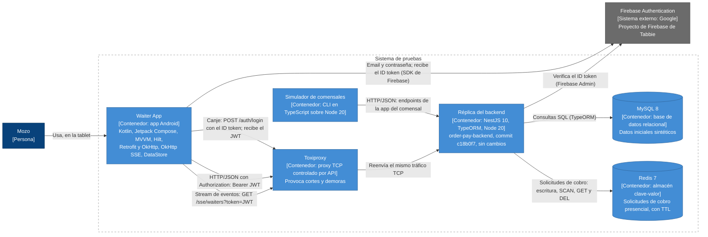
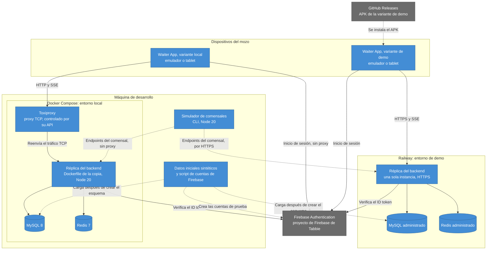
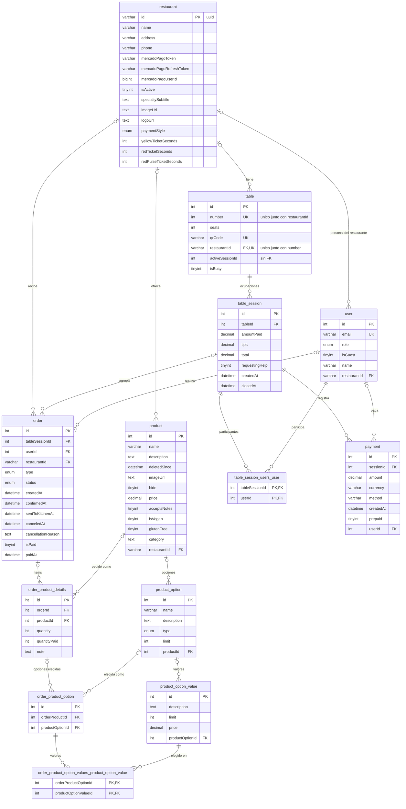

## Índice

0. [Ficha del proyecto](#0-ficha-del-proyecto)
1. [Descripción general del producto](#1-descripción-general-del-producto)
2. [Arquitectura del sistema](#2-arquitectura-del-sistema)
3. [Modelo de datos](#3-modelo-de-datos)
4. [Especificación de la API](#4-especificación-de-la-api)
5. [Historias de usuario](#5-historias-de-usuario)
6. [Tickets de trabajo](#6-tickets-de-trabajo)
7. [Pull requests](#7-pull-requests)

---

## 0. Ficha del proyecto

### **0.1. Tu nombre completo:**

Mauro Cocaro

### **0.2. Nombre del proyecto:**

Tabbie Waiter App

### **0.3. Descripción breve del proyecto:**

Tabbie Waiter App es una app Android para tablet con la que el mozo opera el salón durante todo el turno: ve las mesas ocupadas y sus pedidos, los manda a cocina, atiende los pedidos de ayuda, cobra en persona y cierra la mesa. Reemplaza al panel de mozos que hoy es una sección de la app de comensales de Tabbie, y usa el mismo backend sin modificarlo.

### **0.4. URL del proyecto:**

> Puede ser pública o privada, en cuyo caso deberás compartir los accesos de manera segura. Puedes enviarlos a [alvaro@lidr.co](mailto:alvaro@lidr.co) usando algún servicio como [onetimesecret](https://onetimesecret.com/).

https://github.com/MauroUX/tabbie-waiter/tree/feature/entrega-1-mc

Todavía no hay despliegue, porque la Entrega 1 es solo documentación.

### 0.5. URL o archivo comprimido del repositorio

> Puedes tenerlo alojado en público o en privado, en cuyo caso deberás compartir los accesos de manera segura. Puedes enviarlos a [alvaro@lidr.co](mailto:alvaro@lidr.co) usando algún servicio como [onetimesecret](https://onetimesecret.com/). También puedes compartir por correo un archivo zip con el contenido

https://github.com/MauroUX/tabbie-waiter/tree/feature/entrega-1-mc


---

## 1. Descripción general del producto

> Describe en detalle los siguientes aspectos del producto:

### **1.1. Objetivo:**

> Propósito del producto. Qué valor aporta, qué soluciona, y para quién.

Tabbie es una plataforma de pedidos y pagos para restaurantes: el comensal escanea el QR de la mesa, pide y paga desde su celular. El mozo atiende el salón con una herramienta que es una sección de esa misma app de comensales. Ese acoplamiento hace que lo que se cambia para uno afecte al otro, y ya tiene efectos en el turno: cobros que pueden quedar registrados dos veces, pedidos de ayuda que no se pueden dar por atendidos o pedidos ya cobrados que se pueden cancelar.

- **Para quién:** el mozo, único usuario de la app, que la usa durante todo el turno en una tablet que entrega el restaurante, en modo kiosco. No toma pedidos: los crea y confirma el comensal.
- **Qué aporta al mozo:** una app propia, separada de la app de comensales, que cubre el turno completo, con cobros que se registran una sola vez, avisos que se pueden atender, el salón al día aunque se corte la conexión y menos errores de operación.
- **Qué aporta al restaurante:** reemplaza el panel actual sin cambiar el resto del sistema. Usa las mismas operaciones y los mismos datos, y el backend no se modifica.

Documentos de referencia:

- [PRD del MVP](docs/prd/tabbie-waiter-mvp.md): problema, usuarios, propuesta de valor, alcance y no-alcance, requisitos funcionales y no funcionales, métricas, restricciones y supuestos.
- [Contexto del panel de mozos actual](docs/context/panel-mozos-actual.md): qué hace hoy el mozo (capacidades C1 a C14) y qué endpoints, eventos SSE, tablas y almacenamiento usa el panel, con trazabilidad hasta el código.

### **1.2. Características y funcionalidades principales:**

> Enumera y describe las características y funcionalidades específicas que tiene el producto para satisfacer las necesidades identificadas.

El MVP incluye lo necesario para que un restaurante opere un turno completo sin usar el panel web. Se organiza en siete épicas, priorizadas como Must o Should. El detalle está en el [alcance](docs/prd/tabbie-waiter-mvp.md#4-alcance-del-mvp) y los [requisitos funcionales](docs/prd/tabbie-waiter-mvp.md#6-requisitos-funcionales) del PRD.

| Épica | Prioridad | Qué hace el mozo |
|---|---|---|
| E1. Acceso del mozo | Must | Inicia sesión con email y contraseña. Solo entran mozos y la sesión se renueva sola. Cerrar sesión es Should. |
| E2. Vista del salón en tiempo real | Must | Ve las mesas ocupadas con sus pedidos, comensales, total, lo pagado y un cronómetro de demora, y recibe un aviso por cada pedido confirmado. |
| E3. Gestión de pedidos | Must | Manda a cocina los pedidos confirmados de una mesa y cancela pedidos que no tengan nada cobrado. |
| E4. Pedidos de ayuda | Should | Da por atendido un pedido de ayuda en su tablet. |
| E5. Cobros | Must | Registra cobros manuales, ve las solicitudes de cobro presencial, las confirma o elimina, y ve los cobros de cada mesa. |
| E6. Cierre de mesa | Must | Cierra la mesa, con una advertencia si queda saldo pendiente. |
| E7. Impresora virtual de comandas | Should | Consulta los pedidos confirmados que todavía no se mandaron a cocina. |

Además:

- **Requisitos no funcionales** ([sección 7 del PRD](docs/prd/tabbie-waiter-mvp.md#7-requisitos-no-funcionales)): tiempos máximos para que los cambios lleguen a la tablet, recuperación sola tras un corte de conexión, ninguna acción que cambie datos se repite sola, aislamiento por restaurante, confirmación de las acciones que cierran la sesión, la mesa o un cobro, y tablet en horizontal y en español.
- **Fuera del alcance** ([sección 5 del PRD](docs/prd/tabbie-waiter-mvp.md#5-no-alcance)): entre otros, tomar pedidos (los hace el comensal), cobrar con MercadoPago, imprimir en una impresora Bluetooth, operar sin conexión, avisos con la pantalla bloqueada y cualquier cambio en el backend.
- **Restricciones** ([sección 9 del PRD](docs/prd/tabbie-waiter-mvp.md#9-restricciones-y-supuestos)): app nativa Android para tablet, el mismo backend sin cambios y la misma autenticación que el panel actual.

### **1.3. Diseño y experiencia de usuario:**

> Proporciona imágenes y/o videotutorial mostrando la experiencia del usuario desde que aterriza en la aplicación, pasando por todas las funcionalidades principales.

Se completa con el desarrollo.

### **1.4. Instrucciones de instalación:**
> Documenta de manera precisa las instrucciones para instalar y poner en marcha el proyecto en local (librerías, backend, frontend, servidor, base de datos, migraciones y semillas de datos, etc.)

Se completa con el desarrollo.

---

## 2. Arquitectura del Sistema

### **2.1. Diagrama de arquitectura:**
> Usa el formato que consideres más adecuado para representar los componentes principales de la aplicación y las tecnologías utilizadas. Explica si sigue algún patrón predefinido, justifica por qué se ha elegido esta arquitectura, y destaca los beneficios principales que aportan al proyecto y justifican su uso, así como sacrificios o déficits que implica.

La vista general está en [docs/architecture/README.md](docs/architecture/README.md), con el diagrama de contexto (C4, nivel 1), el patrón y la tabla completa de beneficios y sacrificios. Es una arquitectura propuesta: todavía no hay código, y los diagramas se regeneran desde él cuando exista.

Diagrama de contenedores (C4, nivel 2) del sistema de pruebas: la app contra la réplica del backend, con el simulador en lugar del comensal y Toxiproxy en el medio para provocar cortes.



**Patrón:** un cliente nativo sobre un backend existente con contrato fijo, probado contra una réplica idéntica. La app usa los mismos endpoints y eventos que el panel actual y rodea los huecos del backend con su propio comportamiento; como la réplica es una copia sin cambios, pasar al backend real es cambiar la URL base.

**Beneficios principales:**

- la herramienta del mozo se separa de la app de comensales sin tocar el backend;
- pasar al backend real es cambiar la URL base;
- la plataforma admite lo que viene después: impresora Bluetooth, operación sin conexión y avisos con la pantalla bloqueada;
- pruebas reproducibles, con datos sintéticos y fallos provocados;
- una sola fuente de verdad, y ningún cobro duplicado por reintentos.

**Sacrificios principales:**

- la app hereda los huecos del backend (O1 a O4): los rodea, no los resuelve;
- no hay renovación del JWT: renovar es volver a canjear el ID token de Firebase;
- los eventos no tienen replay ni heartbeat, así que hace falta consulta periódica;
- el backend corre en una sola instancia;
- la réplica puede quedar atrás del backend real, y lo vigila la predicción del límite del ADR 0002;
- las cuentas de prueba viven en el proyecto de Firebase de Tabbie.

**Decisiones de arquitectura** ([índice y formato](docs/adr/README.md)):

- [0001 · App nativa Android para tablet](docs/adr/0001-app-nativa-android.md)
- [0002 · Réplica del backend: copia sin cambios y simulador de comensales](docs/adr/0002-replica-del-backend.md)
- [0003 · Stack](docs/adr/0003-stack.md)
- [0004 · Autenticación y renovación de la sesión](docs/adr/0004-autenticacion-y-renovacion.md)
- [0005 · Estado de la app sin base de datos local](docs/adr/0005-estado-sin-base-local.md)
- [0006 · Tiempo real: eventos más consulta periódica](docs/adr/0006-tiempo-real.md)
- [0007 · Acciones que cambian datos](docs/adr/0007-acciones-que-cambian-datos.md)

### **2.2. Descripción de componentes principales:**

> Describe los componentes más importantes, incluyendo la tecnología utilizada

El detalle de cada componente (responsabilidad, tecnología, RF y RNF que atiende y endpoints que usa), el diagrama de componentes de la app y el de secuencia del flujo principal están en [docs/architecture/componentes.md](docs/architecture/componentes.md).

- **App** (Kotlin y Jetpack Compose, MVVM con flujo de datos unidireccional y Hilt):
  - **Sesión:** inicio de sesión en Firebase, canje por el JWT del backend, renovación, control del rol y cierre de sesión.
  - **Cliente HTTP** (Retrofit y OkHttp): agrega el JWT y no reintenta las acciones que cambian datos.
  - **Eventos** (OkHttp SSE): la única conexión al stream de mozos, con reconexión.
  - **Monitor de conexión:** detecta los cortes y muestra el aviso de que no hay conexión.
  - **Salón** y **Cobros:** mesas activas y pedidos, y solicitudes y cobros de cada mesa, en memoria.
  - **Acciones:** mandar a cocina, cancelar, cobrar, confirmar o eliminar una solicitud y cerrar la mesa, con revisión previa y sin reintentos.
  - **Marcas de "Atendido"** (DataStore).
  - **Pantallas:** inicio de sesión, navegación principal, "Órdenes", "Pagos" e impresora virtual.
- **Réplica** (NestJS 10, TypeORM, MySQL 8, Redis 7 y Node 20): copia sin cambios del backend. La app y el simulador usan sus módulos de autenticación y Firebase Admin, los guards, restaurantes, pedidos, sesiones de mesa, pagos (solicitudes en Redis) y el stream de eventos.
- **Simulador de comensales** (TypeScript sobre Node 20): una línea de comandos con escenarios que hacen lo que hace el comensal (ocupar una mesa, confirmar pedidos, pedir ayuda, pedir un cobro presencial y cancelar), un registro del turno y la medición de las métricas.

El [walking skeleton](docs/architecture/walking-skeleton.md) es la épica facilitadora que conecta de punta a punta la app, la réplica y el simulador antes de HU-01: inicio de sesión, eventos, consulta periódica, aviso sin conexión y recuperación después de un corte, con sus propios criterios de aceptación.

### **2.3. Descripción de alto nivel del proyecto y estructura de ficheros**

> Representa la estructura del proyecto y explica brevemente el propósito de las carpetas principales, así como si obedece a algún patrón o arquitectura específica.

Es un monorepo, para que un cambio y su spec entren en el mismo commit. La estructura es una propuesta: las carpetas fuera de `docs/` se crean al armar el proyecto.

```text
tabbie-waiter/
├── backend/      Copia sin cambios del backend de Tabbie; nada propio entra acá
├── replica/      Lo propio de la réplica: datos sintéticos, cuentas de prueba, Toxiproxy y perfiles de entorno
├── android/      La app del mozo, organizada por funcionalidad y por capas
├── simulator/    El simulador de comensales
├── docs/         PRD, contexto, backlog, ADRs, arquitectura y API
├── compose.yaml  MySQL, Redis y Toxiproxy del entorno local
├── Readme.md
└── Prompts.md
```

El árbol hasta el segundo nivel, el patrón de cada parte y qué carpetas toca cada tipo de ticket están en [docs/architecture/estructura.md](docs/architecture/estructura.md).

### **2.4. Infraestructura y despliegue**

> Detalla la infraestructura del proyecto, incluyendo un diagrama en el formato que creas conveniente, y explica el proceso de despliegue que se sigue



- **Local:** Docker Compose con la réplica, MySQL 8, Redis 7 y Toxiproxy; la app, en un emulador o una tablet, llega a la réplica a través de Toxiproxy, y el simulador va directo.
- **Demo:** la réplica en Railway, con MySQL y Redis administrados y HTTPS, sin Toxiproxy; el APK de la variante de demo se publica en GitHub Releases.

**Una sola instancia:** el backend real y la réplica corren en una sola instancia, porque los eventos salen de la memoria del proceso y con dos un evento no llega a los mozos conectados a la otra. Cada despliegue corta todas las conexiones, y la app se recupera sola.

Cada entorno, el proceso de despliegue de la demo, los requisitos de prueba y las variables de entorno de la réplica están en [docs/architecture/infraestructura.md](docs/architecture/infraestructura.md).

### **2.5. Seguridad**

> Enumera y describe las prácticas de seguridad principales que se han implementado en el proyecto, añadiendo ejemplos si procede

- **App:**
  - solo entra el rol `waiter`;
  - usa un único restaurante, el del inicio de sesión, en todas las llamadas;
  - en la tablet solo quedan la sesión, cifrada con una clave del Android Keystore, y las marcas de "Atendido";
  - ninguna acción que cambia datos se repite sola;
  - no muestra ni registra datos sensibles: emails de comensales, credenciales del restaurante ni el JWT;
  - solo HTTPS, salvo en la variante de réplica local;
  - cada renovación de la sesión vuelve a pasar por Firebase y por el control del rol.
- **Réplica y repo:**
  - los secretos son variables de entorno y nunca entran al repo;
  - los datos iniciales son sintéticos;
  - las cuentas de prueba usan un dominio reservado para ejemplos.

**Riesgos aceptados**, porque el backend no se modifica: los huecos O1 a O4, que se comprueban contra la réplica; las carreras entre dos tablets; el JWT en la URL del stream de eventos, y las cuentas de prueba en el proyecto de Firebase de Tabbie.

Cada práctica con su porqué, cada riesgo con lo que hace la app para acotarlo, y el criterio que prueba cada uno están en [docs/architecture/seguridad.md](docs/architecture/seguridad.md).

### **2.6. Tests**

> Describe brevemente algunos de los tests realizados

Se completa con el desarrollo. La estrategia está en la [Definition of Done](docs/backlog/definition-of-done.md): el test de cada scenario se escribe primero y falla, la réplica se prueba por HTTP contra MySQL y Redis reales, y la app se prueba en el dispositivo contra la réplica. Los criterios del [walking skeleton](docs/architecture/walking-skeleton.md) dicen cómo se provoca y se mide cada uno.

---

## 3. Modelo de Datos

### **3.1. Diagrama del modelo de datos:**

> Recomendamos usar mermaid para el modelo de datos, y utilizar todos los parámetros que permite la sintaxis para dar el máximo detalle, por ejemplo las claves primarias y foráneas.

El modelo de datos es el del backend actual de Tabbie, no uno nuevo. La réplica es una copia sin cambios del backend y crea el esquema desde sus entidades al arrancar, y la app no tiene base local. El documento completo, con sus fuentes y convenciones (entre ellas, qué abrevian `BE/` y `TO/`), está en [docs/architecture/modelo-de-datos.md](docs/architecture/modelo-de-datos.md).

Las 13 tablas del inventario (contexto, sección 3.2), con las dos intermedias M:N. `table.activeSessionId` es una columna sin relación, porque no es una FK declarada.



**Cardinalidad:** `|o` del lado padre quiere decir que la FK acepta nulos, y `||` que no los acepta. El tipo completo de cada columna, con largo y precisión, está en la tabla de cada entidad.

**Quedan fuera** del diagrama, porque no aparecen en la cadena del mozo (contexto, sección 3.2): `product_availability_period`, su intermedia `product_availability_periods_product_availability_period`, `feedback`, `association_rule_set` y `association_rule`.

### **3.2. Descripción de entidades principales:**

> Recuerda incluir el máximo detalle de cada entidad, como el nombre y tipo de cada atributo, descripción breve si procede, claves primarias y foráneas, relaciones y tipo de relación, restricciones (unique, not null…), etc.

#### 2.1 `restaurant`

**Entidad:** `Restaurant`, `BE/restaurants/restaurant.entity.ts:18`.

**En la cadena del mozo:** solo se lee. `JwtAuthGuard` la lee con el usuario en toda llamada autenticada (contexto, sección 0).

| Columna | Línea | Tipo en MySQL | Nulos | Por defecto | PK | FK | Único | Descripción |
|---|---|---|---|---|---|---|---|---|
| `id` | 19-20 | `varchar(36)` (uuid; por defecto de TypeORM en MySQL) | No | Lo genera TypeORM en la app, no la base | Sí | — | — | Identificador del restaurante |
| `name` | 22-23 | `varchar(100)` | No (por defecto de TypeORM) | — | — | — | — | Nombre |
| `address` | 25-26 | `varchar(255)` (por defecto de TypeORM) | Sí | — | — | — | — | Dirección |
| `phone` | 28-29 | `varchar(255)` (por defecto de TypeORM) | Sí | — | — | — | — | Teléfono |
| `mercadoPagoToken` | 31-32 | `varchar(255)` (por defecto de TypeORM) | Sí | — | — | — | — | Token de MercadoPago del restaurante. Llega en las respuestas de T05 (O4) |
| `mercadoPagoRefreshToken` | 34-35 | `varchar(255)` (por defecto de TypeORM) | Sí | — | — | — | — | Refresh token de MercadoPago. Llega en las respuestas de T05 (O4) |
| `mercadoPagoUserId` | 37-38 | `bigint` | Sí | — | — | — | — | Usuario de MercadoPago del restaurante |
| `isActive` | 40-41 | `tinyint` (boolean; por defecto de TypeORM) | No (por defecto de TypeORM) | `true` | — | — | — | Si el restaurante está activo |
| `specialtySubtitle` | 43-44 | `text` | Sí | — | — | — | — | Subtítulo de la especialidad |
| `imageUrl` | 46-47 | `text` | Sí | — | — | — | — | URL de la imagen |
| `logoUrl` | 49-50 | `text` | Sí | — | — | — | — | URL del logo |
| `paymentStyle` | 61-62 | `enum('before-order','after-order')` | No (por defecto de TypeORM) | `'after-order'` | — | — | — | Si el comensal paga antes o después de pedir |
| `yellowTicketSeconds` | 64-67 | `int` | No (por defecto de TypeORM) | `300` | — | — | — | Umbral amarillo del cronómetro, en segundos (C3) |
| `redTicketSeconds` | 69-72 | `int` | No (por defecto de TypeORM) | `420` | — | — | — | Umbral rojo del cronómetro, en segundos (C3) |
| `redPulseTicketSeconds` | 74-77 | `int` | No (por defecto de TypeORM) | `600` | — | — | — | Umbral rojo con pulso del cronómetro, en segundos (C3) |

**Relaciones:**

| Propiedad | Con | Tipo | Lado con la FK | Eager | `onDelete` |
|---|---|---|---|---|---|
| `products` (52-53) | `Product` | 1:N | `product.restaurantId` | No | No declarado |
| `tables` (55-56) | `Table` | 1:N | `table.restaurantId` | No | No declarado |
| `orders` (58-59) | `Order` | 1:N | `order.restaurantId` | No | No declarado |
| — | `User` | 1:N | `user.restaurantId` (la relación se declara solo en `User`) | No | No declarado |
| `availabilityPeriods` (79-83) | `ProductAvailabilityPeriod` | 1:N | Fuera del alcance | No | — |

**Índices y restricciones:**

- PK en `id`.
- Índice en `mercadoPagoUserId` (línea 16).
- `@Check` de que `yellowTicketSeconds < redTicketSeconds < redPulseTicketSeconds` (línea 15). **No se crea en MySQL:** TypeORM no sincroniza checks en MySQL (`TO/schema-builder/RdbmsSchemaBuilder.js:335-337` y `:696-698`).
- `@Min(10)` y `@Max(10800)` en los tres umbrales (líneas 65-66, 70-71 y 75-76) son de class-validator: no generan ninguna restricción en la base.

**Valores de `paymentStyle`:** `before-order` y `after-order` (`BE/restaurants/restaurant-payment-style.ts:2-3`). La cadena del mozo no escribe esta columna.

#### 2.2 `user`

**Entidad:** `User`, `BE/users/user.entity.ts:17`.

**En la cadena del mozo:** se lee en toda llamada autenticada. Se escribe solo en T01, con un INSERT la primera vez que inicia sesión un email que no está en la tabla.

| Columna | Línea | Tipo en MySQL | Nulos | Por defecto | PK | FK | Único | Descripción |
|---|---|---|---|---|---|---|---|---|
| `id` | 18-19 | `int` autoincremental (por defecto de TypeORM) | No | Autoincremental | Sí | — | — | Identificador del usuario |
| `email` | 21-22 | `varchar(255)` (por defecto de TypeORM) | No (por defecto de TypeORM) | — | — | — | Sí | Email. `POST /auth/login` busca el usuario por este campo (`BE/auth/auth.service.ts:33-35`) |
| `role` | 24-29 | `enum('user','admin','waiter','backoffice')` | No (por defecto de TypeORM) | `'user'` | — | — | — | Rol del usuario |
| `isGuest` | 31-32 | `tinyint` (boolean; por defecto de TypeORM) | No (por defecto de TypeORM) | `false` | — | — | — | Si es un invitado |
| `name` | 34-35 | `varchar(255)` (por defecto de TypeORM) | Sí | — | — | — | — | Nombre |
| `restaurantId` | 43-45 | `varchar(36)` (el de `restaurant.id`) | Sí | — | — | `restaurant.id` | — | Restaurante del personal. La columna la crea la relación `restaurant`, con `@JoinColumn()` |

La propiedad `restaurantId?: string` de la línea 47 no tiene decorador, así que no es una columna mapeada. La columna `restaurantId` existe por la relación.

**Relaciones:**

| Propiedad | Con | Tipo | Lado con la FK | Eager | `onDelete` |
|---|---|---|---|---|---|
| `restaurant` (43-45) | `Restaurant` | N:1 | `user.restaurantId` | **Sí** | No declarado |
| `orders` (37-38) | `Order` | 1:N | `order.userId` | No | No declarado |
| `payments` (40-41) | `Payment` | 1:N | `payment.userId` | No | No declarado |
| — | `TableSession` | M:N | Intermedia `table_session_users_user` (la relación se declara solo en `TableSession`) | No | `CASCADE` (ver 2.5) |

**Índices y restricciones:**

- PK en `id`.
- Único en `email` (línea 21).
- Índice en `restaurantId` (`@Index(['restaurant'])`, línea 15).

**Valores de `role`:**

| Valor | Origen |
|---|---|
| `user`, `admin`, `waiter`, `backoffice` | Enum `UserRole` (`BE/users/user-role.ts:2-5`) |
| `user` | Lo escribe T01 al crear el usuario en su primer inicio de sesión (`BE/auth/auth.service.ts:38-43`) |

Ningún servicio de la cadena del mozo escribe `waiter`: las filas de los mozos tienen que existir antes de su primer inicio de sesión.

#### 2.3 `table`

**Entidad:** `Table`, `BE/tables/table.entity.ts:19`.

**En la cadena del mozo:** T14 escribe `isBusy = false` y `activeSessionId = null` (`BE/table-sessions/table-session.service.ts:333-335`).

| Columna | Línea | Tipo en MySQL | Nulos | Por defecto | PK | FK | Único | Descripción |
|---|---|---|---|---|---|---|---|---|
| `id` | 20-21 | `int` autoincremental (por defecto de TypeORM) | No | Autoincremental | Sí | — | — | Identificador de la mesa |
| `number` | 23-24 | `int` (por defecto de TypeORM) | No (por defecto de TypeORM) | — | — | — | Sí, junto con `restaurantId` | Número de la mesa en el restaurante |
| `seats` | 26-27 | `int` (por defecto de TypeORM) | No (por defecto de TypeORM) | — | — | — | — | Cantidad de lugares |
| `qrCode` | 29-30 | `varchar(500)` | No (por defecto de TypeORM) | — | — | — | Sí | Código QR de la mesa |
| `restaurantId` | 32-33 | `varchar(36)` (el de `restaurant.id`) | Sí (por defecto de TypeORM) | — | — | `restaurant.id` | Sí, junto con `number` | Restaurante. La columna la crea la relación `restaurant` |
| `activeSessionId` | 35-36 | `int` | Sí | — | — | **No** (columna simple) | — | Sesión de mesa activa. No es una FK declarada |
| `isBusy` | 41-42 | `tinyint` (boolean; por defecto de TypeORM) | No (por defecto de TypeORM) | `false` | — | — | — | Si la mesa está ocupada |

**Relaciones:**

| Propiedad | Con | Tipo | Lado con la FK | Eager | `onDelete` |
|---|---|---|---|---|---|
| `restaurant` (32-33) | `Restaurant` | N:1 | `table.restaurantId` | No | No declarado |
| `tableSessions` (38-39) | `TableSession` | 1:N | `table_session.tableId` | No | No declarado |

**Índices y restricciones:**

- PK en `id`.
- Único en (`restaurantId`, `number`) (línea 16).
- Único en `qrCode` (línea 17).
- Índices en `restaurantId` (línea 12), `isBusy` (línea 13), `activeSessionId` (línea 14) y (`restaurantId`, `isBusy`) (línea 15).

#### 2.4 `table_session`

**Entidad:** `TableSession`, `BE/table-sessions/table-session.entity.ts:21`.

**En la cadena del mozo:**

- T09 recalcula `total` (`BE/orders/order.service.ts:433-439`).
- T11 y T12 suman `amountPaid` y `tips` (`BE/table-sessions/table-session.service.ts:923-927` y `:671-676`).
- T14 escribe `closedAt` (`:337`).

| Columna | Línea | Tipo en MySQL | Nulos | Por defecto | PK | FK | Único | Descripción |
|---|---|---|---|---|---|---|---|---|
| `id` | 22-23 | `int` autoincremental (por defecto de TypeORM) | No | Autoincremental | Sí | — | — | Identificador de la sesión de mesa (una ocupación) |
| `tableId` | 28-29 | `int` (por defecto de TypeORM) | No (por defecto de TypeORM) | — | — | `table.id` | — | Mesa. Columna declarada que comparte nombre con la FK de la relación `table` |
| `amountPaid` | 31-32 | `decimal(10,2)` | No (por defecto de TypeORM) | `0` | — | — | — | Lo pagado, sin propina (C8) |
| `tips` | 34-35 | `decimal(10,2)` | No (por defecto de TypeORM) | `0` | — | — | — | Propinas acumuladas (C8) |
| `total` | 37-38 | `decimal(10,2)` | No (por defecto de TypeORM) | `0` | — | — | — | Total de los pedidos que no están `pending` ni `canceled` (`BE/table-sessions/table-session.service.ts:757-785`) |
| `requestingHelp` | 40-41 | `tinyint` (boolean; por defecto de TypeORM) | No (por defecto de TypeORM) | `false` | — | — | — | Pedido de ayuda del comensal. Nada lo vuelve a `false` (O1) |
| `createdAt` | 53-54 | `datetime(6)` (por defecto de TypeORM) | No | `CURRENT_TIMESTAMP(6)` (por defecto de TypeORM) | — | — | — | Apertura de la sesión; base del tiempo de ocupación (C3) |
| `closedAt` | 56-57 | `datetime` (por defecto de TypeORM) | Sí | — | — | — | — | Cierre de la mesa. Nulo mientras la sesión está activa |

**Relaciones:**

| Propiedad | Con | Tipo | Lado con la FK | Eager | `onDelete` |
|---|---|---|---|---|---|
| `table` (25-26) | `Table` | N:1 | `table_session.tableId` | No | No declarado |
| `users` (43-45) | `User` | M:N | Intermedia `table_session_users_user` (`@JoinTable` en este lado) | No | `CASCADE` (ver 2.5) |
| `orders` (47-48) | `Order` | 1:N | `order.tableSessionId` | No | No declarado |
| `payments` (50-51) | `Payment` | 1:N | `payment.sessionId` | No | No declarado |

**Índices y restricciones:**

- PK en `id`.
- Índices en `tableId` (línea 17), `closedAt` (línea 18) y (`tableId`, `closedAt`) (línea 19).

#### 2.5 `table_session_users_user` (intermedia M:N)

**Entidad:** no tiene clase propia. La crea el `@JoinTable()` de `TableSession.users`, en `BE/table-sessions/table-session.entity.ts:43-45`.

**En la cadena del mozo:** se lee en T05, T11 y T12; no se escribe.

| Columna | Tipo en MySQL | Nulos | Por defecto | PK | FK | Único | Descripción |
|---|---|---|---|---|---|---|---|
| `tableSessionId` | `int` (el de `table_session.id`) | No | — | Sí, compuesta | `table_session.id` | — | Sesión de mesa |
| `userId` | `int` (el de `user.id`) | No | — | Sí, compuesta | `user.id` | — | Comensal que participa en la sesión |

Los nombres de la tabla y de las columnas, que las columnas no acepten nulos y que formen la PK salen de TypeORM, porque el `@JoinTable()` no declara nada (`TO/metadata-builder/JunctionEntityMetadataBuilder.js:80-95`).

**Relaciones:**

- N:1 con `table_session`, por `tableSessionId`. `onDelete: CASCADE` y `onUpdate: CASCADE` (por defecto de TypeORM, `TO/metadata-builder/JunctionEntityMetadataBuilder.js:172-178`).
- N:1 con `user`, por `userId`. `onDelete: CASCADE` y `onUpdate: CASCADE`: `User` no declara la relación inversa, así que TypeORM usa su valor por defecto (`:186-195`).

**Índices y restricciones:**

- PK compuesta (`tableSessionId`, `userId`).
- Un índice en `tableSessionId` y otro en `userId` (`TO/metadata-builder/JunctionEntityMetadataBuilder.js:200-218`).

#### 2.6 `order`

**Entidad:** `Order`, `BE/orders/order.entity.ts:25`.

**En la cadena del mozo:**

- T08 escribe `status` y `sentToKitchenAt` (`BE/orders/order.service.ts:561-562`).
- T09 escribe `status`, `canceledAt` y `cancellationReason` (`:428-430`).
- T11 y T12 escriben `isPaid` y `paidAt` (`BE/table-sessions/table-session.service.ts`, `markAllSessionOrdersAsPaid` en `:513`, `markSpecificOrdersAsPaid` en `:534`, `markLineItemsAsPaid` en `:560` y `markOrdersAsPaidForUser` en `:599`).

| Columna | Línea | Tipo en MySQL | Nulos | Por defecto | PK | FK | Único | Descripción |
|---|---|---|---|---|---|---|---|---|
| `id` | 26-27 | `int` autoincremental (por defecto de TypeORM) | No | Autoincremental | Sí | — | — | Identificador del pedido |
| `tableSessionId` | 29-31 | `int` (el de `table_session.id`) | Sí (por defecto de TypeORM) | — | — | `table_session.id` | — | Sesión de mesa del pedido |
| `userId` | 33-35 | `int` (el de `user.id`) | Sí (por defecto de TypeORM) | — | — | `user.id` | — | Comensal que hizo el pedido |
| `restaurantId` | 37-39 | `varchar(36)` (el de `restaurant.id`) | Sí (por defecto de TypeORM) | — | — | `restaurant.id` | — | Restaurante del pedido |
| `type` | 47-48 | `enum('appetizer','main_course','dessert')` | No (por defecto de TypeORM) | `'main_course'` | — | — | — | Tipo de plato del pedido |
| `status` | 50-51 | `enum('pending','confirmed','in_kitchen','canceled')` | No (por defecto de TypeORM) | `'pending'` | — | — | — | Estado del pedido (contexto, sección 4) |
| `createdAt` | 53-54 | `datetime(6)` (por defecto de TypeORM) | No | `CURRENT_TIMESTAMP(6)` (por defecto de TypeORM) | — | — | — | Creación del pedido |
| `confirmedAt` | 56-57 | `datetime` (por defecto de TypeORM) | Sí | — | — | — | — | Confirmación; base del cronómetro (C3) |
| `sentToKitchenAt` | 59-60 | `datetime` (por defecto de TypeORM) | Sí | — | — | — | — | Envío a cocina (T08) |
| `canceledAt` | 62-63 | `datetime` (por defecto de TypeORM) | Sí | — | — | — | — | Cancelación (T09) |
| `cancellationReason` | 65-66 | `text` | Sí | — | — | — | — | Motivo de la cancelación |
| `isPaid` | 68-69 | `tinyint` (boolean) | No (por defecto de TypeORM) | `false` | — | — | — | Si el pedido está pagado. No depende de `status` (contexto, sección 4) |
| `paidAt` | 71-72 | `datetime` (por defecto de TypeORM) | Sí | — | — | — | — | Cuándo se marcó como pagado |

**Relaciones:**

| Propiedad | Con | Tipo | Lado con la FK | Eager | `onDelete` |
|---|---|---|---|---|---|
| `tableSession` (29-31) | `TableSession` | N:1 | `order.tableSessionId` | No | No declarado |
| `user` (33-35) | `User` | N:1 | `order.userId` | No | No declarado |
| `restaurant` (37-39) | `Restaurant` | N:1 | `order.restaurantId` | No | No declarado |
| `items` (41-45) | `OrderProductDetails` | 1:N | `order_product_details.orderId` | **Sí** (con `cascade: true`) | `CASCADE`, declarado del lado de `OrderProductDetails` |

**Índices y restricciones:**

- PK en `id`.
- Índices en `tableSessionId` (línea 18), `restaurantId` (línea 19), `status` (línea 20), (`tableSessionId`, `status`) (línea 21), (`tableSessionId`, `isPaid`, `createdAt`) (línea 22) y (`tableSessionId`, `userId`, `isPaid`, `createdAt`) (línea 23).

**Valores de `status`:**

| Valor | Origen |
|---|---|
| `pending`, `confirmed`, `in_kitchen`, `canceled` | Enum `OrderStatus` (`BE/orders/order-status.ts:2-5`) |
| `in_kitchen` | T08 (`BE/orders/order.service.ts:561`) |
| `canceled` | T09 (`BE/orders/order.service.ts:428`) |

**Valores de `cancellationReason` en la cadena del mozo:** T09 guarda `reason || cancelReason || 'Cancelado por el cliente'` (`BE/orders/order.service.ts:430`). Para un `waiter`, `reason` es el del body ("Cancelada por el restaurante", en la Waiter App; C6) y `cancelReason` es "El restaurante ha cancelado el pedido" (`:372-377`).

**Valores de `type`:** `appetizer`, `main_course` y `dessert` (`BE/orders/product-type.ts:2-4`). La cadena del mozo no escribe esta columna.

#### 2.7 `order_product_details`

**Entidad:** `OrderProductDetails`, `BE/orders/order-product-details.entity.ts:10`.

**En la cadena del mozo:** T12 escribe `quantityPaid = quantity` cuando el cobro trae `lineItemIds` (`BE/table-sessions/table-session.service.ts:560-597`).

| Columna | Línea | Tipo en MySQL | Nulos | Por defecto | PK | FK | Único | Descripción |
|---|---|---|---|---|---|---|---|---|
| `id` | 11-12 | `int` autoincremental (por defecto de TypeORM) | No | Autoincremental | Sí | — | — | Identificador de la línea del pedido |
| `orderId` | 14-15 | `int` (el de `order.id`) | Sí (por defecto de TypeORM) | — | — | `order.id` | — | Pedido |
| `productId` | 17-18 | `int` (el de `product.id`) | Sí (por defecto de TypeORM) | — | — | `product.id` | — | Producto pedido |
| `quantity` | 20-21 | `int` | No (por defecto de TypeORM) | — | — | — | — | Cantidad |
| `quantityPaid` | 26-27 | `int` | No (por defecto de TypeORM) | `0` | — | — | — | Unidades pagadas. El comentario de las líneas 23-25 pide `0 <= quantityPaid <= quantity`, pero la base no lo controla |
| `note` | 29-30 | `text` | Sí | — | — | — | — | Nota del comensal |

**Relaciones:**

| Propiedad | Con | Tipo | Lado con la FK | Eager | `onDelete` |
|---|---|---|---|---|---|
| `order` (14-15) | `Order` | N:1 | `order_product_details.orderId` | No | **`CASCADE`** |
| `product` (17-18) | `Product` | N:1 | `order_product_details.productId` | **Sí** | No declarado |
| `selectedOptions` (32-36) | `OrderProductOption` | 1:N | `order_product_option.orderProductId` | **Sí** (con `cascade: true`) | `CASCADE`, declarado del lado de `OrderProductOption` |

**Índices y restricciones:**

- PK en `id`.
- Índices en `orderId` (línea 6), `productId` (línea 7) y (`orderId`, `productId`) (línea 8).

#### 2.8 `order_product_option`

**Entidad:** `OrderProductOption`, `BE/orders/order-product-option.entity.ts:9`.

**En la cadena del mozo:** solo se lee, dentro del árbol de ítems.

| Columna | Línea | Tipo en MySQL | Nulos | Por defecto | PK | FK | Único | Descripción |
|---|---|---|---|---|---|---|---|---|
| `id` | 10-11 | `int` autoincremental (por defecto de TypeORM) | No | Autoincremental | Sí | — | — | Identificador de la opción elegida |
| `orderProductId` | 13-14 | `int` (el de `order_product_details.id`) | Sí (por defecto de TypeORM) | — | — | `order_product_details.id` | — | Línea del pedido |
| `productOptionId` | 16-17 | `int` (el de `product_option.id`) | Sí (por defecto de TypeORM) | — | — | `product_option.id` | — | Opción del producto que se eligió |

**Relaciones:**

| Propiedad | Con | Tipo | Lado con la FK | Eager | `onDelete` |
|---|---|---|---|---|---|
| `orderProduct` (13-14) | `OrderProductDetails` | N:1 | `order_product_option.orderProductId` | No | **`CASCADE`** |
| `productOption` (16-17) | `ProductOption` | N:1 | `order_product_option.productOptionId` | **Sí** | No declarado |
| `values` (19-21) | `ProductOptionValue` | M:N | Intermedia `order_product_option_values_product_option_value` (`@JoinTable` en este lado) | **Sí** | `CASCADE` (ver 2.9) |

**Índices y restricciones:**

- PK en `id`.
- Índices en `orderProductId` (línea 6) y `productOptionId` (línea 7).

#### 2.9 `order_product_option_values_product_option_value` (intermedia M:N)

**Entidad:** no tiene clase propia. La crea el `@JoinTable()` de `OrderProductOption.values`, en `BE/orders/order-product-option.entity.ts:19-21`.

**En la cadena del mozo:** solo se lee, dentro del árbol de ítems.

| Columna | Tipo en MySQL | Nulos | Por defecto | PK | FK | Único | Descripción |
|---|---|---|---|---|---|---|---|
| `orderProductOptionId` | `int` (el de `order_product_option.id`) | No | — | Sí, compuesta | `order_product_option.id` | — | Opción elegida en la línea del pedido |
| `productOptionValueId` | `int` (el de `product_option_value.id`) | No | — | Sí, compuesta | `product_option_value.id` | — | Valor elegido |

Como en 2.5, los nombres, que no acepten nulos y la PK salen de TypeORM, porque el `@JoinTable()` no declara nada.

**Relaciones:**

- N:1 con `order_product_option`, por `orderProductOptionId`. `onDelete: CASCADE` y `onUpdate: CASCADE` (por defecto de TypeORM).
- N:1 con `product_option_value`, por `productOptionValueId`. `onDelete: CASCADE` y `onUpdate: CASCADE`, porque `ProductOptionValue` no declara la relación inversa (por defecto de TypeORM).

**Índices y restricciones:**

- PK compuesta (`orderProductOptionId`, `productOptionValueId`).
- Un índice en cada una de las dos columnas.

#### 2.10 `product`

**Entidad:** `Product`, `BE/products/product.entity.ts:11`.

**En la cadena del mozo:** solo se lee, dentro del árbol de ítems. `price` entra en el cálculo de `table_session.total`.

| Columna | Línea | Tipo en MySQL | Nulos | Por defecto | PK | FK | Único | Descripción |
|---|---|---|---|---|---|---|---|---|
| `id` | 12-13 | `int` autoincremental (por defecto de TypeORM) | No | Autoincremental | Sí | — | — | Identificador del producto |
| `name` | 15-16 | `varchar(255)` (por defecto de TypeORM) | No (por defecto de TypeORM) | — | — | — | — | Nombre |
| `description` | 18-19 | `text` | Sí | — | — | — | — | Descripción |
| `deletedSince` | 21-22 | `datetime` | Sí | — | — | — | — | Desde cuándo está borrado. No es un `@DeleteDateColumn`: TypeORM no lo filtra solo |
| `imageUrl` | 24-25 | `text` | Sí | — | — | — | — | URL de la imagen |
| `hide` | 27-28 | `tinyint` (boolean; por defecto de TypeORM) | No (por defecto de TypeORM) | — (sin valor por defecto) | — | — | — | Si el producto está oculto |
| `price` | 30-31 | `decimal(10,0)` (precisión y escala por defecto de TypeORM) | No (por defecto de TypeORM) | — | — | — | — | Precio, **sin decimales** |
| `acceptsNotes` | 33-34 | `tinyint` (boolean; por defecto de TypeORM) | No (por defecto de TypeORM) | `true` | — | — | — | Si acepta notas |
| `isVegan` | 36-37 | `tinyint` (boolean; por defecto de TypeORM) | No (por defecto de TypeORM) | `false` | — | — | — | Si es vegano |
| `glutenFree` | 39-40 | `tinyint` (boolean; por defecto de TypeORM) | No (por defecto de TypeORM) | `false` | — | — | — | Si es sin gluten |
| `category` | 42-43 | `text` | Sí | — | — | — | — | Categoría; el panel agrupa los pedidos por categoría (C3) |
| `restaurantId` | 45-46 | `varchar(36)` (el de `restaurant.id`) | Sí (por defecto de TypeORM) | — | — | `restaurant.id` | — | Restaurante |

**Relaciones:**

| Propiedad | Con | Tipo | Lado con la FK | Eager | `onDelete` |
|---|---|---|---|---|---|
| `restaurant` (45-46) | `Restaurant` | N:1 | `product.restaurantId` | No | No declarado |
| `productOptions` (48-49) | `ProductOption` | 1:N | `product_option.productId` | No (con `cascade: true`) | No declarado |
| — | `OrderProductDetails` | 1:N | `order_product_details.productId` (la relación se declara solo en `OrderProductDetails`) | No | No declarado |
| `availabilityPeriods` (51-53) | `ProductAvailabilityPeriod` | M:N | Intermedia fuera del alcance | No | — |

**Índices y restricciones:**

- PK en `id`.
- Índices en `restaurantId` (línea 6), (`restaurantId`, `name`) (línea 7), (`restaurantId`, `deletedSince`) (línea 8) y `deletedSince` (línea 9).

#### 2.11 `product_option`

**Entidad:** `ProductOption`, `BE/product-options/product-options.entity.ts:8`.

**En la cadena del mozo:** solo se lee, dentro del árbol de ítems.

| Columna | Línea | Tipo en MySQL | Nulos | Por defecto | PK | FK | Único | Descripción |
|---|---|---|---|---|---|---|---|---|
| `id` | 9-10 | `int` autoincremental (por defecto de TypeORM) | No | Autoincremental | Sí | — | — | Identificador de la opción |
| `name` | 12-13 | `varchar(255)` (por defecto de TypeORM) | No (por defecto de TypeORM) | — | — | — | — | Nombre |
| `description` | 15-16 | `text` | Sí | — | — | — | — | Descripción |
| `type` | 18-23 | `enum('single-choice','multiple-choice')` | No (por defecto de TypeORM) | `'single-choice'` | — | — | — | Si se elige un valor o varios |
| `limit` | 25-26 | `int` | No (por defecto de TypeORM) | — | — | — | — | Límite de la opción |
| `productId` | 28-29 | `int` (el de `product.id`) | Sí (por defecto de TypeORM) | — | — | `product.id` | — | Producto. La columna la crea la relación `product` |

La propiedad `productId?: number` de la línea 34 no tiene decorador, así que no es una columna mapeada.

**Relaciones:**

| Propiedad | Con | Tipo | Lado con la FK | Eager | `onDelete` |
|---|---|---|---|---|---|
| `product` (28-29) | `Product` | N:1 | `product_option.productId` | No | No declarado |
| `productOptionValues` (31-32) | `ProductOptionValue` | 1:N | `product_option_value.productOptionId` | No (con `cascade: true`) | No declarado |
| — | `OrderProductOption` | 1:N | `order_product_option.productOptionId` (la relación se declara solo en `OrderProductOption`) | No | No declarado |

**Índices y restricciones:**

- PK en `id`.
- Índice en `productId` (línea 6).

**Valores de `type`:** `single-choice` y `multiple-choice` (`BE/product-options/product-options-type.ts:2-3`). La cadena del mozo no escribe esta columna.

#### 2.12 `product_option_value`

**Entidad:** `ProductOptionValue`, `BE/product-option-values/product-option-values.entity.ts:6`.

**En la cadena del mozo:** solo se lee, dentro del árbol de ítems. `price` entra en el cálculo de `table_session.total`.

| Columna | Línea | Tipo en MySQL | Nulos | Por defecto | PK | FK | Único | Descripción |
|---|---|---|---|---|---|---|---|---|
| `id` | 7-8 | `int` autoincremental (por defecto de TypeORM) | No | Autoincremental | Sí | — | — | Identificador del valor |
| `description` | 10-11 | `text` | No | — | — | — | — | Descripción del valor |
| `limit` | 13-14 | `int` | No (por defecto de TypeORM) | — | — | — | — | Límite del valor |
| `price` | 16-17 | `decimal(10,0)` (precisión y escala por defecto de TypeORM) | No (por defecto de TypeORM) | — | — | — | — | Precio adicional, **sin decimales** |
| `productOptionId` | 19-20 | `int` (el de `product_option.id`) | Sí (por defecto de TypeORM) | — | — | `product_option.id` | — | Opción a la que pertenece. La columna la crea la relación `productOption` |

La propiedad `productOptionId?: number` de la línea 22 no tiene decorador, así que no es una columna mapeada.

**Relaciones:**

| Propiedad | Con | Tipo | Lado con la FK | Eager | `onDelete` |
|---|---|---|---|---|---|
| `productOption` (19-20) | `ProductOption` | N:1 | `product_option_value.productOptionId` | No | No declarado |
| — | `OrderProductOption` | M:N | Intermedia `order_product_option_values_product_option_value` (la relación se declara solo en `OrderProductOption`) | No | `CASCADE` (ver 2.9) |

**Índices y restricciones:**

- PK en `id`.
- Índice en `productOptionId` (línea 4).

#### 2.13 `payment`

**Entidad:** `Payment`, `BE/payments/payment.entity.ts:8`.

**En la cadena del mozo:** T11 y T12 insertan una fila (`BE/table-sessions/table-session.service.ts:929-935` y `:685-692`). T07 lee los pagos de una sesión.

| Columna | Línea | Tipo en MySQL | Nulos | Por defecto | PK | FK | Único | Descripción |
|---|---|---|---|---|---|---|---|---|
| `id` | 9-10 | `int` autoincremental (por defecto de TypeORM) | No | Autoincremental | Sí | — | — | Identificador del pago |
| `sessionId` | 12-13 | `int` (por defecto de TypeORM) | No (por defecto de TypeORM) | — | — | `table_session.id` | — | Sesión de mesa. Columna declarada que comparte nombre con la FK de la relación `session` |
| `amount` | 15-16 | `decimal(10,2)` | No (por defecto de TypeORM) | `0` | — | — | — | Monto cobrado, con propina (C10) |
| `currency` | 18-19 | `varchar(255)` (por defecto de TypeORM) | No (por defecto de TypeORM) | — | — | — | — | Moneda. T11 y T12 escriben `'UYU'` (`BE/table-sessions/table-session.service.ts:689` y `:932`) |
| `method` | 21-22 | `varchar(255)` (largo por defecto de TypeORM) | Sí | — | — | — | — | Método de pago. **No es un enum en la base** |
| `createdAt` | 24-25 | `datetime(6)` (por defecto de TypeORM) | No | `CURRENT_TIMESTAMP(6)` (por defecto de TypeORM) | — | — | — | Fecha del pago |
| `prepaid` | 27-28 | `tinyint` (boolean; por defecto de TypeORM) | No (por defecto de TypeORM) | `false` | — | — | — | Si fue prepago. T11 escribe `false`; T12, lo que trae el body |
| `userId` | 30-31 | `int` (por defecto de TypeORM) | Sí | — | — | `user.id` | — | Comensal que pagó. Nulo en los pagos manuales (C8, C10). Columna declarada que comparte nombre con la FK de la relación `user` |

**Relaciones:**

| Propiedad | Con | Tipo | Lado con la FK | Eager | `onDelete` |
|---|---|---|---|---|---|
| `session` (37-39) | `TableSession` | N:1 | `payment.sessionId` | No | No declarado |
| `user` (33-35) | `User` | N:1 | `payment.userId` | No | No declarado |

**Índices y restricciones:**

- PK en `id`.
- Índice en (`sessionId`, `createdAt`) (línea 6).

**Valores de `method`:**

| Valor | Origen |
|---|---|
| `POS`, `Cash`, `Mercadopago` | Enum `PaymentMethod` (`BE/payments/payment-method.enum.ts:2-4`). Es el tipo de `method` en el body de T12 (`BE/table-sessions/dtos/pay-session-dto.ts:10`), que lo guarda sin validarlo (`BE/table-sessions/table-session.service.ts:691`): el DTO no tiene decoradores de class-validator |
| `cash` | T11, en minúsculas (`BE/table-sessions/table-session.service.ts:934`) |

Fuera de la cadena del mozo también insertan en `payment` el webhook de MercadoPago (`BE/payments/Payment Types/MercadoPago/mercadopago.service.ts:152`) y `BE/payments/Payment Types/GenericPayment/generic-payment.service.ts:23`. Sus valores no se documentan acá.

Lo que se guarda fuera de la base (las solicitudes de cobro en Redis, y la sesión y las marcas de "Atendido" en la tablet) está en [modelo-de-datos.md, sección 3](docs/architecture/modelo-de-datos.md#3-almacenamiento-fuera-de-la-base).

---

## 4. Especificación de la API

> Si tu backend se comunica a través de API, describe los endpoints principales (máximo 3) en formato OpenAPI. Opcionalmente puedes añadir un ejemplo de petición y de respuesta para mayor claridad

Se completa en la Entrega 2. La app usa el contrato del backend actual, sin cambios: los endpoints y eventos que usa están en el [inventario del contexto](docs/context/panel-mozos-actual.md#31-endpoints-y-eventos-usados).

---

## 5. Historias de Usuario

> Documenta 3 de las historias de usuario principales utilizadas durante el desarrollo, teniendo en cuenta las buenas prácticas de producto al respecto.

El backlog completo tiene 11 historias (8 Must y 3 Should) y se ve en [docs/backlog/README.md](docs/backlog/README.md), con la cobertura de los RF, la matriz impacto/complejidad, el orden del backlog y los riesgos aceptados.

**Historia de Usuario 1**

**[HU-02. Ver las mesas activas y sus pedidos](docs/backlog/historias/HU-02-mesas-activas.md)**

- **Épica:** E2. Vista del salón en tiempo real
- **Prioridad:** Must
- **Estimación:** 5 puntos

**Como** mozo,
**quiero** ver las mesas ocupadas con sus pedidos, sus comensales, el total, lo pagado, cuánto tiempo lleva ocupada cada una y la demora,
**para** saber en todo momento qué mesa necesita atención y darle prioridad a la que más espera.

Criterios de aceptación del camino feliz:

**HU-02.c1 · Navegación principal**

- **Dado** que el mozo inició sesión
- **Cuando** mira la pantalla de la operación
- **Entonces** ve la navegación principal con "Órdenes" y "Pagos"

**HU-02.c2 · Una tarjeta por mesa ocupada**

- **Dado** que el restaurante tiene tres mesas ocupadas, cada una con pedidos sin mandar a cocina, y dos libres
- **Cuando** el mozo abre la pestaña "Pendientes" de "Órdenes"
- **Entonces** ve tres tarjetas, una por cada mesa ocupada, y ninguna de las mesas libres
- **Y** en cada tarjeta los pedidos aparecen agrupados por categoría

**HU-02.c3 · Pestañas "Pendientes" e "Ingresadas"**

- **Dado** que una mesa tiene un pedido confirmado que no se mandó a cocina y otro que ya se mandó
- **Cuando** el mozo mira las dos pestañas de "Órdenes"
- **Entonces** en "Pendientes" ve solo el primero
- **Y** en "Ingresadas" ve solo el segundo

**HU-02.c4 · Datos de la tarjeta**

- **Dado** que una mesa está ocupada hace 25 minutos, tiene dos comensales, un total de $5000, $2000 pagados y un pedido de ayuda
- **Cuando** el mozo mira su tarjeta
- **Entonces** ve los dos comensales, el total de $5000, $2000 pagados, 25 minutos de ocupación y el ícono de ayuda

**HU-02.c5 · Color según la demora**

- **Dado** que el restaurante configuró sus tres umbrales de demora
- **Cuando** el pedido confirmado más antiguo de la mesa supera cada umbral
- **Entonces** la tarjeta pasa a amarillo al superar el primero, a rojo al superar el segundo y a rojo parpadeante al superar el tercero
- **Y** el cronómetro muestra el tiempo transcurrido desde ese pedido

Tiene 8 criterios más para los huecos (HU-02.h1 a HU-02.h8), que se ven en [su archivo](docs/backlog/historias/HU-02-mesas-activas.md).

**Historia de Usuario 2**

**[HU-04. Mandar a cocina y cancelar pedidos](docs/backlog/historias/HU-04-cocina-y-cancelacion.md)**

- **Épica:** E3. Gestión de pedidos
- **Prioridad:** Must
- **Estimación:** 8 puntos

**Como** mozo,
**quiero** mandar a cocina los pedidos confirmados de una mesa y cancelar los que no van,
**para** que la cocina reciba a tiempo lo que tiene que preparar y la cuenta de la mesa refleje solo lo que se sirve, sin descuadrar lo ya cobrado.

Criterios de aceptación del camino feliz:

**HU-04.c1 · Mandar a cocina**

- **Dado** que la mesa 4 tiene tres pedidos en "Pendientes" y la mesa 5 tiene uno
- **Cuando** el mozo aprieta "Mandar a cocina" en la tarjeta de la mesa 4
- **Entonces** los tres pedidos de la mesa 4 dejan de verse en "Pendientes" y aparecen en "Ingresadas"
- **Y** el pedido de la mesa 5 sigue en "Pendientes"

**HU-04.c2 · Cancelar pedidos**

- **Dado** que una mesa tiene pedidos sin nada cobrado
- **Cuando** el mozo elige uno, varios o todos con la acción para eliminar pedidos y los cancela
- **Entonces** los pedidos cancelados dejan de verse
- **Y** el total de la mesa baja en la suma de sus importes
- **Y** la app no pide confirmación antes de cancelar

**HU-04.c3 · No se cancela lo que tiene algo cobrado**

- **Dado** que un pedido tiene algo cobrado, total o parcialmente
- **Cuando** el mozo intenta cancelarlo
- **Entonces** la app no lo cancela
- **Y** le explica que ese pedido ya tiene algo cobrado

Tiene 8 criterios más para los huecos (HU-04.h1 a HU-04.h8), que se ven en [su archivo](docs/backlog/historias/HU-04-cocina-y-cancelacion.md).

**Historia de Usuario 3**

**[HU-07. Confirmar o eliminar una solicitud de cobro](docs/backlog/historias/HU-07-confirmar-o-eliminar-solicitud.md)**

- **Épica:** E5. Cobros
- **Prioridad:** Must
- **Estimación:** 5 puntos

**Como** mozo,
**quiero** confirmar las solicitudes de cobro que cobro en persona y eliminar las que no corresponden,
**para** que cada cobro quede registrado una sola vez, sin errores, y la lista de lo que falta cobrar esté al día.

Criterios de aceptación del camino feliz:

**HU-07.c1 · Diálogo de confirmación**

- **Dado** que una solicitud presencial identifica al comensal
- **Cuando** el mozo aprieta "Confirmar pago" en su ítem
- **Entonces** aparece un diálogo de confirmación con el comensal, el monto, la propina y el tipo de pago de la solicitud

**HU-07.c2 · Confirmar el pago**

- **Dado** que el diálogo de confirmación está abierto
- **Cuando** el mozo confirma
- **Entonces** el ítem queda marcado como pagado
- **Y** lo pagado de la mesa sube en el monto de la solicitud sin la propina

**HU-07.c3 · Eliminar una solicitud**

- **Dado** que una solicitud no corresponde
- **Cuando** el mozo aprieta "Eliminar"
- **Entonces** la solicitud desaparece de la tarjeta de su mesa
- **Y** el número de "Pagos" baja en uno
- **Y** la app no pide confirmación antes de eliminarla

**HU-07.c4 · Solicitudes de MercadoPago**

- **Dado** que una mesa tiene una solicitud de MercadoPago
- **Cuando** el mozo mira su tarjeta en "Pagos"
- **Entonces** ve la solicitud
- **Y** la solicitud no tiene el botón "Confirmar pago"

Tiene 5 criterios más para los huecos (HU-07.h1 a HU-07.h5), que se ven en [su archivo](docs/backlog/historias/HU-07-confirmar-o-eliminar-solicitud.md).

---

## 6. Tickets de Trabajo

> Documenta 3 de los tickets de trabajo principales del desarrollo, uno de backend, uno de frontend, y uno de bases de datos. Da todo el detalle requerido para desarrollar la tarea de inicio a fin teniendo en cuenta las buenas prácticas al respecto. 

Son 17 tickets: los del walking skeleton y los de HU-01, HU-02 y HU-04. Ningún ticket tiene criterios propios: hereda los de las historias, del walking skeleton y de seguridad por su ID, y suma la Definition of Done de su tipo. El índice, con el orden y las dependencias, está en [docs/backlog/tickets/README.md](docs/backlog/tickets/README.md), y la Definition of Done en [docs/backlog/definition-of-done.md](docs/backlog/definition-of-done.md).

**Ticket 1**

### TK-01 · Réplica levantada, detrás de Toxiproxy, con el contrato comprobado

| | |
|---|---|
| **Tipo** | Backend (réplica y simulador) |
| **Origen** | [Walking skeleton](docs/architecture/walking-skeleton.md): "Réplica" en el alcance, y el riesgo técnico "La réplica no arranca sin las variables de MercadoPago ni de almacenamiento de archivos" |
| **Readme.md** | Ticket de backend de la sección 6 |

#### Objetivo

Dejar la réplica corriendo en el entorno local, con la copia sin cambios en `backend/`, los servicios de `compose.yaml` y Toxiproxy delante, y el contrato de los endpoints y eventos que usa la app comprobado por HTTP.

#### Criterios heredados

- [SEG-c10](docs/architecture/seguridad.md#43-criterios-nuevos) · Los secretos no están en el repo.
- [WS-c1](docs/architecture/walking-skeleton.md#5-criterios-de-aceptación) · La app arranca contra la réplica. **En parte:** que la réplica arranca y atiende con las variables de MercadoPago y de archivos vacías o de mentira. El criterio completo es de [TK-06](docs/backlog/tickets/TK-06-eventos-y-consulta-periodica.md).

#### Alcance

**Incluye:**

- **La copia en `backend/`:** `order-pay-backend`, rama `main`, commit `c18b0f7`, con su código y su configuración de build. No entran datos, variables de entorno ni la configuración de despliegue de Tabbie (0002).
- **`backend/UPSTREAM.md`:** de qué repositorio y commit sale la copia, cómo se comprueba que sigue sin cambios y cómo se compara el contrato con el `main` de Tabbie (0002, "Predicción del límite").
- **`compose.yaml`:** la réplica, construida con el Dockerfile de la copia; MySQL 8, vacío al primer arranque; Redis 7, sin persistencia; y Toxiproxy, con su API accesible solo desde la máquina de desarrollo ([infraestructura.md](docs/architecture/infraestructura.md), sección 2.1).
- **`replica/entornos/`:** los ejemplos de los dos perfiles, el normal y el de pruebas, con los nombres de las variables de [infraestructura.md](docs/architecture/infraestructura.md), sección 5, y sin valores. El perfil de pruebas tiene vencimientos cortos de `JWT_EXPIRATION_WAITERS` y `REDIS_EXPIRATION_TIME`; el del JWT tiene que permitir los 3 minutos de WS-c10.
- **`replica/toxiproxy/`:** el proxy hacia la réplica, por el que pasa la app, y las dos formas de corte del skeleton (sección 4) listas para activarse por la API: "sin red" (rechaza las conexiones nuevas y cierra las abiertas) y "el sistema no responde" (deja las conexiones abiertas sin pasar datos).
- **Arranque sin MercadoPago ni archivos:** `MP_*`, `AWS_*` y `FRONT_URL` vacías o con valores de mentira, comprobando que ningún endpoint de la cadena del mozo ni del simulador las usa.
- **Prueba del contrato por HTTP**, a través de Toxiproxy, como la app: una por cada fila de la columna "Waiter App" del inventario (contexto, sección 3.1). Comprueba el método y la ruta, los guards de la tabla de trazabilidad (sin JWT responde 401 donde hay "J"), los campos del cuerpo que manda la app y los de la respuesta que lee. Los eventos se comprueban abriendo el stream: con un JWT vigente se abre; con uno vencido responde 401 antes de abrirse (C1).
- **El detector de secretos** de SEG-c10, sobre todo el historial y todas las ramas.

**No incluye:**

- Los datos iniciales y las cuentas de prueba: [TK-02](docs/backlog/tickets/TK-02-datos-iniciales.md).
- La comprobación de O1 a O4 (SEG-c1 a SEG-c4), que necesita el simulador: [TK-03](docs/backlog/tickets/TK-03-simulador-mesas-y-pedidos.md) y [TK-04](docs/backlog/tickets/TK-04-simulador-cobros.md).
- Los escenarios del simulador: TK-03, TK-04 y [TK-12](docs/backlog/tickets/TK-12-simulador-cancelar-pedido.md).
- El entorno de demo en Railway ([infraestructura.md](docs/architecture/infraestructura.md), sección 2.2): no lo pide ningún criterio de esta descomposición (ver el [índice](docs/backlog/tickets/README.md), "Fuera de esta descomposición").
- La app: [TK-05](docs/backlog/tickets/TK-05-app-base.md).

#### Dónde se trabaja

- **Carpetas** ([estructura.md](docs/architecture/estructura.md)): `backend/` (solo para poner la copia y `UPSTREAM.md`), `compose.yaml`, `replica/entornos/` y `replica/toxiproxy/`. La prueba del contrato, fuera de `backend/`, en la carpeta que se decida (ver "Riesgos y decisiones pendientes").
- **Componentes** ([componentes.md](docs/architecture/componentes.md), sección 2): los módulos de la copia tal como están, sin tocarlos: `AppModule`, `AuthModule`, `FirebaseAdminModule`, los guards, `RestaurantsModule`, `OrderModule`, `TableSessionModule`, `PaymentModule`, `SseModule` y `RedisModule`.

#### Contrato que usa

Las filas de la columna "Waiter App" del inventario ([contexto, sección 3.1](docs/context/panel-mozos-actual.md#31-endpoints-y-eventos-usados)), por su fila de la [tabla de trazabilidad](docs/context/panel-mozos-actual.md#2-tabla-de-trazabilidad):

- **HTTP:** T01, T05, T06, T07, T08, T09, T11, T12, T13 y T14.
- **Eventos de `/sse/waiters`:** T16, T17 e `in-person-payment-request-deleted`, que no tiene fila.

No comprueba las filas que la app no usa: T02, T03, T04, T10, T15 y T18.

#### Requisitos de prueba del backlog

- **Un vencimiento corto, configurable, de la sesión y de las solicitudes de cobro:** el perfil de pruebas de `replica/entornos/`.
- **Una forma de provocar fallos parciales al mandar a cocina y al cancelar:** la parte de Toxiproxy, para la falta de respuesta, las demoras y los cortes ([infraestructura.md](docs/architecture/infraestructura.md), sección 4).

#### Dependencias

Ninguna. Es el primer ticket.

#### Pasos

1. Crear el cambio de OpenSpec, con los scenarios de SEG-c10 y de la parte de WS-c1, y una spec del contrato con una entrada por cada fila del inventario.
2. Escribir las pruebas primero: el detector de secretos, el arranque de la réplica y el contrato. Las del arranque y el contrato fallan, porque todavía no hay réplica.
3. Copiar `c18b0f7` en `backend/` sin tocar ningún archivo, y escribir `UPSTREAM.md`. Comprobar que el `diff` contra el commit da vacío.
4. Escribir los ejemplos de los perfiles en `replica/entornos/`, y armar el archivo local de variables, que no entra al repo, con las credenciales del proyecto de Firebase de Tabbie y un `JWT_SECRET` propio del entorno local.
5. Escribir `compose.yaml` con los cuatro servicios. Levantar y comprobar que la réplica se conecta a MySQL y Redis y crea el esquema desde sus entidades (`DB_SYNC` activada).
6. Arrancar con `MP_*`, `AWS_*` y `FRONT_URL` vacías. Si la copia no arranca, usar valores de mentira, nunca cambiar su código, y dejar anotado en el ejemplo qué variable lo necesita.
7. Configurar en `replica/toxiproxy/` el proxy hacia la réplica y las dos formas de corte. Comprobar por la API que cada una se activa, tiene el efecto esperado y se quita.
8. Completar las pruebas del contrato, a través de Toxiproxy y sin fallos activos, hasta que pasen todas.
9. Correr el detector de secretos sobre todo el historial y todas las ramas.
10. Actualizar [infraestructura.md](docs/architecture/infraestructura.md) con los comandos reales del entorno local, y [estructura.md](docs/architecture/estructura.md) si alguna carpeta quedó distinta.
11. Abrir el PR desde una rama `mc`, con el `diff` vacío de `backend/` como evidencia.

#### Definition of Done

- La de [Para todos](docs/backlog/definition-of-done.md#para-todos) y la de [Backend](docs/backlog/definition-of-done.md#backend-réplica-y-simulador).
- **Propio del ticket:**
  - El PR muestra que el `diff` de `backend/` contra `c18b0f7` da vacío, salvo `UPSTREAM.md`.
  - La réplica arranca desde cero con `compose.yaml` y un archivo local de variables, siguiendo solo lo que dice [infraestructura.md](docs/architecture/infraestructura.md).
  - Cada fila de la columna "Waiter App" del inventario tiene su prueba del contrato, y pasa a través de Toxiproxy.
  - Las dos formas de corte se activan y se quitan por la API de Toxiproxy, y una prueba comprueba el efecto de cada una.
  - Si una prueba del contrato no coincide con el contexto, se corrige el contexto, no la copia.

#### Riesgos y decisiones pendientes

- **Riesgo técnico del skeleton** ([walking-skeleton.md](docs/architecture/walking-skeleton.md), sección 6): "La réplica no arranca sin las variables de MercadoPago ni de almacenamiento de archivos". Se despeja en el paso 6.
- **Predicción del límite** (0002): si al comparar el contrato con el `main` de Tabbie hay diferencias, la réplica pasa a un commit nuevo con un ADR que reemplaza a 0002. No se edita a mano ningún archivo de la copia ([estructura.md](docs/architecture/estructura.md), "Copia aislada del backend").
- **Pendiente:** dónde viven las pruebas de integración de la réplica ([índice](docs/backlog/tickets/README.md#decisiones-pendientes)).
- **Pendiente:** cómo obtiene la prueba del contrato un JWT de mozo antes de que existan las cuentas de TK-02 ([índice](docs/backlog/tickets/README.md#decisiones-pendientes)).
- **Pendiente:** quién provoca los cortes y los fallos: "Falta decidir si los provoca el simulador por la API de Toxiproxy o se provocan aparte" ([componentes.md](docs/architecture/componentes.md), "Decisiones pendientes").

**Ticket 2**

### TK-02 · Datos iniciales sintéticos y cuentas de prueba

| | |
|---|---|
| **Tipo** | Datos |
| **Origen** | [Walking skeleton](docs/architecture/walking-skeleton.md): "Réplica: arranca con sus datos iniciales"; backlog, "Requisitos de prueba" y "Comportamientos entre tablets" |
| **Readme.md** | Ticket de base de datos de la sección 6 |

#### Objetivo

Cargar en una réplica recién creada dos restaurantes sintéticos, con sus mesas, su menú y sus mozos, y crear en el proyecto de Firebase de Tabbie las cuentas de prueba que les corresponden.

#### Criterios heredados

- [SEG-c11](docs/architecture/seguridad.md#43-criterios-nuevos) · Datos iniciales sintéticos y cuentas de prueba reconocibles.
- [WS-c1](docs/architecture/walking-skeleton.md#5-criterios-de-aceptación) · La app arranca contra la réplica. **En parte:** que la réplica corre con sus datos iniciales y que la cuenta de prueba del primer mozo del restaurante 1 inicia sesión por T01. El criterio completo es de [TK-06](docs/backlog/tickets/TK-06-eventos-y-consulta-periodica.md).

#### Alcance

**Incluye:**

- **Restaurante 1**, para las pruebas con dos tablets:
  - nombre, dirección y teléfono inventados;
  - los tres umbrales de demora, ordenados (amarillo < rojo < rojo parpadeante) y entre 10 y 10800 s, con valores que dejen ver los tres colores de HU-02.c5 en pocos minutos;
  - `mercadoPagoToken` y `mercadoPagoRefreshToken` con valores de mentira que se reconocen como tales, para SEG-c4;
  - al menos seis mesas, numeradas desde 1, con su `qrCode` único y sus lugares. HU-02.c2 pide tres ocupadas y dos libres, HU-02.h2 nombra las mesas 3 y 6, y HU-04.c1 las mesas 4 y 5;
  - un menú con productos de al menos tres categorías, para agrupar los pedidos (HU-02.c2), precios sin decimales, y al menos un producto con una opción y sus valores, para que T05 traiga el árbol de ítems completo.
- **Restaurante 2**, para el aislamiento (RNF-7): sus propias mesas y su propio menú, y sus propios valores de mentira de MercadoPago.
- **Usuarios**, todos con email del dominio reservado para ejemplos (PR-3):
  - dos mozos del restaurante 1 y uno del restaurante 2, con rol `waiter` y su `restaurantId`. Tienen que existir antes de su primer inicio de sesión ([modelo-de-datos.md](docs/architecture/modelo-de-datos.md), sección 4);
  - una cuenta que no es de mozo, con el restaurante 1 asignado. La usan HU-01.c2 y HU-01.h5, y SEG-c4 como "un usuario que tiene asignado el restaurante 1";
  - las cuentas de los comensales, solo si se decide que el comensal se autentica con una cuenta (ver "Riesgos y decisiones pendientes"). SEG-c3 pide un comensal con email.
- **`replica/firebase/`:** el script que crea en el proyecto de Firebase de Tabbie una cuenta por cada usuario de los datos iniciales, con las mismas direcciones. Si una cuenta ya existe, no la duplica. También da de baja una cuenta de prueba y la vuelve a dar de alta, para HU-01.c4 ("la cuenta se dio de baja"). Las contraseñas son exclusivas de estas cuentas.
- **Las credenciales de prueba** documentadas en el `Readme.md` (backlog, "Comportamientos entre tablets"; RA-7).
- **La forma de cargar y de volver a cargar desde cero**, documentada con sus comandos en [infraestructura.md](docs/architecture/infraestructura.md), secciones 2.1 y 2.2.

**No incluye:**

- El esquema: lo crea la réplica al arrancar ([TK-01](docs/backlog/tickets/TK-01-replica.md)).
- Las mesas ocupadas, los pedidos, los pedidos de ayuda y las solicitudes de cobro: los genera el simulador ([TK-03](docs/backlog/tickets/TK-03-simulador-mesas-y-pedidos.md) y [TK-04](docs/backlog/tickets/TK-04-simulador-cobros.md)).
- La mesa con pedidos ya cobrados para HU-04: [TK-15](docs/backlog/tickets/TK-15-mesa-con-pedidos-cobrados.md).

#### Dónde se trabaja

- **Carpetas** ([estructura.md](docs/architecture/estructura.md)): `replica/datos-iniciales/` y `replica/firebase/`. `compose.yaml` solo si la carga necesita un servicio.
- **Componentes** ([componentes.md](docs/architecture/componentes.md), sección 2): las tablas que leen `UsersModule`, `RestaurantsModule`, `TableModule` y los módulos de productos; `FirebaseAdminModule`, que verifica el ID token de las cuentas en T01. Ningún componente de la app.

#### Contrato que usa

Por su fila de la [tabla de trazabilidad](docs/context/panel-mozos-actual.md#2-tabla-de-trazabilidad):

- **T19:** el script crea las cuentas en Firebase Authentication, y la prueba obtiene con ellas un ID token.
- **T01:** cada cuenta canjea su ID token y recibe su rol y su restaurante.
- **T05:** la prueba consulta las mesas activas del restaurante 1 con el JWT de su primer mozo, y no recibe ninguna, porque los datos iniciales no traen mesas ocupadas.

#### Requisitos de prueba del backlog

- **Datos iniciales con dos restaurantes, y dos mozos en el primero:** este ticket lo cumple. Lo usan HU-01, HU-02 y HU-03 (dos restaurantes) y HU-03 y HU-06 a HU-11 (dos mozos).

#### Dependencias

- [TK-01](docs/backlog/tickets/TK-01-replica.md): la réplica que crea el esquema sobre el que se cargan los datos.

#### Pasos

1. Crear el cambio de OpenSpec, con los scenarios de SEG-c11 y de la parte de WS-c1.
2. Escribir las pruebas primero, y verlas fallar: la carga sobre una base recién creada, la recarga desde cero, el inicio de sesión de cada cuenta por T01 y las comprobaciones de SEG-c11.
3. Aplicar la decisión sobre cómo se cargan los datos. Si el seeder de la copia no puede leerlos desde `replica/datos-iniciales/` sin cambiar su código, se cargan por fuera ([estructura.md](docs/architecture/estructura.md), sección 3).
4. Escribir los datos de los dos restaurantes, sus mesas, su menú y sus usuarios, revisando cada tabla contra [modelo-de-datos.md](docs/architecture/modelo-de-datos.md): las columnas que no aceptan nulos y no tienen valor por defecto, el uuid de `restaurant.id`, las FK que aceptan nulos pero tienen que llenarse y los valores de los enums.
5. Escribir el script de `replica/firebase/`: crea las cuentas que faltan, no toca las que existen, y da de baja o de alta una cuenta cuando se le pide.
6. Cargar sobre una base recién creada, recrear la base y volver a cargar. Las dos veces el resultado tiene que ser el mismo.
7. Iniciar sesión con cada cuenta por T01 contra la réplica local y comprobar su rol y su restaurante.
8. Documentar las credenciales de prueba en el `Readme.md`, y los pasos de carga en [infraestructura.md](docs/architecture/infraestructura.md).
9. Abrir el PR desde una rama `mc`.

#### Definition of Done

- La de [Para todos](docs/backlog/definition-of-done.md#para-todos) y la de [Datos](docs/backlog/definition-of-done.md#datos).
- **Propio del ticket:**
  - Cada cuenta de Firebase coincide con una fila `user` de los datos, y cada fila `user` tiene su cuenta ([estructura.md](docs/architecture/estructura.md), sección 3).
  - Cada mozo recibe por T01 el rol `waiter` y su `restaurantId`; la cuenta que no es de mozo recibe su rol y el restaurante 1.
  - Correr el script dos veces no duplica ninguna cuenta.
  - **Cómo se deshace:** solo recreando la base, que vacía también lo que generó el simulador. Las cuentas de Firebase no se tocan.

#### Riesgos y decisiones pendientes

- **RA-7** ([seguridad.md](docs/architecture/seguridad.md)): "Las cuentas de prueba existen en el proyecto de Firebase de Tabbie", y sus credenciales se publican en el `Readme.md`. Por eso usan el dominio reservado y contraseñas exclusivas (PR-3).
- **Modelo de datos, sección 4:** "El `@Check` de los umbrales no existe en MySQL"; "Los precios no tienen decimales"; "`restaurant.id` lo genera TypeORM, no MySQL"; "Los mozos tienen que existir antes de su primer inicio de sesión".
- **Pendiente:** "Carga de los datos iniciales: … Falta decidir cómo se cargan: con el seeder que trae la copia (`src/seeder/`) o por fuera" ([componentes.md](docs/architecture/componentes.md), "Decisiones pendientes").
- **Pendiente:** "Cómo se autentica el comensal: con una cuenta de Firebase y `POST /auth/login` (1, T01), o como invitado con `POST /auth/guest` (2, T02)" ([componentes.md](docs/architecture/componentes.md)). Si es con cuenta, este ticket crea también las de los comensales.
- **Pendiente:** dónde viven las pruebas de integración de la réplica ([índice](docs/backlog/tickets/README.md#decisiones-pendientes)).

**Ticket 3**

### TK-16 · Mandar a cocina desde "Órdenes"

| | |
|---|---|
| **Tipo** | Frontend (app) |
| **Origen** | [HU-04](docs/backlog/historias/HU-04-cocina-y-cancelacion.md) · Mandar a cocina y cancelar pedidos (RF-13) |
| **Readme.md** | Ticket de frontend de la sección 6 |

#### Objetivo

Que el mozo mande a cocina, con un toque en la tarjeta de la mesa en "Pendientes", todos los pedidos confirmados de esa mesa, sin que la acción se repita sola y sabiendo qué se mandó cuando algo falla.

#### Criterios heredados

- [HU-04.c1](docs/backlog/historias/HU-04-cocina-y-cancelacion.md#criterios-de-aceptación) · Mandar a cocina.
- [HU-04.h1](docs/backlog/historias/HU-04-cocina-y-cancelacion.md#criterios-de-aceptación) · El envío a cocina falla.
- [HU-04.h2](docs/backlog/historias/HU-04-cocina-y-cancelacion.md#criterios-de-aceptación) · Envío a medias.
- [HU-04.h4](docs/backlog/historias/HU-04-cocina-y-cancelacion.md#criterios-de-aceptación) · Pedido que llega durante el envío.
- [HU-04.h5](docs/backlog/historias/HU-04-cocina-y-cancelacion.md#criterios-de-aceptación) · Doble toque. **En parte:** el envío a cocina. La cancelación es de [TK-17](docs/backlog/tickets/TK-17-cancelar-pedidos.md).

#### Alcance

**Incluye:**

- **El botón "Mandar a cocina"** en la tarjeta de cada mesa, en la pestaña "Pendientes", solo en las mesas con pedidos `confirmed`. No pide confirmación (RNF-9).
- **La acción**, con las reglas comunes de Acciones (0007), que este ticket deja escritas para las acciones que vienen después:
  - **revisión previa:** actualiza la mesa (T05) antes de actuar. Si ya no tiene pedidos `confirmed`, avisa y no actúa;
  - **bloqueo:** mientras la acción está en curso, el botón de esa mesa no está disponible (HU-04.h5);
  - **sin reintentos:** usa el cliente de las acciones de [TK-09](docs/backlog/tickets/TK-09-cliente-de-acciones.md);
  - **actualización posterior:** al terminar, actualiza mesas y solicitudes (T05 y T06). Si la acción falla o no responde, las actualiza antes de dejar intentarla de nuevo.
- **Una petición por pedido** (C5): un `PUT /orders/:id/send-to-kitchen` sin body por cada pedido `confirmed` que corresponde mandar.
- **El resultado, por pedido:**
  - **todos salen bien:** los pedidos pasan a "Ingresadas" con la actualización posterior;
  - **algunos fallan:** los que salieron bien pasan a "Ingresadas", los otros siguen en "Pendientes", y la app avisa cuántos no se mandaron (HU-04.h2);
  - **falla o no responde en 10 s:** la app avisa que no se pudo confirmar el envío, no lo repite y actualiza las mesas antes de habilitar el botón otra vez (HU-04.h1).
- **El pedido que llega durante el envío** queda en "Pendientes" y no se manda sin que el mozo lo haya visto (HU-04.h4).
- **Los estados de la tarjeta durante la acción:** en curso, terminada, a medias y fallida, con sus mensajes en español.
- **Registro de diagnóstico:** cada envío y su resultado por pedido, por ID y sin cuerpos (PA-6).

**No incluye:**

- Cancelar pedidos: [TK-17](docs/backlog/tickets/TK-17-cancelar-pedidos.md).
- El aviso de pedido confirmado y el contador que parpadea: HU-03, fuera de esta descomposición. HU-03.h5 usa los envíos de este ticket.
- Cambios en `backend/`: el envío es el `PUT` que ya existe (T08).

#### Dónde se trabaja

- **Carpetas** ([estructura.md](docs/architecture/estructura.md)): `salon/`, donde viven la pantalla "Órdenes" y sus acciones, con sus pruebas en `test/` y `androidTest/`. Usa, sin cambiarlo, el cliente de `comun/red/`.
- **Componentes** ([componentes.md](docs/architecture/componentes.md), sección 1): Acciones (reglas comunes y "Mandar a cocina"), Pantalla "Órdenes", Salón (revisión previa y actualización) y Cobros (actualización de solicitudes).

#### Contrato que usa

Por su fila de la [tabla de trazabilidad](docs/context/panel-mozos-actual.md#2-tabla-de-trazabilidad):

- **T08:** `PUT /orders/:id/send-to-kitchen`, sin body, uno por pedido.
- **T05:** la revisión previa y la actualización de mesas.
- **T06:** la actualización de solicitudes.

#### Requisitos de prueba del backlog

- **Una forma de provocar fallos parciales al mandar a cocina y al cancelar:**
  - **fallo de negocio** (HU-04.h2): el simulador cancela, como comensal, uno de los pedidos justo antes del envío ([TK-12](docs/backlog/tickets/TK-12-simulador-cancelar-pedido.md)); la réplica rechaza ese y acepta los demás;
  - **falta de respuesta** (HU-04.h1): Toxiproxy retiene la respuesta o cierra la conexión ([TK-01](docs/backlog/tickets/TK-01-replica.md));
  - **demora** (HU-04.h4): con una demora activa en Toxiproxy, el simulador confirma un pedido en esa mesa mientras el envío está en curso ([infraestructura.md](docs/architecture/infraestructura.md), sección 4).

#### Dependencias

- [TK-13](docs/backlog/tickets/TK-13-ordenes.md): "Órdenes" con sus pestañas.
- [TK-09](docs/backlog/tickets/TK-09-cliente-de-acciones.md): el cliente de las acciones.
- [TK-12](docs/backlog/tickets/TK-12-simulador-cancelar-pedido.md): el fallo de negocio de HU-04.h2.
- [TK-03](docs/backlog/tickets/TK-03-simulador-mesas-y-pedidos.md): las mesas con pedidos confirmados.

#### Pasos

1. Crear el cambio de OpenSpec, con un scenario por cada criterio heredado, con el `PUT` de T08 y las respuestas de la réplica.
2. Escribir las pruebas primero, y verlas fallar:
   - **locales**, de Acciones con un cliente falso: todos bien, uno que falla, ninguno responde, el bloqueo, la actualización antes de habilitar otra vez y el pedido nuevo que no entra;
   - **en el dispositivo**, contra la réplica local: HU-04.c1 con las mesas 4 y 5; HU-04.h1 con Toxiproxy; HU-04.h2 con ESC-7; HU-04.h4 con una demora y ESC-2 durante el envío; HU-04.h5 con dos toques seguidos.
3. Escribir las reglas comunes de Acciones: revisión previa, bloqueo y actualización posterior.
4. Escribir la acción "Mandar a cocina": qué pedidos manda, una petición por pedido y el resultado de cada uno.
5. Escribir el botón y los estados de la tarjeta, con sus mensajes.
6. Pasar todas las pruebas, en la tablet de referencia y en la mínima.
7. Actualizar [componentes.md](docs/architecture/componentes.md) con lo que se decidió sobre qué pedidos se mandan y sobre las peticiones en serie o en paralelo.
8. Abrir el PR desde una rama `mc`, con capturas de los estados de la tarjeta.

#### Definition of Done

- La de [Para todos](docs/backlog/definition-of-done.md#para-todos) y la de [Frontend](docs/backlog/definition-of-done.md#frontend-app).
- **Propio del ticket:**
  - El registro de diagnóstico de cada prueba muestra una sola petición por pedido, también cuando la acción no respondió.
  - Las reglas comunes de Acciones quedan en un solo lugar, listas para cancelar pedidos y para las acciones de HU-05, HU-07 y HU-08.
  - Las dos decisiones pendientes de este ticket quedan escritas en [componentes.md](docs/architecture/componentes.md) y salen de "Decisiones pendientes".

#### Riesgos y decisiones pendientes

- **C5:** el envío es un `PUT` por pedido, así que un envío puede salir a medias, y un pedido que ya no está `confirmed` se rechaza.
- **0007, Consecuencias:** "Si una acción no responde, la app no sabe si se registró. El mozo decide si repetirla después de ver el estado actualizado".
- **Pendiente:** "Qué pedidos manda 'Mandar a cocina' (HU-04.h4): … Falta decidir si se mandan los pedidos que el mozo veía al tocar el botón o los que trae la revisión" ([componentes.md](docs/architecture/componentes.md), "Decisiones pendientes").
- **Pendiente:** "Varias peticiones por acción (HU-04.h2, HU-04.h3): … Falta decidir si van en serie o en paralelo, y si un fallo detiene los que faltan" ([componentes.md](docs/architecture/componentes.md)).
- **Pendiente:** "Quién provoca los cortes y los fallos: … cómo se hace fallar una sola petición de varias" ([componentes.md](docs/architecture/componentes.md)).

---

## 7. Pull Requests

> Documenta 3 de las Pull Requests realizadas durante la ejecución del proyecto

No aplica en la Entrega 1: todavía no hay código ni pull requests.

**Pull Request 1**

**Pull Request 2**

**Pull Request 3**

