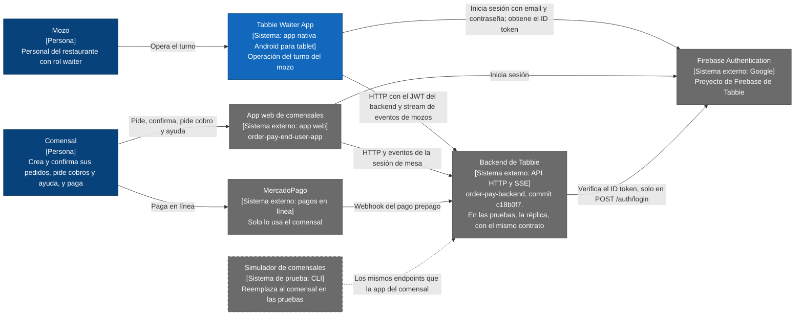
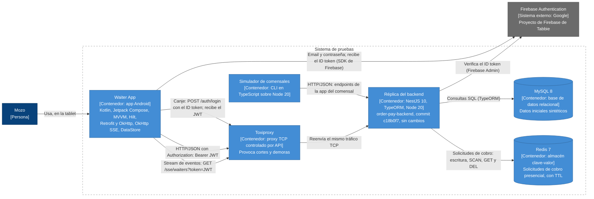

# Arquitectura: Tabbie Waiter App

> Vista general de la arquitectura de la Tabbie Waiter App: el contexto del sistema, sus contenedores, el patrón que sigue, por qué se eligió, y sus beneficios y sacrificios.
>
> La base son las [decisiones de arquitectura](../adr/README.md), el [PRD](../prd/tabbie-waiter-mvp.md) y el [documento de contexto](../context/panel-mozos-actual.md). Las decisiones están en los ADRs; este documento las junta y no agrega ninguna.

**Es una arquitectura propuesta.** Todavía no hay código: los diagramas muestran lo que deciden los ADRs, no lo que está construido. Cuando exista el código, los diagramas se regeneran desde él y este documento se actualiza.

**Referencias:** las mismas que en los ADRs. Un número de cuatro cifras remite a un ADR; "PRD", "contexto" y "backlog" remiten a esos tres documentos; los IDs (RF-n, RNF-n, M-n, Cn, Tnn, On, HU-nn) son los de cada documento.

## Índice de `docs/architecture/`

| Archivo | Contenido | Estado |
|---|---|---|
| [README.md](README.md) | Vista general: contexto, contenedores, patrón, beneficios y sacrificios | Este archivo |
| [componentes.md](componentes.md) | Componentes principales de la app, la réplica y el simulador, con su tecnología | Escrito |
| [walking-skeleton.md](walking-skeleton.md) | La primera versión de punta a punta: inicio de sesión, avisos en tiempo real, reconexión, aviso sin conexión, recuperación después de un corte y consulta periódica (backlog) | Escrito |
| [estructura.md](estructura.md) | Estructura del proyecto y de sus carpetas | Escrito |
| [infraestructura.md](infraestructura.md) | Infraestructura del entorno de prueba y despliegue | Escrito |
| [seguridad.md](seguridad.md) | Prácticas de seguridad | Escrito |

## 1. Diagrama de contexto (C4, nivel 1)

El sistema es la Waiter App. Las líneas punteadas existen solo en las pruebas.

| Elemento | Qué es | De dónde sale |
|---|---|---|
| Mozo | El único usuario de la app. Ningún otro rol la usa. | PRD, sección 2; RF-2 |
| Comensal | Crea y confirma sus pedidos, pide cobros y ayuda, y paga con MercadoPago desde su app. No usa la Waiter App. | PRD, sección 2; contexto, secciones 3.3 y 4 |
| Tabbie Waiter App | App nativa Android para tablet, en orientación horizontal. | 0001; RNF-10 |
| App web de comensales | La app web actual, que hoy también contiene el panel de mozos que la Waiter App reemplaza. Los comensales la siguen usando. Inicia sesión con el SDK de Firebase. | Contexto, secciones 0 y 3.1 (T19); PRD, secciones 1 y 9 |
| Backend de Tabbie | El backend actual, que no se modifica. Corre en una sola instancia en Railway. En las pruebas lo reemplaza la réplica, una copia sin cambios del mismo commit. | 0002; contexto, sección 0; PRD, sección 9 |
| Firebase Authentication | El proyecto de Firebase de Tabbie. El backend usa Firebase Admin solo en `POST /auth/login`; las demás rutas validan un JWT propio. La réplica valida contra el mismo proyecto. | 0002, 0004; contexto, secciones 0 y 3.1 |
| MercadoPago | El comensal paga en línea, y el webhook de MercadoPago confirma pedidos en el flujo prepago. La Waiter App no habla con MercadoPago: ve sus solicitudes, pero no las confirma. | Contexto, sección 2 ("Origen de los eventos") y sección 3.3; C9, C11 |
| Simulador de comensales | En las pruebas ocupa mesas, crea y confirma pedidos, pide ayuda, pide cobros presenciales y cancela pedidos, con los mismos endpoints que la app del comensal. | 0002; PRD, sección 8 |

## 2. Diagrama de contenedores (C4, nivel 2)

Muestra el **sistema de pruebas**: la app contra la réplica, con el simulador en lugar del comensal y Toxiproxy en el medio para provocar cortes.

**Contenedores:**

| Contenedor | Tecnología | De dónde sale |
|---|---|---|
| Waiter App | Kotlin y Jetpack Compose; MVVM con flujo de datos unidireccional; Hilt; Retrofit y OkHttp; OkHttp SSE; Firebase Authentication; DataStore cifrado con una clave del Android Keystore | 0001, 0003, 0005 |
| Réplica del backend | NestJS 10, TypeORM y Node 20: lo que trae la copia, no una elección | 0002, 0003 |
| MySQL 8 | Las 13 tablas que usa la cadena del mozo, con datos iniciales propios y sintéticos | 0002, 0003; contexto, sección 3.2 |
| Redis 7 | Las solicitudes de cobro presencial, con vencimiento (`REDIS_EXPIRATION_TIME`) | 0003; contexto, sección 3.3 |
| Simulador de comensales | Cliente HTTP por línea de comandos, en TypeScript sobre Node 20 | 0002, 0003 |
| Toxiproxy | Proxy TCP que se controla por API, entre la app y la réplica | 0003 |
| Firebase Authentication | El proyecto de Firebase de Tabbie; no es un contenedor del sistema, pero el sistema de pruebas depende de él | 0002, 0004 |

**Qué viaja en cada flecha:**

- **Inicio de sesión en Firebase:** la app usa el SDK de Firebase con email y contraseña, y recibe el ID token (RF-1; 0004). Este tráfico **no pasa por Toxiproxy** (0003).
- **Canje del ID token:** `POST /auth/login` con el ID token en el body; el backend lo verifica con Firebase Admin y devuelve su propio JWT (T01; C1; contexto, sección 0). El ID token se usa solo en este canje (0004).
- **HTTP con el JWT:** las consultas (T05 a T07) y las acciones que cambian datos (T08, T09, T11 a T14) llevan el JWT del backend en `Authorization: Bearer` (contexto, sección 0, `JwtAuthGuard`; 0004).
- **Stream de eventos:** una sola conexión a `GET /sse/waiters?token=<JWT>`, con el JWT en la URL, que trae `order-confirmed-notification`, `in-person-payment-request` e `in-person-payment-request-deleted` (T16, T17; contexto, secciones 3.1 y 5; 0006).
- **Toxiproxy:** reenvía el tráfico TCP sin tocarlo. Los cortes y las demoras se provocan desde su API, sin tocar la app ni la réplica (0003). La app usa una única URL base para HTTP y SSE (contexto, sección 1), así que en local esa URL apunta siempre a Toxiproxy, que sin fallos activos reenvía el tráfico sin tocarlo (0003; [infraestructura.md](infraestructura.md)).
- **Consultas a MySQL:** la réplica lee y escribe con TypeORM las tablas de la cadena del mozo (contexto, sección 3.2).
- **Consultas a Redis:** las solicitudes de cobro presencial viven solo en Redis. Las escribe el comensal (o el simulador) con `POST /payments/in-person-request`; la cadena del mozo las lee con `SCAN` y `GET` y las borra con `DEL` (contexto, sección 3.3).
- **Simulador:** llama directo a la réplica, con los endpoints de la app del comensal (0002). No pasa por Toxiproxy, que está entre la app y la réplica (0003).

**Lo que no es un contenedor:**

- Los eventos salen de un `Subject` en la memoria del proceso de la réplica, no de Redis ni de una cola (contexto, secciones 0 y 3.3).
- En la tablet, DataStore guarda solo la sesión del mozo y las marcas de "Atendido", y el SDK de Firebase guarda su propia sesión. No hay base de datos local (0005; RNF-8).

## 3. Patrón y justificación

**Patrón:** un **cliente nativo sobre un backend existente con contrato fijo, probado contra una réplica idéntica**.

- **Cliente nativo (0001).** La app es nativa Android, en Kotlin con Jetpack Compose, porque la operación va a necesitar después imprimir comandas por Bluetooth, operar sin conexión y recibir avisos con la pantalla bloqueada (PRD, sección 1). Las tres están fuera del MVP, pero la plataforma que se elige ahora tiene que poder ofrecerlas. Una PWA no puede, por los límites del navegador, y React Native agrega una capa sobre las mismas APIs nativas.
- **Backend existente con contrato fijo (0002; PRD, sección 9).** La app usa los endpoints y eventos del backend actual, los de la columna "Waiter App" del contexto (sección 3.1), y no pide ninguno nuevo. Lo que el backend no resuelve, la app lo rodea con su propio comportamiento:
  - "Atendido" por tablet (O1, C7);
  - no cancelar pedidos cobrados (C6);
  - no confirmar cobros que van a fallar (C11);
  - no mostrar ni persistir datos sensibles (O4, C3);
  - no repetir sola una acción que cambia datos (0007).
- **Probado contra una réplica idéntica (0002).** La app no se puede probar contra el backend productivo. La réplica es una copia sin cambios del mismo commit que documenta el contexto, con el mismo contrato, los mismos eventos y los mismos huecos, y valida el inicio de sesión contra el mismo proyecto de Firebase. Por eso la app pasa al backend real cambiando solo la URL base. Lo que las pruebas necesitan (datos iniciales, vencimientos cortos y fallos provocados) se resuelve fuera del código de la réplica: con datos, variables de entorno, el simulador y Toxiproxy (0002, 0003).
- **El backend es la única fuente de verdad (0005).** La app tiene el estado de la operación solo en memoria y lo recarga del backend, con eventos para lo inmediato y consulta periódica para el resto (0006). Una copia local sería una segunda fuente de verdad que tarde o temprano deja de coincidir, y operar sin conexión está fuera del MVP (PRD, sección 5).

Dentro de la app, el estado de cada pantalla vive en su ViewModel, con MVVM y flujo de datos unidireccional (0003). El detalle va en [componentes.md](componentes.md).

## 4. Beneficios y sacrificios

| Tipo | Qué | Detalle | Fuente |
|---|---|---|---|
| Beneficio | La herramienta del mozo se separa de la app de comensales | Lo que se cambia para el comensal deja de afectar al mozo, y al revés. | PRD, secciones 1 y 3 |
| Beneficio | El backend no se toca | El restaurante reemplaza el panel sin cambiar cómo trabaja el resto del sistema. | 0002; PRD, secciones 3 y 9 |
| Beneficio | Pasar al backend real es cambiar la URL base | La réplica tiene el mismo contrato y el mismo proyecto de Firebase. | 0002 |
| Beneficio | Plataforma preparada para lo que viene | Impresora Bluetooth, operación sin conexión y avisos con la pantalla bloqueada se pueden agregar sin cambiar de plataforma. | 0001 |
| Beneficio | Pruebas reproducibles, con fallos provocados | Datos sintéticos, vencimientos cortos por variables de entorno y cortes desde Toxiproxy, sin tocar la app ni la réplica. M-1 a M-3 se miden con el simulador. | 0002, 0003; PRD, sección 8 |
| Beneficio | Una sola fuente de verdad | Sin base local no hay datos que dejen de coincidir, y los datos sensibles de O4 no llegan al almacenamiento de la tablet. | 0005 |
| Beneficio | Cobros sin duplicados por reintentos | Ni la app ni OkHttp repiten una acción que cambia datos. | 0007; RNF-6, M-2 |
| Sacrificio | **La app hereda O1 a O4** | El backend no se corrige: "Atendido" vale solo en una tablet y no detecta un segundo pedido de ayuda (O1); los endpoints de pagos no aplican roles (O2); hay endpoints públicos en la cadena (O3); las mesas activas traen emails y tokens de MercadoPago, que llegan a la memoria de la app (O4). La app los rodea, no los resuelve. | 0002, 0005; contexto, sección 7; PRD, sección 5 |
| Sacrificio | **No hay renovación del JWT** | El backend no tiene endpoint de renovación, así que renovar es pedir un ID token nuevo a Firebase y volver a canjearlo. La sesión del turno depende de que la sesión de Firebase siga válida en la tablet, y al renovar hay que reabrir el stream de eventos. | 0004; C1 |
| Sacrificio | **Los eventos no tienen replay ni heartbeat** | Lo que se emite durante un corte se pierde. Hace falta consulta periódica (menos de 30 s), un sondeo cada 5 s o menos para detectar cortes, y actualizar todo al reconectar. Hay tráfico constante mientras la app está abierta, con una consulta de cobros por cada mesa (T07). | 0006; contexto, sección 5 |
| Sacrificio | **El backend corre en una sola instancia** | Los eventos salen de la memoria de esa instancia: con más de una, un evento no llega a los clientes conectados a otra. Un reinicio o un despliegue corta todas las conexiones. Vale para el backend real y para la réplica. | 0006; contexto, secciones 0 y 5 |
| Sacrificio | **La réplica puede quedar atrás del backend real** | Es una copia de un commit fijo. Lo vigila la predicción del límite: antes de cada entrega y antes de pasar al backend real se compara el contrato; si cambió, la réplica se actualiza con un ADR nuevo. | 0002 |
| Sacrificio | **Las cuentas de prueba viven en el proyecto de Firebase de Tabbie** | La réplica necesita las credenciales de ese proyecto como secreto. Las credenciales de las cuentas de prueba, documentadas en el `Readme.md`, también sirven para iniciar sesión en ese proyecto; si una inicia sesión contra el backend real, `POST /auth/login` crea su fila `user` en esa base. Falta confirmar si el proyecto es el productivo. | 0002 (T01); ADRs, "Decisiones pendientes" |
| Sacrificio | El JWT viaja en la URL del stream | El backend recibe el token del stream por query param; falta decidir qué registran los logs. | 0004, 0006; contexto, sección 5; ADRs, "Decisiones pendientes" |
| Sacrificio | Sin conexión no hay datos | Al reiniciar se recarga todo del backend, y sin red la app solo puede mostrar el aviso de RNF-4. | 0005 |
| Sacrificio | Una acción que no responde queda en duda | Sin reintentos, la app no sabe si la acción se registró; el mozo decide después de ver el estado actualizado. Un fallo de conexión que OkHttp resolvía en silencio llega al mozo como error. | 0007 |
| Sacrificio | Margen entre la revisión previa y la acción | Con dos tablets casi al mismo tiempo puede haber un cobro duplicado, un cobro manual que supera el saldo o una mesa cerrada dos veces. Se acepta porque el backend no se modifica e inicialmente hay una sola tablet por restaurante. | 0007; backlog, "Riesgos aceptados" |
| Sacrificio | Dos lenguajes y un APK | Kotlin en la app y TypeScript en la réplica y el simulador; hay que compilar y distribuir un APK. | 0001, 0003 |
