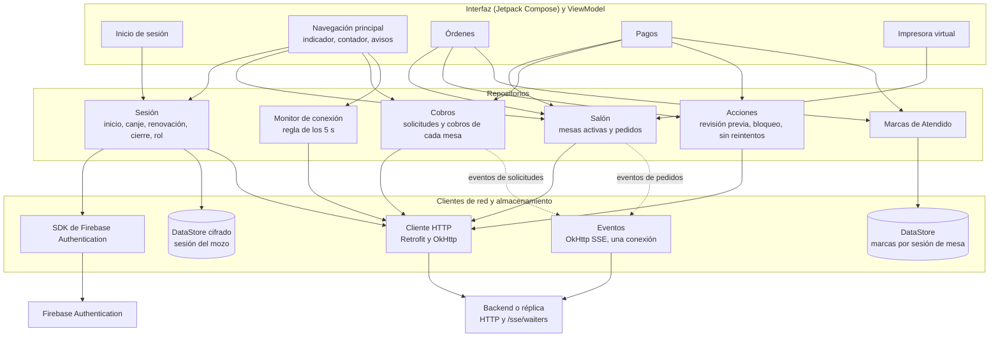
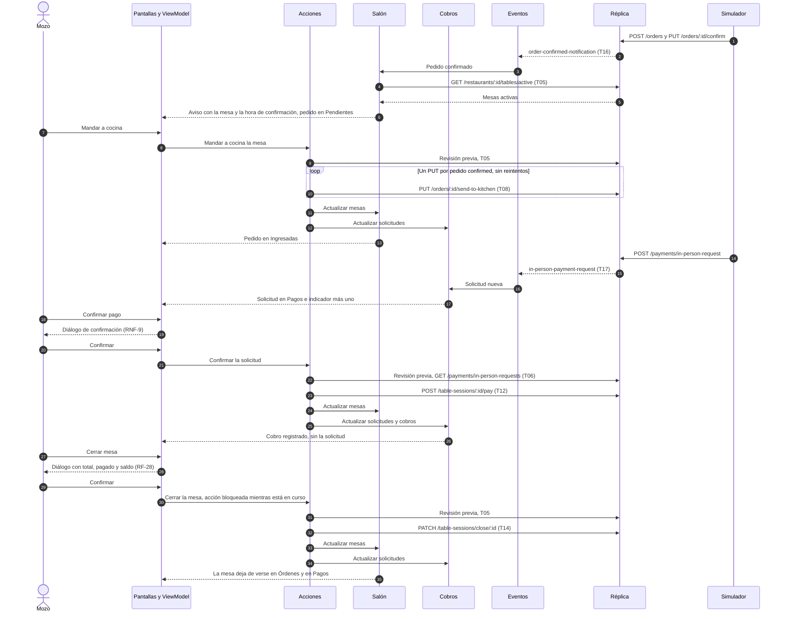

# Componentes: Tabbie Waiter App

> Componentes principales de la app del mozo, de la réplica del backend y del simulador de comensales: qué hace cada uno, con qué tecnología, qué requisitos del PRD atiende y qué endpoints o eventos usa.
>
> La base son las [decisiones de arquitectura](../adr/README.md), el [PRD](../prd/tabbie-waiter-mvp.md), el [documento de contexto](../context/panel-mozos-actual.md) y el [backlog](../backlog/README.md). Las decisiones están en los ADRs; este documento las junta y no agrega ninguna. Lo que falta decidir está en "Decisiones pendientes".

**Es una arquitectura propuesta.** Todavía no hay código de la app ni del simulador: las tablas muestran lo que deciden los ADRs, no lo que está construido. La réplica sí se describe como es, porque es una copia sin cambios del backend (0002).

**Referencias:**

- Las mismas que en los ADRs: un número de cuatro cifras remite a un ADR; "PRD", "contexto" y "backlog" remiten a esos tres documentos; los IDs (RF-n, RNF-n, M-n, Cn, Tnn, On, HU-nn) son los de cada documento.
- **Endpoints:** número del inventario del contexto (sección 3.1, "HTTP del backend") y fila de la trazabilidad, por ejemplo **4 (T05)**. Los eventos van por su nombre y su fila; `in-person-payment-request-deleted` no tiene fila.
- **Endpoints del comensal:** no están en el inventario, porque el mozo no los invoca. Van por su ruta, tal como los nombra el contexto ("Origen de los eventos" y sección 4).

## 1. App

### Capas

La app sigue MVVM con flujo de datos unidireccional (0003), en cuatro capas:

1. **Interfaz:** las pantallas en Jetpack Compose. Muestran el estado y mandan las acciones del mozo a su ViewModel.
2. **ViewModel:** uno por pantalla. Tiene el estado de la pantalla en memoria (0005) y lo arma con lo que exponen los repositorios.
3. **Repositorios:** Sesión, Salón, Cobros, Acciones, Marcas de "Atendido" y Monitor de conexión. Tienen las reglas de la operación y el estado compartido entre pantallas, en memoria.
4. **Clientes de red y almacenamiento:** Cliente HTTP, Eventos, DataStore y el SDK de Firebase.

Todos los componentes se conectan con Hilt (0003).

### Componentes

| Componente | Capa | Responsabilidad | Tecnología | RF y RNF | Endpoints y eventos |
|---|---|---|---|---|---|
| **Sesión** | Repositorio | <ul><li>**Inicio de sesión:** email y contraseña en Firebase, y canje del ID token por el JWT del backend. El ID token se usa solo en ese canje (0004).</li><li>**Control del rol:** si el rol no es `waiter`, cierra la sesión de Firebase, descarta el JWT y muestra el mensaje de RF-2. No guarda nada de esa sesión (HU-01.h5).</li><li>**Restaurante:** toma `user.restaurantId` del canje y es el único restaurante que usan los demás componentes (RNF-7).</li><li>**Renovación (0004):** vuelve a canjear antes del `exp` del JWT y ante un 401 que le avisa el Cliente HTTP. Hay una sola renovación en curso a la vez. Si es rechazada, lleva al inicio de sesión (con el mensaje de RF-2 si el rol cambió). Si falla por la red, la trata como un corte: reintenta con espera creciente y conserva la sesión.</li><li>Al renovar, le pasa el JWT nuevo a Eventos para que reabra la conexión.</li><li>**Cierre de sesión:** borra la sesión de DataStore y la de Firebase, pero no las marcas de "Atendido" (0005).</li><li>Expone el estado de la sesión, que decide si se ve el inicio de sesión o la operación.</li></ul> | Firebase Authentication (`signInWithEmailAndPassword`, `getIdToken`, `onAuthStateChanged`); DataStore cifrado con una clave del Android Keystore: JWT, `exp`, `restaurantId` y rol (0005) | RF-1, RF-2, RF-3, RF-4, RNF-5, RNF-7, RNF-8 | 1 (T01); Firebase Authentication (T19) |
| **Cliente HTTP** | Cliente de red | <ul><li>Hace todas las llamadas HTTP a la URL base única del ambiente (contexto, sección 1). En las pruebas de red, esa URL apunta a Toxiproxy (0003).</li><li>Agrega `Authorization: Bearer <JWT>` a todas las llamadas, menos al canje.</li><li>**401 en una consulta:** pide la renovación a Sesión y repite la consulta una vez con el JWT nuevo (0004).</li><li>**401 en una acción que cambia datos:** pide la renovación, no repite la acción y le devuelve el error a Acciones (0004, 0007).</li><li>**No reintenta** las acciones que cambian datos: no lo hace la app, y tampoco OkHttp, que se usa con `retryOnConnectionFailure` desactivado (RNF-6, 0007).</li><li>Le informa al Monitor de conexión cuándo una consulta falla o no responde (0006).</li></ul> | Retrofit y OkHttp | RF-3, RNF-4, RNF-6 | 1 (T01), 4 (T05), 5 (T06), 6 (T07), 7 (T08), 8 (T09), 10 (T11), 11 (T12), 12 (T13), 13 (T14) |
| **Eventos** | Cliente de red | <ul><li>Mantiene **una sola conexión** a `GET /sse/waiters?token=<JWT>` para los tres eventos, siempre con un JWT vigente (0006).</li><li>Lee `order-confirmed-notification` en dos pasos, `data` y después `data.body`, con manejo de errores (C4). Si no puede leer un evento, lo descarta y le pide a Salón que actualice las mesas (RF-12).</li><li>Le pasa `in-person-payment-request` e `in-person-payment-request-deleted` (`{requestId, restaurantId}`) a Cobros.</li><li>**Reconexión:** ante un error, cierra la conexión y la reabre con espera creciente. Al renovarse la sesión, la reabre con el JWT nuevo (0004, 0006).</li><li>Expone el estado de la conexión. Al reconectar, pide que se actualicen mesas, solicitudes y cobros (RNF-4).</li><li>Sin sesión no hay conexión, así que después de cerrar sesión no llegan avisos (HU-09.h3).</li></ul> | OkHttp SSE | RF-10, RF-12, RF-22, RNF-1, RNF-4 | `order-confirmed-notification` (T16), `in-person-payment-request` (T17), `in-person-payment-request-deleted` |
| **Monitor de conexión** | Repositorio | <ul><li>Corre un sondeo liviano cada 5 s o menos, con una de las consultas que ya existen; no agrega endpoints (0006). Cuál, está pendiente (ADRs, "Decisiones pendientes").</li><li>Marca "sin conexión" cuando falla una consulta o cuando pasan más de 5 s sin respuesta, y la navegación principal muestra el aviso (RNF-4).</li><li>Al recuperarse la comunicación, quita el aviso y pide que se actualicen mesas, solicitudes y cobros en 5 s o menos, sin que el mozo haga nada (RNF-4).</li><li>Sesión le avisa cuando una renovación falla por la red, que también cuenta como corte (0004).</li></ul> | Kotlin, sobre el Cliente HTTP | RNF-4 | Una de 4 (T05), 5 (T06) o 6 (T07) |
| **Salón** | Repositorio | <ul><li>Consulta las mesas activas con el `restaurantId` de la sesión: periódicamente, cada menos de 30 s (0006); después de cada acción (RNF-3); al reconectar (RNF-4), y cuando Eventos lo pide.</li><li>Ante `order-confirmed-notification`, actualiza las mesas y produce el aviso con el número de mesa y la hora `confirmedAt`, no la de llegada (RF-10, RF-11).</li><li>Arma cada mesa: comensales, total, lo pagado, saldo, tiempo de ocupación (desde el `createdAt` de la sesión de mesa), pedido de ayuda (`requestingHelp`) y si quedó saldada (`amountPaid >= total - 0.01`, contexto, sección 4).</li><li>Separa los pedidos en "Pendientes" (`confirmed`) e "Ingresadas" (`in_kitchen`), agrupados por categoría, y descarta los `canceled` (RF-6).</li><li>Da los datos del cronómetro: el `confirmedAt` más antiguo y los umbrales `yellowTicketSeconds`, `redTicketSeconds` y `redPulseTicketSeconds` que trae cada mesa (C3).</li><li>Cuenta los pedidos sin mandar a cocina, para el contador de "Órdenes" y de "Pendientes" (HU-03).</li><li>Alimenta "Órdenes", la lista de mesas de "Pagos" y la impresora virtual, que se arma con los pedidos `confirmed` de las mesas activas, sin T15 (C14).</li><li>No les pasa a las pantallas los campos sensibles de O4 (emails, tokens de MercadoPago) y no guarda las respuestas en el dispositivo (RF-9, RNF-8, 0005).</li></ul> | Kotlin, sobre el Cliente HTTP; estado en memoria (0005) | RF-5, RF-6, RF-7, RF-8, RF-9, RF-10, RF-11, RF-12, RF-30, RNF-1, RNF-2, RNF-3, RNF-4, RNF-7, RNF-8 | 4 (T05); `order-confirmed-notification` (T16), por medio de Eventos |
| **Cobros** | Repositorio | <ul><li>**Solicitudes de cobro (T06):** las consulta periódicamente, cada menos de 30 s; después de cada acción, y al reconectar (0006).</li><li>Agrega la solicitud de `in-person-payment-request` y quita la de `in-person-payment-request-deleted` (RF-22). Las que borran `/pay`, `/add-payment` y el cierre de mesa, sin evento, desaparecen con la consulta siguiente (C9).</li><li>Las agrupa por mesa (RF-20) y cuenta las que no son de MercadoPago, para el indicador (RF-21).</li><li>Marca las de MercadoPago, que no se confirman (RF-24), y las que no identifican al comensal (`userId` que no es un número mayor que cero), que se muestran como "Comensal sin identificar" (C11, HU-06.h7).</li><li>**Cobros de cada mesa (T07):** los consulta periódicamente, una consulta por mesa activa (0006). Los que tienen `user` nulo figuran como "Pago manual", y `method` se compara sin distinguir mayúsculas (C10).</li><li>No les pasa a las pantallas los emails de los comensales (RF-9) y no guarda nada en el dispositivo (RNF-8).</li></ul> | Kotlin, sobre el Cliente HTTP; estado en memoria (0005) | RF-9, RF-20, RF-21, RF-22, RF-23, RNF-1, RNF-2, RNF-3, RNF-4, RNF-8 | 5 (T06), 6 (T07); `in-person-payment-request` (T17) e `in-person-payment-request-deleted`, por medio de Eventos |
| **Acciones** | Repositorio | **Reglas comunes (0007):** <ul><li>**Revisión previa:** antes de actuar, actualiza el estado que la acción necesita. Si la acción ya no corresponde, avisa y no actúa (backlog, "Riesgos aceptados").</li><li>**Bloqueo:** mientras una acción está en curso, no se puede repetir (RF-29; HU-04.h5, HU-05.h6).</li><li>**Sin reintentos:** ninguna acción se repite sola (RNF-6).</li><li>**Actualización posterior:** al terminar, Salón y Cobros actualizan mesas y solicitudes (RNF-3). Si falla o no responde, las actualizan antes de dejar intentarla de nuevo (RNF-6).</li></ul> **Acciones:** <ul><li>**Mandar a cocina:** un `PUT` sin body por cada pedido `confirmed` de la mesa (C5, RF-13).</li><li>**Cancelar pedidos:** revisa los cobros de cada pedido; no cancela los que tienen `isPaid` o algún ítem con `quantityPaid > 0`, y explica por qué (RF-15). Manda un `PUT` por pedido, con `{"reason":"Cancelada por el restaurante"}` en la raíz del body (C6, RF-14).</li><li>**Registrar un cobro manual:** propone el saldo (`total - amountPaid`) y permite propina (RF-17). Revisa el saldo y no registra un monto sin propina que lo supere (RF-18). Manda `{amount, noTipAmount}`; el backend lo guarda como `cash` y sin comensal (C8, RF-19).</li><li>**Confirmar una solicitud:** no confirma las de MercadoPago (RF-24). Si la solicitud no identifica al comensal, no la confirma y explica que se registre como cobro manual y después se elimine (RF-25). Revisa que la solicitud siga en T06 (HU-07.h2).</li><li>**Eliminar una solicitud** (RF-26).</li><li>**Cerrar una mesa:** solo para sesiones que vienen en T05 (RF-27). Da el total, lo pagado y el saldo para el diálogo (RF-28). Revisa que la mesa siga activa; si no, avisa y la quita (HU-08.h4).</li></ul> | Kotlin, sobre el Cliente HTTP | RF-13, RF-14, RF-15, RF-17, RF-18, RF-19, RF-24, RF-25, RF-26, RF-27, RF-28, RF-29, RNF-3, RNF-6 | Revisión previa: 4 (T05) y 5 (T06). Acciones: 7 (T08), 8 (T09), 10 (T11), 11 (T12), 12 (T13), 13 (T14) |
| **Marcas de "Atendido"** | Repositorio y almacenamiento | <ul><li>Guarda las marcas por sesión de mesa, en la tablet (C7, 0005).</li><li>Con una marca, el aviso de ayuda de esa mesa se oculta en "Órdenes" y en "Pagos" de esta tablet, hasta que se cierra la mesa. Una ocupación nueva es otra sesión de mesa, así que vuelve a mostrar el aviso (HU-10.h3).</li><li>Funciona sin conexión (HU-10.h6).</li><li>Las marcas se mantienen al cerrar sesión y al fallar la renovación (RF-4, HU-10.h7).</li><li>No llama a `PUT /table-sessions/:id/attend`, que siempre falla (O1).</li></ul> | DataStore (0005) | RF-4, RF-16, RNF-8 | Ninguno |
| **Pantalla de inicio de sesión** | Interfaz y ViewModel | <ul><li>Pide email y contraseña (RF-1).</li><li>Avisa si los datos no son correctos (HU-01.h1) o si no hay conexión (HU-01.h2), sin salir del inicio de sesión.</li><li>Muestra el mensaje de RF-2 a quien no es mozo.</li></ul> | Jetpack Compose y ViewModel | RF-1, RF-2, RNF-10 | Ninguno directo (usa Sesión) |
| **Navegación principal** | Interfaz y ViewModel | <ul><li>Según el estado de Sesión, muestra el inicio de sesión o la operación. Sin sesión no se ve ninguna pantalla de la operación, tampoco con "Atrás" (RF-2, HU-09.h2).</li><li>Tiene "Órdenes", "Pagos" y el acceso fijo a la impresora virtual, y se ve desde cualquier pantalla de la operación (backlog, "Navegación principal").</li><li>Muestra el indicador de solicitudes sobre "Pagos" (RF-21) y el contador que parpadea sobre "Órdenes" (HU-03.c3).</li><li>Muestra el aviso de pedido confirmado, con el número de mesa, y emite el sonido "Nuevo pedido" (RF-10, HU-03.c2).</li><li>Muestra el aviso de que no hay conexión (RNF-4).</li><li>Ofrece "Cerrar sesión", con confirmación (RF-4, RNF-9). El lugar exacto del botón es diseño de pantalla (HU-09.h6).</li></ul> | Jetpack Compose y ViewModel | RF-2, RF-4, RF-10, RF-21, RF-32, RNF-4, RNF-9, RNF-10 | Ninguno directo |
| **Pantalla "Órdenes"** | Interfaz y ViewModel | <ul><li>Una tarjeta por mesa activa, con los comensales por su nombre, el total, lo pagado, el tiempo de ocupación y el ícono de ayuda con la acción "Atendido" (RF-7, RF-16).</li><li>Pestañas "Pendientes" e "Ingresadas", con los pedidos por categoría; "Pendientes" parpadea con el contador (RF-6, HU-03.c4).</li><li>Cronómetro que cambia de color con cada umbral y deja de verse cuando la mesa queda saldada (RF-8; backlog, "Cronómetro de demora").</li><li>"Mandar a cocina", la selección para cancelar pedidos, que deja afuera los que tienen algo cobrado (HU-04.h6), y "Registrar cobro", con su diálogo, que no está disponible si la mesa está saldada (HU-05.h7).</li><li>Ninguna de estas acciones pide confirmación (RNF-9).</li></ul> | Jetpack Compose y ViewModel | RF-5, RF-6, RF-7, RF-8, RF-9, RF-13, RF-14, RF-15, RF-16, RF-17, RNF-9, RNF-10 | Ninguno directo |
| **Pantalla "Pagos"** | Interfaz y ViewModel | <ul><li>Una tarjeta por mesa activa, con el ícono de ayuda y la acción "Atendido" (RF-7, RF-16).</li><li>Las solicitudes de la mesa: comensal (o "Comensal sin identificar"), monto y tipo de pago; las de MercadoPago marcadas y sin "Confirmar pago"; "Eliminar" en todas (RF-20, RF-24, RF-26).</li><li>Los cobros registrados, con "Pago manual" para los cobros manuales (RF-23).</li><li>El diálogo de confirmación de una solicitud, con el comensal, el monto, la propina y el tipo de pago (RF-24, RNF-9), y la explicación de RF-25.</li><li>"Cerrar mesa" al pie de los cobros, con el diálogo que muestra total, lo pagado y saldo, y advierte si queda saldo (RF-28, RNF-9).</li></ul> | Jetpack Compose y ViewModel | RF-7, RF-9, RF-16, RF-20, RF-22, RF-23, RF-24, RF-25, RF-26, RF-27, RF-28, RF-29, RNF-9, RNF-10 | Ninguno directo |
| **Pantalla de la impresora virtual** | Interfaz y ViewModel | <ul><li>Lista los pedidos confirmados sin mandar a cocina de las mesas activas, con los datos de Salón (RF-30).</li><li>Abre el detalle de cada pedido: plato, cantidad, opciones, número de mesa y hora de confirmación, sin emails ni credenciales (HU-11.h5, RF-9).</li><li>No tiene acciones que cambien datos (RF-31).</li></ul> | Jetpack Compose y ViewModel | RF-9, RF-30, RF-31, RNF-10 | Ninguno directo |

**Endpoints que usa la app:** 1, 4, 5, 6, 7, 8, 10, 11, 12 y 13, y los tres eventos de `/sse/waiters`. Son los de la columna "Waiter App" del inventario (contexto, sección 3.1). No usa 2, 3, 9 ni 14, ni `/table-sessions/:id/subscribe`.

### Diagrama de componentes

Las flechas llenas son dependencias; las punteadas, suscripciones a los eventos. Además de lo que muestra el diagrama, los componentes se avisan entre sí:

- **Cliente HTTP → Sesión:** un 401 pide la renovación (0004).
- **Sesión → Eventos:** al renovar, la conexión se reabre con el JWT nuevo (0004).
- **Cliente HTTP y Sesión → Monitor de conexión:** una consulta que falla o no responde, o una renovación que falla por la red, cuentan como corte (0004, 0006).
- **Acciones → Salón y Cobros:** después de cada acción, y antes de dejar repetir una que falló, actualizan mesas y solicitudes (RNF-3, RNF-6).
- **Eventos y Monitor de conexión → Salón y Cobros:** al reconectar o al recuperarse la comunicación, actualizan mesas, solicitudes y cobros (RNF-4).

## 2. Réplica del backend

La réplica es una **copia sin cambios** de `order-pay-backend`, rama `main`, commit `c18b0f7` (0002). No agrega guards, eventos ni endpoints. La tabla describe los módulos de NestJS de la copia que atienden los endpoints y eventos que usan la app y el simulador, tal como están en ese commit.

| Módulo (carpeta) | Responsabilidad en la copia | Tecnología | RF y RNF que atiende | Endpoints y eventos |
|---|---|---|---|---|
| **`AppModule`** (`src/app.module.ts`) | Registra los módulos y la conexión a MySQL con TypeORM, configurada por las variables `DB_*`. | NestJS 10, TypeORM, MySQL 8 | Todos, como base | Ninguno propio |
| **`AuthModule`** (`src/auth/`) | <ul><li>`AuthController` y `AuthService`: canjean el ID token de Firebase por un JWT propio y crean la fila `user` en el primer inicio de sesión de un email (T01).</li><li>El JWT de un mozo dura `JWT_EXPIRATION_WAITERS` (16 h por defecto) y se firma con `JWT_SECRET`. No hay endpoint de renovación (C1).</li><li>Provee `JwtStrategy`, que usa `JwtAuthGuard`.</li></ul> | NestJS, Passport, JWT | RF-1, RF-2 (devuelve el rol), RF-3, RNF-5, RNF-7 (devuelve `restaurantId`) | 1 (T01); 2 (T02), que la app no usa |
| **`FirebaseAdminModule`** (`src/firebase/`) | Verifica el ID token con Firebase Admin, solo en `POST /auth/login`. Se inicializa solo si está definida `USE_FIREBASE`, con la cuenta de servicio de las variables `FIREBASE_*`. | Firebase Admin SDK | RF-1 | Lo usa 1 (T01) |
| **Guards** (`src/guards/auth/`, `src/guards/roles/`) | <ul><li>`JwtAuthGuard` toma el JWT del header `Authorization: Bearer` o del query param `?token=`, y carga `user` con su `restaurant`.</li><li>`RolesGuard` aplica `@Roles(...)` solo donde figura en `@UseGuards` (O2).</li><li>No son un módulo de NestJS: los usan los controladores.</li></ul> | NestJS, Passport | RNF-7 | Todas las filas con "J" o "J + R" de la trazabilidad |
| **`UsersModule`** (`src/users/`) | La entidad `User` y los roles `user`, `admin`, `waiter` y `backoffice`. Los invitados tienen rol `user`. | NestJS, TypeORM | RF-2 | Ninguno que use la app |
| **`RestaurantsModule`** (`src/restaurants/`) | <ul><li>`RestaurantsController.getActiveTables`: las mesas activas con sus sesiones, comensales, pedidos y árbol de ítems. Descarta los pedidos `pending` y mantiene los `canceled`.</li><li>Rechaza si el restaurante del usuario es distinto.</li><li>Trae los umbrales del restaurante y también los campos sensibles de O4.</li></ul> | NestJS, TypeORM | RF-5, RF-6, RF-7, RF-8, RF-30, RNF-7 | 4 (T05) |
| **`OrderModule`** (`src/orders/`) | <ul><li>`OrderController` y `OrderService`: mandar a cocina y cancelar pedidos, que recalcula `total` sin revertir lo pagado (C6).</li><li>Crea y confirma pedidos para el comensal. `OrderService.confirmOrder` fija `confirmedAt` y emite `order-confirmed-notification` por `SseService`.</li></ul> | NestJS, TypeORM | RF-10, RF-11, RF-13, RF-14 | 7 (T08), 8 (T09); 14 (T15), que la app no usa. Del comensal: `POST /orders`, `PUT /orders/:id/confirm`. Emite `order-confirmed-notification` (T16) |
| **`TableSessionModule`** (`src/table-sessions/`) | <ul><li>`TableSessionController` y `TableSessionService`: cobros de la sesión, cobro manual, confirmación de una solicitud y cierre de mesa.</li><li>Suma a `amountPaid` el monto sin propina y acumula la propina en `tips`; marca los pedidos como pagados cuando la mesa queda saldada (C8).</li><li>`/pay` escribe los montos antes de validar `userId` (C11), y el cierre no controla el saldo ni si la sesión ya estaba cerrada (C13).</li><li>Para el comensal: confirmar los pedidos de la sesión y pedir ayuda (`requestingHelp`, que no se puede volver a `false`, O1).</li><li>También tiene `PUT /table-sessions/:id/attend`, que siempre falla (O1).</li></ul> | NestJS, TypeORM; Redis por `InPersonRequestService` | RF-7, RF-19, RF-23, RF-24, RF-27, RF-28, RF-29 | 6 (T07), 10 (T11), 11 (T12), 13 (T14); 3 (T04) y 9 (T10), que la app no usa. Del comensal: `POST /table-sessions/:id/confirm`, `PUT /table-sessions/:id/request-help` |
| **`PaymentModule`** (`src/payments/`) | <ul><li>`PaymentController` e `InPersonRequestService`: listan y eliminan las solicitudes de cobro presencial, que viven solo en Redis con vencimiento `REDIS_EXPIRATION_TIME` (3600 s por defecto).</li><li>Para el comensal, `POST /payments/in-person-request` guarda la solicitud y emite `in-person-payment-request`.</li><li>Eliminar una solicitud emite `in-person-payment-request-deleted`.</li><li>`MercadopagoService` genera las solicitudes de MercadoPago (60 s, sin evento) y procesa el webhook del pago prepago.</li></ul> | NestJS, TypeORM, Redis | RF-20, RF-21, RF-22, RF-24, RF-26 | 5 (T06), 12 (T13). Del comensal: `POST /payments/in-person-request`. Emite `in-person-payment-request` (T17) e `in-person-payment-request-deleted` |
| **`SseModule`** (`src/sse/`) | `SseController` y `SseService`: el stream de mozos, alimentado por un `Subject` por restaurante en la memoria de la instancia, sin heartbeat ni replay. Con un JWT vencido responde 401 antes de abrir el stream. | NestJS, RxJS | RF-10, RF-22, RNF-1 | `GET /sse/waiters`: `order-confirmed-notification` (T16), `in-person-payment-request` (T17), `in-person-payment-request-deleted` |
| **`RedisModule`** (`src/redis/`) | El cliente de Redis, configurado por `REDIS_URL` o por `REDIS_HOST`, `REDIS_PORT` y `REDIS_PASSWORD`. Lo usa solo `InPersonRequestService`. | Redis 7, ioredis | RF-20, RF-22 | Lo usan 5 (T06), 10 (T11), 11 (T12), 12 (T13) y 13 (T14) |
| **`TableModule`** (`src/tables/`) | La entidad `Table` (`isBusy`, `activeSessionId`) y `TableService`, que también usa `TableSessionModule`. | NestJS, TypeORM | RF-5, RF-27 | Ninguno que use la app |
| **`ProductModule`, `ProductOptionsModule`, `ProductOptionValuesModule`** (`src/products/`, `src/product-options/`, `src/product-option-values/`) | Las entidades del árbol de ítems: producto, opciones y valores. Llegan con las mesas activas. | NestJS, TypeORM | RF-6, RF-30 | Ninguno que use la app |

**Lo demás que trae la copia** y que no usan ni la app ni el simulador: `ProductAvailabilityPeriodModule`, `TransactionsModule`, `SessionFeedbackModule`, `UploadModule`, `AssociationRulesModule`, `S3Service` y el seeder de `src/seeder/`. Quedan en la copia porque es una copia sin cambios (0002).

**Configuración que usan las pruebas:** todas son variables de entorno que ya lee la copia, así que ajustarlas no cambia su código (0002):

- `JWT_EXPIRATION_WAITERS`: vencimiento corto de la sesión (HU-01, HU-10; 0004).
- `REDIS_EXPIRATION_TIME`: vencimiento corto de las solicitudes de cobro (HU-06).
- `USE_FIREBASE` y `FIREBASE_*`: validación contra el proyecto de Firebase de Tabbie (0002).

## 3. Simulador de comensales

El simulador es un cliente HTTP por línea de comandos, en TypeScript sobre Node 20, que no comparte código con la app (0003). Hace lo que hace el comensal, contra la réplica y sin pasar por Toxiproxy (0003). Usa los endpoints del comensal que nombra el contexto; los que el contexto no nombra quedan en "Decisiones pendientes".

### Componentes

| Componente | Responsabilidad | Tecnología | RF, RNF y M | Endpoints |
|---|---|---|---|---|
| **Línea de comandos** | Elige el escenario y sus parámetros: restaurante, mesa, cantidad de pedidos, montos. | TypeScript sobre Node 20 | M-1, M-2, M-3 | Ninguno |
| **Sesión del comensal** | Obtiene el JWT con el que el comensal llama a la réplica. Cómo lo obtiene está pendiente. | TypeScript sobre Node 20 | — | Pendiente: 1 (T01) o 2 (T02) |
| **Cliente HTTP del comensal** | Llama a la réplica con la URL base de la réplica y el JWT del comensal. | TypeScript sobre Node 20 | — | Los de la tabla de escenarios |
| **Escenarios** | Ejecutan las acciones del comensal de la tabla de abajo, solas o combinadas en un turno. | TypeScript sobre Node 20 | Ver la tabla de escenarios | Ver la tabla de escenarios |
| **Registro del turno** | Guarda lo que pidió el simulador: pedidos confirmados, solicitudes de cobro y sus montos, con la mesa, el comensal y la hora. M-2 se compara contra este registro (PRD, sección 8). | TypeScript sobre Node 20 | M-2, M-3 | Ninguno |
| **Medición** | Al terminar el turno, busca los cobros duplicados de M-2 y concilia las mesas cerradas de M-3. De dónde lee los cobros registrados, lo pagado y las propinas está pendiente. | TypeScript sobre Node 20 | M-2, M-3 | Pendiente |

### Escenarios mínimos

Salen de las métricas M-1 a M-3 (PRD, sección 8) y de los requisitos de prueba del backlog.

| Escenario | Qué hace el comensal | Endpoints | Para qué |
|---|---|---|---|
| **ESC-1 · Ocupar una mesa** | Se une a una mesa libre, que pasa a estar activa. | Pendiente | Base de todos los demás. HU-02.h1 (RNF-2) |
| **ESC-2 · Confirmar un pedido** | Crea un pedido y lo confirma. | `POST /orders`, `PUT /orders/:id/confirm` | HU-02, HU-03 (RF-10, RF-11; RNF-1), HU-04, HU-11 |
| **ESC-3 · Confirmar un conjunto de pedidos** | Crea varios pedidos y los confirma juntos. | `POST /orders`, `POST /table-sessions/:id/confirm` | HU-03.h4 |
| **ESC-4 · Pedir ayuda** | Pide ayuda en su mesa. | `PUT /table-sessions/:id/request-help` | HU-10 (RF-7, RF-16), con dos tablets |
| **ESC-5 · Pedir un cobro presencial** | Pide pagar en persona, con `POS` o `Cash`, un monto con o sin propina. | `POST /payments/in-person-request` | HU-06 y HU-07 (RF-20 a RF-24; RNF-1), con dos tablets; M-2, M-3 |
| **ESC-6 · Pedir un cobro sin comensal identificado** | Igual que ESC-5, con `userId: "guest"`, como lo hace la app del comensal cuando no encuentra a su usuario en la sesión (C11). | `POST /payments/in-person-request` | HU-06.h7, HU-07.h5 (RF-25); requisito de prueba del backlog |
| **ESC-7 · Cancelar un pedido** | Cancela un pedido `pending` o `confirmed` desde su app. | Pendiente | HU-02.h8 (RNF-2) |
| **ESC-8 · Pedido en el otro restaurante** | ESC-1 y ESC-2 en el segundo restaurante de los datos iniciales. | Los de ESC-1 y ESC-2 | HU-01.h6, HU-02.h7, HU-03.h7 (RNF-7) |
| **ESC-9 · Turno simulado** | Combina ESC-1 a ESC-5 en varias mesas a lo largo de un turno, mientras el mozo opera solo con la app. | Los de ESC-1 a ESC-5 | M-1 |
| **ESC-10 · Cobros con cortes** | Repite ESC-5 mientras se provocan cortes de conexión entre la app y la réplica con Toxiproxy (0003). Quién provoca los cortes está pendiente. | Los de ESC-5 | M-2 (RNF-6) |
| **ESC-11 · Conciliación** | No actúa como comensal: al terminar ESC-9 o ESC-10, corre la medición de M-2 y M-3. | Pendiente | M-2, M-3 |

## 4. Flujo principal

El comensal (el simulador) confirma un pedido, llega el aviso, el mozo lo manda a cocina, el comensal pide el cobro, el mozo lo confirma y cierra la mesa. Es el flujo principal del backlog ("Orden del backlog"). Las actualizaciones periódicas y el sondeo corren en paralelo y no se muestran.

## 5. Cobertura

Cada RF y cada RNF del PRD tiene al menos un componente de la app responsable. La réplica atiende los mismos requisitos del lado del backend (sección 2), y el simulador los ejercita en las pruebas (sección 3).

### Requisitos funcionales

| RF | Requisito (resumen) | Componentes responsables |
|---|---|---|
| RF-1 | Iniciar sesión con email y contraseña | Sesión, pantalla de inicio de sesión |
| RF-2 | Rechazar a los usuarios que no son mozos | Sesión, pantalla de inicio de sesión, navegación principal |
| RF-3 | Renovar la sesión antes de que venza | Sesión, Cliente HTTP |
| RF-4 | Cerrar sesión, manteniendo las marcas de "Atendido" | Sesión, Marcas de "Atendido", navegación principal |
| RF-5 | Mostrar solo las mesas ocupadas | Salón, pantalla "Órdenes" |
| RF-6 | Pedidos por categoría en "Pendientes" e "Ingresadas" | Salón, pantalla "Órdenes" |
| RF-7 | Comensales, total, lo pagado, tiempo de ocupación y pedido de ayuda | Salón, pantallas "Órdenes" y "Pagos" |
| RF-8 | Cronómetro de demora con los umbrales del restaurante | Salón, pantalla "Órdenes" |
| RF-9 | Ninguna pantalla muestra datos sensibles | Salón, Cobros, pantallas "Órdenes", "Pagos" e impresora virtual |
| RF-10 | Aviso con la mesa al confirmarse un pedido | Eventos, Salón, navegación principal |
| RF-11 | El aviso usa la hora de confirmación | Salón |
| RF-12 | Un aviso ilegible no se muestra y se actualizan las mesas | Eventos, Salón |
| RF-13 | Mandar a cocina los pedidos confirmados de una mesa | Acciones, pantalla "Órdenes" |
| RF-14 | Cancelar uno o más pedidos | Acciones, pantalla "Órdenes" |
| RF-15 | No cancelar pedidos con algo cobrado | Acciones, pantalla "Órdenes" |
| RF-16 | "Atendido" oculta el aviso de ayuda solo en esa tablet | Marcas de "Atendido", pantallas "Órdenes" y "Pagos" |
| RF-17 | El cobro manual propone el saldo y permite propina | Acciones, pantalla "Órdenes" |
| RF-18 | El cobro manual no supera el saldo | Acciones |
| RF-19 | El cobro manual queda como efectivo y sin comensal | Acciones (lo registra la réplica, `TableSessionModule`) |
| RF-20 | Solicitudes agrupadas por mesa | Cobros, pantalla "Pagos" |
| RF-21 | Indicador de solicitudes, sin MercadoPago | Cobros, navegación principal |
| RF-22 | Una solicitud eliminada o resuelta deja de verse, también en otras tablets | Cobros, Eventos, pantalla "Pagos" |
| RF-23 | Cobros registrados y solicitudes de cada mesa | Cobros, pantalla "Pagos" |
| RF-24 | Confirmar una solicitud presencial | Acciones, pantalla "Pagos" |
| RF-25 | Solicitud sin comensal: no se confirma y se explica | Acciones, Cobros (la marca), pantalla "Pagos" |
| RF-26 | Eliminar una solicitud | Acciones, pantalla "Pagos" |
| RF-27 | Cerrar solo mesas activas | Acciones, pantalla "Pagos" |
| RF-28 | Confirmación al cerrar y advertencia de saldo | Acciones, pantalla "Pagos" |
| RF-29 | El cierre no se repite mientras está en curso | Acciones, pantalla "Pagos" |
| RF-30 | La impresora lista los pedidos confirmados sin mandar a cocina | Salón, pantalla de la impresora virtual |
| RF-31 | La impresora no cambia datos | Pantalla de la impresora virtual |
| RF-32 | Se llega a la impresora desde una pantalla de la app | Navegación principal |

### Requisitos no funcionales

| RNF | Tema | Componentes responsables |
|---|---|---|
| RNF-1 | Avisos inmediatos (2 s) | Eventos, Salón, Cobros |
| RNF-2 | Cambios hechos fuera de la tablet (30 s) | Salón, Cobros (consulta periódica) |
| RNF-3 | Actualización tras cada acción | Acciones, Salón, Cobros |
| RNF-4 | Cortes de conexión (5 s) | Monitor de conexión, Eventos, Cliente HTTP, Sesión, Salón, Cobros, navegación principal |
| RNF-5 | Duración de la sesión | Sesión |
| RNF-6 | Sin repeticiones automáticas | Cliente HTTP, Acciones |
| RNF-7 | Aislamiento por restaurante | Sesión, Salón |
| RNF-8 | Datos en la tablet | Sesión, Marcas de "Atendido", Salón, Cobros |
| RNF-9 | Confirmación de las acciones que cierran algo | Navegación principal, pantallas "Órdenes" y "Pagos" |
| RNF-10 | Dispositivo e idioma | Todas las pantallas |

**Requisitos sin componente responsable:** ninguno.

## Decisiones pendientes

No están en los ADRs ni en el prompt de este documento, así que quedan sin decidir.

**App:**

- **Pedidos de un mismo conjunto (HU-03.h4):** cómo reconoce Salón que varios `order-confirmed-notification` son de un mismo conjunto, para mostrar un solo aviso y emitir un solo sonido. El evento trae `{orderId, tableNumber, tableSessionId, restaurantId, confirmedAt}` (C4). El backlog deja esta definición para el diseño (HU-03, INVEST).
- **Qué pedidos manda "Mandar a cocina" (HU-04.h4):** la revisión previa actualiza la mesa antes de actuar (0007), pero un pedido confirmado durante el envío no se tiene que mandar sin que el mozo lo haya visto. Falta decidir si se mandan los pedidos que el mozo veía al tocar el botón o los que trae la revisión.
- **Varias peticiones por acción (HU-04.h2, HU-04.h3):** mandar a cocina y cancelar son un `PUT` por pedido. Falta decidir si van en serie o en paralelo, y si un fallo detiene los que faltan.
- **Cuándo una acción "no responde" (RNF-6, 0007):** falta el tiempo de espera de las acciones y de las consultas, y cómo se relaciona con los 5 s de RNF-4.
- **Reintentos de OkHttp en las consultas:** 0007 desactiva `retryOnConnectionFailure` en las acciones que cambian datos. No dice si las consultas usan el mismo cliente o uno con los reintentos de OkHttp.
- **Eventos de solicitud ilegibles:** RF-12 dice qué hacer con un aviso de pedido que no se puede leer. No hay una regla para un `in-person-payment-request` o un `in-person-payment-request-deleted` ilegible.
- **Intervalos y sondeo:** ya figuran en los ADRs ("Decisiones pendientes"): los valores de la consulta periódica, incluida la de cobros por mesa (T07), y qué consulta usa el sondeo del Monitor de conexión.

**Simulador:**

- **Cómo se autentica el comensal:** con una cuenta de Firebase y `POST /auth/login` (1, T01), o como invitado con `POST /auth/guest` (2, T02). `PUT /orders/:id/confirm` admite los roles `admin` y `user`, y los invitados tienen rol `user` (contexto, sección 0).
- **Unirse a la mesa (ESC-1):** el contexto no nombra el endpoint. El código de la copia tiene `POST /table-sessions/join/restaurant/:restaurantId/table/:tableNumber`, que el contexto no documenta. `PUT /table-sessions/:id/request-help` revisa que el usuario pertenezca a la sesión de mesa, así que ESC-4 también depende de esto.
- **Cancelar como comensal (ESC-7):** el contexto describe qué puede cancelar el comensal (sección 4), pero no nombra el endpoint que usa.
- **MercadoPago (HU-06.h2, HU-06.h8):** el contexto no nombra el endpoint con el que el comensal inicia un pago con MercadoPago, y el webhook lo llama MercadoPago. Falta decidir cómo se generan, en las pruebas, las solicitudes y los cobros de MercadoPago.
- **Datos para medir M-2 y M-3 (ESC-11):** M-3 necesita lo pagado y las propinas de las mesas cerradas, y T05 solo trae mesas activas. Falta decidir de dónde los lee el simulador.
- **Quién provoca los cortes y los fallos:** los cortes de M-2 (ESC-10) y los fallos parciales al mandar a cocina y al cancelar (HU-04.h2, HU-04.h3) se provocan con Toxiproxy (0003). Falta decidir si los provoca el simulador por la API de Toxiproxy o se provocan aparte, y cómo se hace fallar una sola petición de varias. El backlog los deja para el plan de pruebas.

**Réplica:**

- **Carga de los datos iniciales:** 0002 decide datos iniciales propios y sintéticos, con dos restaurantes y dos mozos en el primero. Falta decidir cómo se cargan: con el seeder que trae la copia (`src/seeder/`) o por fuera.
