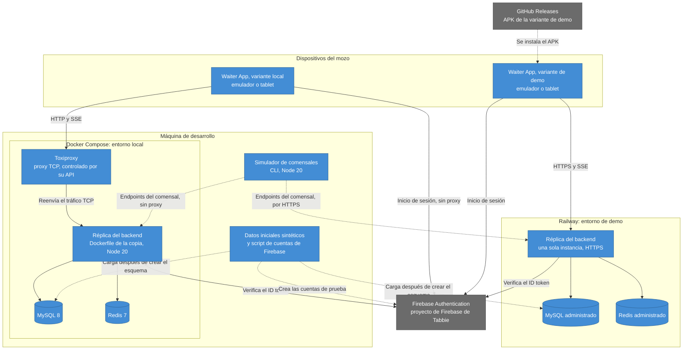

# Infraestructura: entornos, despliegue y configuración de la réplica

> Los entornos donde corren la réplica, la app y el simulador, cómo se despliega la demo y cómo se configura la réplica para las pruebas del backlog.
>
> La base son las [decisiones de arquitectura](../adr/README.md), el [backlog](../backlog/README.md) y el [documento de contexto](../context/panel-mozos-actual.md). Las referencias siguen la convención del [README de arquitectura](README.md).

**Es una infraestructura propuesta.** Todavía no hay código: los pasos dicen qué se hace, no con qué comandos. Cuando exista el código, este documento se actualiza con los comandos reales.

> **Una sola instancia.** El backend real corre en una sola instancia en Railway (contexto, sección 0), y la réplica también, en los dos entornos. Los eventos de `/sse/waiters` salen de un `Subject` en la memoria del proceso, sin Redis ni cola de por medio: con dos instancias, un evento emitido en una no llega a los mozos conectados a la otra (0006; contexto, sección 5). Por eso la réplica **nunca se escala horizontalmente**, y cada despliegue o reinicio corta todas las conexiones.

## 1. Diagrama de despliegue

Las líneas punteadas son tráfico de prueba o de publicación, no del uso de la app.

**Lo que no está en el diagrama:**

- El backend real de Tabbie: la variante Tabbie de la app apunta a él, pero no es parte de esta infraestructura y no se despliega desde este proyecto (0002).
- La cola o el bus de eventos: no existen. Los eventos viven en la memoria de la réplica.

## 2. Entornos

### 2.1 Local: desarrollo y pruebas

**Qué corre y dónde:**

| Pieza | Dónde | Configuración |
|---|---|---|
| Réplica del backend | Contenedor de Docker Compose, construido con el Dockerfile que trae la copia | Variables de entorno de la sección 5, desde un archivo local que no entra al repo |
| MySQL 8 | Contenedor de Docker Compose | Base vacía al primer arranque; la réplica crea el esquema |
| Redis 7 | Contenedor de Docker Compose | Sin persistencia necesaria: las solicitudes de cobro vencen solas |
| Toxiproxy | Contenedor de Docker Compose | Un proxy hacia la réplica. Su API queda accesible solo desde la máquina de desarrollo |
| Waiter App, variante local | Emulador en la máquina de desarrollo, o tablet en la misma red | URL base apuntando a Toxiproxy |
| Simulador de comensales | Línea de comandos en la máquina de desarrollo | URL de la réplica, **sin pasar por Toxiproxy** |

**El camino de la app:**

- La app llega a la réplica **siempre a través de Toxiproxy**, con una única URL base para HTTP y SSE (contexto, sección 1; 0003). Sin fallos activos, Toxiproxy reenvía el tráfico sin tocarlo, así que el mismo montaje sirve para el uso normal y para las pruebas de red.
- Desde un emulador, la URL base usa la dirección con la que el emulador ve a la máquina anfitriona. Desde una tablet física, la dirección de la máquina en la red local.
- El tráfico con Firebase no pasa por Toxiproxy (0003): un corte provocado afecta solo a la réplica.
- El simulador no pasa por Toxiproxy: los cortes afectan a la app y no a los comensales simulados.

**Cómo se levanta:**

1. Se completa el archivo local de variables a partir del archivo de ejemplo del repo, con las credenciales del proyecto de Firebase de Tabbie y el secreto del JWT.
2. Se elige el perfil: el normal, o el **perfil de pruebas**, con los vencimientos cortos de la sección 4.
3. Se levanta Docker Compose. La réplica arranca, se conecta a MySQL y Redis, y crea el esquema desde sus entidades (`DB_SYNC` activada).
4. Se corre, una sola vez por proyecto de Firebase, el script que crea las cuentas de prueba en Firebase. Si las cuentas ya existen, no las duplica.
5. Se cargan los datos iniciales sintéticos en MySQL.
6. Se configura en Toxiproxy el proxy hacia la réplica.
7. Se instala la variante local de la app en el emulador o la tablet, y se inicia sesión con una cuenta de prueba.
8. Se corre el simulador para generar mesas, pedidos, solicitudes de cobro y pedidos de ayuda.

**Para volver a empezar:** se borran los volúmenes de MySQL y Redis y se repiten los pasos 3 y 5. Las cuentas de Firebase no se tocan.

### 2.2 Demo

**Qué corre y dónde:**

| Pieza | Dónde | Configuración |
|---|---|---|
| Réplica del backend | Servicio de Railway, construido con el mismo Dockerfile, en **una sola instancia** | Variables de entorno de la sección 5, cargadas en Railway |
| MySQL | Base administrada de Railway | Desechable; la réplica crea el esquema |
| Redis | Redis administrado de Railway | Se conecta con `REDIS_URL` |
| HTTPS | Dominio de Railway | Railway termina TLS delante de la réplica |
| Waiter App, variante de demo | Emulador o tablet, desde el APK de GitHub Releases | URL base apuntando a la réplica de demo |
| Simulador de comensales | Línea de comandos en la máquina de quien hace la demo | URL de la réplica de demo, por HTTPS |

**Diferencias con el entorno local:**

- **No hay Toxiproxy.** La demo muestra el uso normal; los cortes y los fallos de red se prueban en local.
- **Usa los vencimientos normales**, no el perfil de pruebas.
- **La base es desechable.** Tiene solo datos sintéticos; si se pierde o se ensucia, se vacía y se vuelven a cargar los datos iniciales.

**Cómo se levanta (la primera vez):**

1. Se crea el proyecto de Railway con tres servicios: la réplica, MySQL y Redis.
2. Se cargan en Railway las variables de entorno de la réplica, con las conexiones a la base y a Redis que da Railway.
3. Se fija la réplica en **una instancia**, sin réplicas ni autoescalado.
4. Se despliega la réplica, que crea el esquema al arrancar.
5. Se cargan los datos iniciales sintéticos contra la base de Railway. Las cuentas de Firebase son las mismas del entorno local: el script no se vuelve a correr.
6. Se publica el APK de la variante de demo (sección 3).

### 2.3 Variantes de la app

| Variante | URL base | Dónde se usa |
|---|---|---|
| Réplica local | Toxiproxy, en la máquina de desarrollo | Desarrollo y pruebas, incluidas las de red |
| Réplica de demo | La réplica en Railway, por HTTPS | Demo y evaluación; su APK se publica en GitHub Releases |
| Tabbie | El backend real de Tabbie | Cuando se pase al backend real (0002) |

- Las variantes cambian **solo la URL base** (0002). La única otra diferencia es técnica: la variante local permite HTTP sin cifrar, solo hacia la máquina de desarrollo, porque Toxiproxy y la réplica local no tienen TLS. Las otras dos exigen HTTPS.
- Las tres usan el **proyecto de Firebase de Tabbie** (0002), donde hay que registrar la app Android. Como el identificador de la app es el mismo en las tres, alcanza con un registro, y en un mismo dispositivo se instala una variante a la vez.

### 2.4 Secretos

- Las credenciales del proyecto de Firebase de Tabbie y el secreto del JWT son **variables de entorno de cada entorno**: el archivo local en desarrollo y las variables de Railway en la demo.
- Nunca entran al repo. El repo trae un **archivo de ejemplo** con los nombres de la sección 5 y sin valores.
- Cada entorno tiene su propio secreto del JWT: un JWT de la réplica local no vale en la demo.
- La clave con la que se firma el APK tampoco entra al repo.
- Las credenciales de las cuentas de prueba se documentan en el `Readme.md` (backlog, "Comportamientos entre tablets"). Si se acepta publicarlas sigue pendiente (ADRs, "Decisiones pendientes").

## 3. Despliegue de la demo

**Qué dispara un despliegue:**

- Un cambio que llega a `main` en la réplica, su Dockerfile o sus datos iniciales. Como la réplica es una copia sin cambios, esto pasa casi solo cuando se actualiza a un commit nuevo del backend de Tabbie, con un ADR que reemplaza a 0002.
- Un cambio en una variable de entorno de la réplica en Railway. La réplica lee las variables solo al arrancar, así que un cambio de configuración siempre es un despliegue.
- Un despliegue a mano desde Railway.

**Qué pasa durante un despliegue:**

- Railway construye la imagen nueva y reemplaza el proceso. Como hay una sola instancia, **todas las conexiones abiertas se cortan**: los streams de `/sse/waiters` y las peticiones en curso.
- Los eventos emitidos durante el corte se pierden: el stream no tiene replay (contexto, sección 5).
- La app se recupera sola, sin que el mozo haga nada (0006):
  - las consultas fallan o no responden en 5 s, y la app muestra el aviso de RNF-4;
  - la conexión de eventos se reabre con espera creciente;
  - al reconectar, la app actualiza mesas, solicitudes y cobros.
- La sesión del mozo sigue: el JWT vale en la réplica nueva porque el secreto no cambió (0004). Si se cambió `JWT_SECRET`, el primer 401 dispara la renovación con un ID token nuevo de Firebase.
- Una acción que cambia datos y quedó sin respuesta durante el corte no se repite sola: el mozo ve el estado actualizado y decide (0007).
- El esquema no cambia si el commit de la réplica no cambia. Las solicitudes de cobro en Redis sobreviven al despliegue, porque viven en el Redis administrado y no en el proceso.

**Cómo se publica el APK:**

1. Se compila la variante de demo, firmada con la clave de firma.
2. Se crea una release en GitHub con el número de versión y se adjunta el APK.
3. Quien prueba descarga el APK de la release y lo instala en el emulador o la tablet.

El APK se publica cuando cambia la app, no cuando se despliega la réplica: la URL de la demo no cambia entre despliegues.

## 4. Requisitos de prueba

Los cinco requisitos del backlog ("Requisitos de prueba") se logran **sin cambiar el código de la réplica**: con datos, variables de entorno, el simulador y Toxiproxy (0002, 0003).

| Requisito | Cómo se logra | Historias que lo usan |
|---|---|---|
| Dos restaurantes, con dos mozos en el primero y uno en el segundo | Datos iniciales sintéticos propios, con los restaurantes, sus mesas, su menú y sus mozos con rol `waiter`. Se cargan después de que la réplica crea el esquema. Un script crea las cuentas de esos mozos en el proyecto de Firebase de Tabbie. No se usan datos de Tabbie. | Dos restaurantes: HU-01, HU-02 y HU-03 (RNF-7). Dos mozos: HU-03, HU-06, HU-07, HU-08, HU-09, HU-10 y HU-11. |
| Vencimiento corto, configurable, de la sesión y de las solicitudes de cobro | Las variables `JWT_EXPIRATION_WAITERS` y `REDIS_EXPIRATION_TIME`, con valores cortos en el **perfil de pruebas** del entorno local. La réplica las lee al arrancar, así que cambiarlas exige reiniciarla. | Sesión: HU-01 y HU-10. Solicitudes: HU-06. |
| Fallos parciales al mandar a cocina y al cancelar | **Fallos de negocio:** el simulador cancela, como comensal, uno de los pedidos justo antes de la acción del mozo. La app todavía lo muestra, y el backend rechaza ese pedido y acepta los demás, porque la app manda una petición por pedido, y un pedido ya cancelado no se puede cancelar ni mandar a cocina (contexto, C5 y C6). **Falta de respuesta, demoras y cortes:** Toxiproxy, controlado por su API, entre la app y la réplica. Con una demora activa, el simulador puede confirmar un pedido mientras el envío a cocina está en curso. | HU-04. |
| Una solicitud sin comensal identificado (RF-25) | El simulador la crea con el comensal `guest`, como la crea la app del comensal cuando no encuentra a su usuario (contexto, C11). El backend no valida ese cuerpo. | HU-06 y HU-07. |
| El montaje de dos tablets | Dos emuladores, o una tablet y un emulador, con mozos distintos del primer restaurante, contra la misma réplica, local o de demo. El simulador genera los pedidos de ayuda y las solicitudes de cobro. | HU-03, HU-06, HU-07, HU-08, HU-10 y HU-11. |

**Notas:**

- El perfil de pruebas existe solo en el entorno local. En la demo, cambiar un vencimiento es cambiar una variable de Railway, y eso es un despliegue que corta las conexiones (sección 3).
- Los cortes de Toxiproxy existen solo en el entorno local. Con dos tablets en local, un corte afecta a las dos, porque comparten el proxy.
- Las métricas M-1 a M-3 se miden en el entorno local, con el simulador y con los cortes de Toxiproxy durante los cobros (PRD, sección 8).

## 5. Variables de entorno de la réplica

Solo los nombres y para qué sirve cada una. Los valores van en el archivo local o en Railway, nunca en el repo.

| Grupo | Variable | Para qué sirve |
|---|---|---|
| Base | `DB_HOST` | Host de MySQL |
| Base | `DB_PORT` | Puerto de MySQL |
| Base | `DB_USER` | Usuario de MySQL |
| Base | `DB_PASSWORD` | Contraseña de MySQL. Secreto |
| Base | `DB_NAME` | Nombre de la base |
| Base | `DB_SYNC` | Activa la sincronización que crea el esquema desde las entidades al arrancar. Viene activada por defecto y se deja así |
| Redis | `REDIS_URL` | Conexión a Redis en una sola cadena. Es la forma que se usa con el Redis administrado de Railway |
| Redis | `REDIS_HOST` | Host de Redis, si no se usa `REDIS_URL` |
| Redis | `REDIS_PORT` | Puerto de Redis, si no se usa `REDIS_URL` |
| Redis | `REDIS_PASSWORD` | Contraseña de Redis, si no se usa `REDIS_URL`. Secreto |
| Sesión | `JWT_SECRET` | Firma y valida el JWT propio del backend. Secreto, distinto en cada entorno |
| Sesión | `JWT_EXPIRATION_WAITERS` | Vencimiento del JWT de los mozos. Corto en el perfil de pruebas |
| Sesión | `JWT_EXPIRATION` | Vencimiento del JWT de los demás usuarios |
| Solicitudes de cobro | `REDIS_EXPIRATION_TIME` | Vencimiento de las solicitudes de cobro presencial en Redis. Corto en el perfil de pruebas |
| Firebase | `USE_FIREBASE` | Activa la verificación del ID token con Firebase Admin en `POST /auth/login`. Activada en los dos entornos |
| Firebase | `FIREBASE_PROJECT_ID` | Proyecto de Firebase de Tabbie |
| Firebase | `FIREBASE_PRIVATE_KEY` | Clave privada de la cuenta de servicio. Secreto |
| Firebase | `FIREBASE_CLIENT_EMAIL` | Email de la cuenta de servicio |
| Firebase | Los demás `FIREBASE_*` | Los demás campos de la cuenta de servicio de ese proyecto. Se tratan como secretos |
| Servidor | `PORT` | Puerto donde escucha la réplica. En Railway lo asigna la plataforma |
| Servidor | `CORS_ORIGINS` | Orígenes web permitidos. No afecta a la app nativa ni al simulador, que no son navegadores |
| Sin uso | `MP_*` | MercadoPago. El flujo del mozo no las usa: quedan vacías |
| Sin uso | `AWS_*` | Servicios de AWS. El flujo del mozo no las usa: quedan vacías |
| Sin uso | `FRONT_URL` | URL de la app de comensales. El flujo del mozo no la usa: queda vacía |
