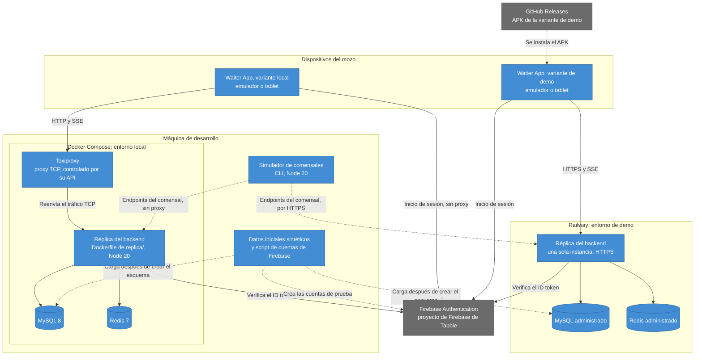

# Infraestructura: entornos, despliegue y configuración de la réplica

> Los entornos donde corren la réplica, la app y el simulador, cómo se despliega la demo y cómo se configura la réplica para las pruebas del backlog.
>
> La base son las [decisiones de arquitectura](../adr/README.md), el [backlog](../backlog/README.md) y el [documento de contexto](../context/panel-mozos-actual.md). Las referencias siguen la convención del [README de arquitectura](README.md).

**Qué ya existe:** el entorno local de la réplica (sección 2.1, pasos 1 a 3), las pruebas de la réplica y la CI (sección 6) tienen código y comandos reales desde TK-01. Lo demás sigue como propuesta hasta su ticket: la carga de los datos iniciales y el script de cuentas de Firebase (TK-02), Toxiproxy (ampliación) y la demo en Railway (final de la ampliación).

> **Una sola instancia.** El backend real corre en una sola instancia en Railway (contexto, sección 0), y la réplica también, en los dos entornos. Los eventos de `/sse/waiters` salen de un `Subject` en la memoria del proceso, sin Redis ni cola de por medio: con dos instancias, un evento emitido en una no llega a los mozos conectados a la otra (0006; contexto, sección 5). Por eso la réplica **nunca se escala horizontalmente**, y cada despliegue o reinicio corta todas las conexiones.

## 1. Diagrama de despliegue

Las líneas punteadas son tráfico de prueba o de publicación, no del uso de la app.



**Lo que no está en el diagrama:**

- El backend real de Tabbie: la variante Tabbie de la app apunta a él, pero no es parte de esta infraestructura y no se despliega desde este proyecto (0002).
- La cola o el bus de eventos: no existen. Los eventos viven en la memoria de la réplica.

## 2. Entornos

### 2.1 Local: desarrollo y pruebas

**Qué corre y dónde:**

| Pieza | Dónde | Configuración |
|---|---|---|
| Réplica del backend | Servicio `replica` de `compose.yaml`, construido con `replica/Dockerfile` (Node 20) | Variables de entorno de la sección 5, desde el archivo local del perfil (`replica/entornos/<perfil>.env`), que no entra al repo. Dentro del contenedor escucha en 3000; `PORT` elige el puerto publicado en la máquina |
| MySQL 8 | Servicio `mysql` de `compose.yaml` (MySQL 8.4) | Base vacía al primer arranque, en un volumen; las migraciones de la réplica crean el esquema. Toma la base, el usuario y la contraseña de las variables `DB_*` del perfil, y no publica puerto |
| Redis 7 | Servicio `redis` de `compose.yaml` (Redis 7.4) | Sin persistencia: las solicitudes de cobro vencen solas. Toma la contraseña de `REDIS_PASSWORD` |
| Pruebas de la réplica | Servicio `pruebas` de `compose.yaml`, perfil `pruebas`, construido con `replica/tests/Dockerfile` (Node 20) | Las mismas variables del perfil, más el repo montado de solo lectura |
| Generador del OpenAPI | Servicio `openapi` de `compose.yaml`, perfil `herramientas` | No necesita variables ni MySQL ni Redis; escribe `docs/api/openapi.yaml` |
| Toxiproxy | Contenedor de Docker Compose, desde la ampliación (DP-41) | Un proxy hacia la réplica. Su API queda accesible solo desde la máquina de desarrollo |
| Carga de los datos iniciales | Servicio de Docker Compose que corre una sola vez | Espera a que terminen las migraciones de la réplica y ejecuta el SQL de `replica/datos-iniciales/` (DP-16, DP-51) |
| Waiter App, variante local | Emulador en la máquina de desarrollo, o tablet en la misma red | URL base apuntando a la réplica en el lote 1, y a Toxiproxy desde la ampliación (DP-41) |
| Simulador de comensales | Línea de comandos en la máquina de desarrollo | URL de la réplica, **sin pasar por Toxiproxy** |

**El camino de la app:**

- **En el lote 1 (DP-41):** la app llega directo a la réplica. El walking skeleton delgado prueba la reconexión y el aviso con MockWebServer (DP-04), así que Toxiproxy no hace falta hasta los cortes de punta a punta. Lo que sigue describe el entorno desde la ampliación.
- La app llega a la réplica **siempre a través de Toxiproxy**, con una única URL base para HTTP y SSE (contexto, sección 1; 0003). Sin fallos activos, Toxiproxy reenvía el tráfico sin tocarlo, así que el mismo montaje sirve para el uso normal y para las pruebas de red.
- Desde un emulador, la URL base usa la dirección con la que el emulador ve a la máquina anfitriona. Desde una tablet física, la dirección de la máquina en la red local.
- El tráfico con Firebase no pasa por Toxiproxy (0003): un corte provocado afecta solo a la réplica.
- El simulador no pasa por Toxiproxy: los cortes afectan a la app y no a los comensales simulados.

**Cómo se levanta:**

1. Se completa el archivo local de cada perfil a partir de su ejemplo: `replica/entornos/local.env` desde `local.env.example` (el normal, con las credenciales del proyecto de Firebase de Tabbie y `USE_FIREBASE=true`) y `replica/entornos/pruebas.env` desde `pruebas.env.example` (el **perfil de pruebas**, con los vencimientos cortos de la sección 4 y `USE_FIREBASE=false`). Cada uno con su propio `JWT_SECRET`. `.gitignore` los deja fuera del repo.
2. Se elige el perfil con el archivo que se pasa a Docker Compose en `--env-file`.
3. Se levanta Docker Compose. La réplica arranca, se conecta a MySQL y Redis, y corre sus migraciones, que crean el esquema (DP-51). Si falta una variable obligatoria, no arranca y dice cuál.

   ```powershell
   docker compose --env-file replica/entornos/local.env up -d --build --wait
   ```

   Con el perfil de pruebas, el mismo comando con `replica/entornos/pruebas.env`.
4. Se corre, una sola vez por proyecto de Firebase, el script que crea las cuentas de prueba en Firebase. Si las cuentas ya existen, no las duplica.
5. El servicio de carga de Docker Compose espera a que terminen las migraciones y ejecuta en MySQL el SQL de los datos iniciales sintéticos (DP-16). La réplica no tiene seeder.
6. Desde la ampliación, se configura en Toxiproxy el proxy hacia la réplica (DP-41).
7. Se instala la variante local de la app en el emulador o la tablet, y se inicia sesión con una cuenta de prueba.
8. Se corre el simulador para generar mesas, pedidos, solicitudes de cobro y pedidos de ayuda.

**Para volver a empezar:** se borran los volúmenes de MySQL y Redis y se repiten los pasos 3 y 5. Las cuentas de Firebase no se tocan. Al cambiar de perfil también se vuelve a empezar, porque MySQL guarda el usuario y la contraseña del primer arranque.

```powershell
docker compose --env-file replica/entornos/pruebas.env down -v
```

**Comandos de la réplica:**

| Para qué | Comando |
|---|---|
| Correr la suite de la réplica, con el stack levantado | `docker compose --env-file replica/entornos/pruebas.env --profile pruebas run --rm --build pruebas` |
| Correr también las pruebas locales, que necesitan Firebase (DP-43) | Con el stack levantado con `local.env`: `$env:PRUEBAS_LOCALES='1'; docker compose --env-file replica/entornos/local.env --profile pruebas run --rm pruebas` |
| Regenerar `docs/api/openapi.yaml` (DP-52) | `docker compose --profile herramientas run --rm --build --no-deps openapi` |
| Detector de secretos sobre todo el historial y todas las ramas (SEG-c10) | `git fetch --all --prune; docker run --rm -v "${PWD}:/repo" ghcr.io/gitleaks/gitleaks:v8.30.1 git /repo --log-opts="--all" --redact` |
| Buscar en el historial los valores de un archivo local (SEG-c10) | `bash replica/scripts/buscar-valores-de-secretos.sh replica/entornos/local.env`. Imprime solo el nombre de cada variable y si aparece |
| Deshacer la migración (DP-51) | `docker compose --env-file replica/entornos/pruebas.env exec replica node node_modules/typeorm/cli.js migration:revert -d dist/data-source.js` |

### 2.2 Demo

**Qué corre y dónde:**

| Pieza | Dónde | Configuración |
|---|---|---|
| Réplica del backend | Servicio de Railway, construido con el mismo Dockerfile, en **una sola instancia** | Variables de entorno de la sección 5, cargadas en Railway |
| MySQL | Base administrada de Railway | Desechable; las migraciones de la réplica crean el esquema |
| Redis | Redis administrado de Railway | Se conecta con `REDIS_URL` |
| HTTPS | Dominio de Railway | Railway termina TLS delante de la réplica |
| Waiter App, variante de demo | Emulador o tablet, desde el APK de GitHub Releases | URL base apuntando a la réplica de demo |
| Simulador de comensales | Línea de comandos en la máquina de quien hace la demo | URL de la réplica de demo, por HTTPS |

**Diferencias con el entorno local:**

- **No hay Toxiproxy.** La demo muestra el uso normal; los cortes y los fallos de red se prueban en local.
- **Usa los vencimientos normales**, no el perfil de pruebas.
- **La base es desechable.** Tiene solo datos sintéticos; si se pierde o se ensucia, se vacía y se vuelven a cargar los datos iniciales.

**Cómo se levanta (la primera vez):**

1. Se crea el proyecto de Railway con tres servicios: la réplica, MySQL y Redis.
2. Se cargan en Railway las variables de entorno de la réplica, con las conexiones a la base y a Redis que da Railway.
3. Se fija la réplica en **una instancia**, sin réplicas ni autoescalado.
4. Se despliega la réplica, que corre sus migraciones al arrancar.
5. Se ejecuta el mismo SQL de `replica/datos-iniciales/` contra la base de Railway. Las cuentas de Firebase son las mismas del entorno local: el script no se vuelve a correr.
6. Se publica el APK de la variante de demo (sección 3).

### 2.3 Variantes de la app

| Variante | URL base | Dónde se usa |
|---|---|---|
| Réplica local | La réplica en la máquina de desarrollo; desde la ampliación, Toxiproxy (DP-41) | Desarrollo y pruebas, incluidas las de red |
| Réplica de demo | La réplica en Railway, por HTTPS | Demo y evaluación; su APK se publica en GitHub Releases |
| Tabbie | El backend real de Tabbie | Cuando se pase al backend real (0002) |

- Las variantes cambian **solo la URL base** (0002). Con la réplica propia, eso es la intención para la variante Tabbie: las diferencias que aparezcan al conectar se ajustan entonces (0010). La única otra diferencia es técnica: la variante local permite HTTP sin cifrar, solo hacia la máquina de desarrollo, porque Toxiproxy y la réplica local no tienen TLS. Las otras dos exigen HTTPS.
- Las tres usan el **proyecto de Firebase de Tabbie** (0002), donde hay que registrar la app Android. Como el identificador de la app es el mismo en las tres, alcanza con un registro, y en un mismo dispositivo se instala una variante a la vez.

### 2.4 Secretos

- Las credenciales del proyecto de Firebase de Tabbie y el secreto del JWT son **variables de entorno de cada entorno**: el archivo local en desarrollo y las variables de Railway en la demo.
- Nunca entran al repo. El repo trae un **archivo de ejemplo** con los nombres de la sección 5 y sin valores.
- Cada entorno tiene su propio secreto del JWT: un JWT de la réplica local no vale en la demo.
- La clave con la que se firma el APK tampoco entra al repo.
- Las credenciales de las cuentas de prueba **no se publican**: se entregan con el formulario de entrega, y el `Readme.md` dice eso en lugar de listarlas ([0009](../adr/0009-publicacion-del-repo-y-credenciales.md); DP-35).
- Ninguna credencial ni cuenta entra al repo, aunque el repo sea público hasta la entrega final (DP-01). El hook de pre-commit de `.claude/hooks/` bloquea `.env`, la cuenta de servicio de Firebase, `JWT_SECRET`, los tokens de MercadoPago, las contraseñas de las cuentas de prueba y los emails que no son del dominio de prueba (DP-07), y la CI corre gitleaks en cada PR (sección 6).

## 3. Despliegue de la demo

**Qué dispara un despliegue:**

- Un cambio que llega a `main` en la réplica, su Dockerfile, sus migraciones o sus datos iniciales. Como la réplica es propia (0010), pasa con cada ticket de Backend que llega a `main`.
- Un cambio en una variable de entorno de la réplica en Railway. La réplica lee las variables solo al arrancar, así que un cambio de configuración siempre es un despliegue.
- Un despliegue a mano desde Railway.

**Qué pasa durante un despliegue:**

- Railway construye la imagen nueva y reemplaza el proceso. Como hay una sola instancia, **todas las conexiones abiertas se cortan**: los streams de `/sse/waiters` y las peticiones en curso.
- Los eventos emitidos durante el corte se pierden: el stream no tiene replay (contexto, sección 5).
- La app se recupera sola, sin que el mozo haga nada (0006):
  - las consultas fallan o no responden en 5 s, y la app muestra el aviso de RNF-4;
  - la conexión de eventos se reabre con espera creciente;
  - al reconectar, la app actualiza mesas, solicitudes y cobros.
- La sesión del mozo sigue: el JWT vale en la réplica nueva porque el secreto no cambió (0004). Si se cambió `JWT_SECRET`, el primer 401 dispara la renovación con un ID token nuevo de Firebase.
- Una acción que cambia datos y quedó sin respuesta durante el corte no se repite sola: el mozo ve el estado actualizado y decide (0007).
- El esquema cambia solo con una migración nueva, que corre al arrancar. Las solicitudes de cobro en Redis sobreviven al despliegue, porque viven en el Redis administrado y no en el proceso.

**Cómo se publica el APK:**

1. Se compila la variante de demo, firmada con la clave de firma.
2. Se crea una release en GitHub con el número de versión y se adjunta el APK.
3. Quien prueba descarga el APK de la release y lo instala en el emulador o la tablet.

El APK se publica cuando cambia la app, no cuando se despliega la réplica: la URL de la demo no cambia entre despliegues.

## 4. Requisitos de prueba

Los cinco requisitos del backlog ("Requisitos de prueba") se logran **sin endpoints solo de prueba en la réplica**: con datos, variables de entorno, el simulador y Toxiproxy (0002, 0003, DP-48).

| Requisito | Cómo se logra | Historias que lo usan |
|---|---|---|
| Dos restaurantes, con dos mozos en el primero y uno en el segundo | Datos iniciales sintéticos propios, con los restaurantes, sus mesas, su menú y sus mozos con rol `waiter`. Se cargan después de las migraciones de la réplica. Un script crea las cuentas de esos mozos en el proyecto de Firebase de Tabbie. No se usan datos de Tabbie. | Dos restaurantes: HU-01, HU-02 y HU-03 (RNF-7).<br>Dos mozos: HU-03, HU-06, HU-07, HU-08, HU-09, HU-10 y HU-11. |
| Vencimiento corto, configurable, de la sesión y de las solicitudes de cobro | Las variables `JWT_EXPIRATION_WAITERS` y `REDIS_EXPIRATION_TIME`, con valores cortos en el **perfil de pruebas** del entorno local. La réplica las lee al arrancar, así que cambiarlas exige reiniciarla. | Sesión: HU-01 y HU-10.<br>Solicitudes: HU-06. |
| Fallos parciales al mandar a cocina y al cancelar | **Fallos de negocio:** el simulador cancela, como comensal, uno de los pedidos justo antes de la acción del mozo. La app todavía lo muestra, y el backend rechaza ese pedido y acepta los demás, porque la app manda una petición por pedido, y un pedido ya cancelado no se puede cancelar ni mandar a cocina (contexto, C5 y C6).<br>**Fallo o demora de una sola petición de varias** (HU-04.h2, HU-12.h1 y HU-04.h4): en las pruebas de la app, con MockWebServer (DP-20).<br>**Cortes completos:** Toxiproxy, entre la app y la réplica, controlado por su API desde el script de la prueba. El simulador no controla Toxiproxy (DP-20). | HU-04 y HU-12. |
| Una solicitud sin comensal identificado (RF-25) | El simulador la crea con el comensal `guest`, como la crea la app del comensal cuando no encuentra a su usuario (contexto, C11). El backend no valida ese cuerpo. | HU-06 y HU-07. |
| El montaje de dos tablets | Dos emuladores, o una tablet y un emulador, con mozos distintos del primer restaurante, contra la misma réplica, local o de demo. El simulador genera los pedidos de ayuda y las solicitudes de cobro. | HU-03, HU-06, HU-07, HU-08, HU-10 y HU-11. |

**Notas:**

- El perfil de pruebas existe solo en el entorno local. En la demo, cambiar un vencimiento es cambiar una variable de Railway, y eso es un despliegue que corta las conexiones (sección 3).
- Los cortes de Toxiproxy existen solo en el entorno local. Con dos tablets en local, un corte afecta a las dos, porque comparten el proxy.
- Las métricas M-1 a M-3 se miden en el entorno local, con el simulador y con los cortes de Toxiproxy durante los cobros (PRD, sección 8). La medición de M-2 y M-3 lee MySQL con consultas de solo lectura (DP-24).
- **MercadoPago en las pruebas:** la solicitud se escribe directo en Redis y el cobro se inserta como fila en MySQL con el método de MercadoPago. No se usa la API de MercadoPago, y la réplica no tiene MercadoPago (DP-23, 0010).
- **Pruebas de la réplica:** viven en `replica/tests/`, en TypeScript con Jest y Supertest, y van por HTTP contra la réplica levantada con Docker Compose, con MySQL y Redis reales. Ahí van también las comprobaciones de O1 a O4 (DP-14).

## 5. Variables de entorno de la réplica

Solo los nombres y para qué sirve cada una. Los valores van en el archivo local o en Railway, nunca en el repo.

| Grupo | Variable | Para qué sirve |
|---|---|---|
| Base | `DB_HOST` | Host de MySQL |
| Base | `DB_PORT` | Puerto de MySQL |
| Base | `DB_USER` | Usuario de MySQL |
| Base | `DB_PASSWORD` | Contraseña de MySQL. Secreto |
| Base | `DB_NAME` | Nombre de la base |
| Redis | `REDIS_URL` | Conexión a Redis en una sola cadena. Es la forma que se usa con el Redis administrado de Railway |
| Redis | `REDIS_HOST` | Host de Redis, si no se usa `REDIS_URL` |
| Redis | `REDIS_PORT` | Puerto de Redis, si no se usa `REDIS_URL` |
| Redis | `REDIS_PASSWORD` | Contraseña de Redis, si no se usa `REDIS_URL`. Secreto |
| Sesión | `JWT_SECRET` | Firma y valida el JWT propio del backend. Secreto, distinto en cada entorno |
| Sesión | `JWT_EXPIRATION_WAITERS` | Vencimiento del JWT de los mozos. Corto en el perfil de pruebas |
| Sesión | `JWT_EXPIRATION` | Vencimiento del JWT de los demás usuarios |
| Solicitudes de cobro | `REDIS_EXPIRATION_TIME` | Vencimiento de las solicitudes de cobro presencial en Redis. Corto en el perfil de pruebas |
| Firebase | `USE_FIREBASE` | Activa la verificación del ID token con Firebase Admin en `POST /auth/login`, solo con el valor `true`. Activada en los dos entornos; desactivada en el perfil de pruebas y en la CI, donde `POST /auth/login` responde 503 (DP-43, DP-59) |
| Firebase | `FIREBASE_PROJECT_ID` | Proyecto de Firebase de Tabbie |
| Firebase | `FIREBASE_PRIVATE_KEY` | Clave privada de la cuenta de servicio, en una sola línea, como el campo `private_key` del JSON (con los saltos escritos `
`). Secreto |
| Firebase | `FIREBASE_CLIENT_EMAIL` | Email de la cuenta de servicio |
| Servidor | `PORT` | Puerto donde escucha la réplica. En Railway lo asigna la plataforma |
| Servidor | `CORS_ORIGINS` | Orígenes web permitidos. No afecta a la app nativa ni al simulador, que no son navegadores |

La réplica no tiene una variable para sincronizar el esquema: corre sus migraciones al arrancar, con `synchronize` desactivado (DP-51). Tampoco lee variables de MercadoPago, de AWS ni la URL de la app de comensales, porque no tiene esos módulos (0010).

## 6. Integración continua

Hay CI con GitHub Actions desde el primer PR de código, en `.github/workflows/` (DP-11). Corre en cada PR y bloquea el merge si algo falla. Desde TK-01 está `.github/workflows/replica.yml`, con los pasos de la réplica (tests, OpenAPI y gitleaks); ktlint y los tests de la app se suman con TK-04, cuando exista `android/`:

| Paso | Qué comprueba |
|---|---|
| ktlint | El estilo del código Kotlin de `android/` |
| Tests de la app | Las pruebas locales de `android/app/src/test/`, incluidas las de MockWebServer (DP-20) |
| Tests de la réplica | Las pruebas de `replica/tests/`, contra la réplica levantada con Docker Compose, con MySQL y Redis reales (DP-14), incluidas las de O1 a O4 (DP-50) |
| OpenAPI | Regenera `docs/api/openapi.yaml` desde el código de la réplica y falla si difiere del commiteado (DP-52) |
| gitleaks | Que el repo, con todo su historial y todas sus ramas, no traiga secretos ni credenciales (DP-01, SEG-c10) |

- **Sin credenciales de Firebase en la CI (DP-43):** las pruebas de la réplica corren con `USE_FIREBASE` desactivada y con JWT firmados con el `JWT_SECRET` de prueba de la CI, como la prueba del contrato (DP-15). La CI genera en cada corrida el `JWT_SECRET` y las contraseñas de MySQL y Redis, así que no hay ningún valor guardado. Las que necesitan el proyecto de Firebase de Tabbie (el canje de las cuentas de prueba de TK-02 y el inicio de sesión en el dispositivo) se marcan como locales, no corren en la CI, y su evidencia va en el PR.
- La revisión adversarial del PR no es parte de la CI: la lanza el humano antes del merge (DP-12; [Definition of Done](../backlog/definition-of-done.md)).
