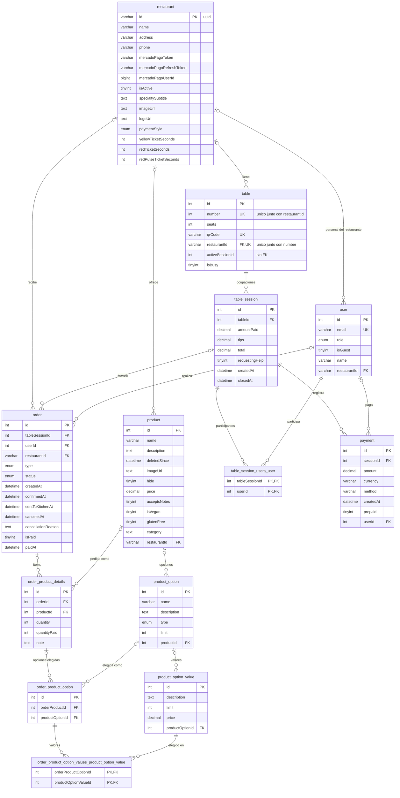

# Modelo de datos: las tablas que usa la Waiter App

> El modelo de datos que usa la Waiter App, sacado de las entidades del backend de Tabbie: un diagrama ER, una subsección por tabla y lo que se guarda fuera de la base.
>
> La base son las [decisiones de arquitectura](../adr/README.md), el [documento de contexto](../context/panel-mozos-actual.md) y el código del backend. Las referencias siguen la convención del [README de arquitectura](README.md).

**El modelo es el del backend, no uno nuevo.** La réplica es una copia sin cambios del backend (0002) y crea el esquema desde sus entidades al arrancar, con `DB_SYNC` activada ([infraestructura.md](infraestructura.md)). Este proyecto no tiene migraciones ni tablas propias, y la app no tiene base local (0005).

**Fuentes:**

- Las entidades y los enums del backend, en el commit `c18b0f7`. `BE/` abrevia `order-pay-backend/order-pay-backend/src/`, como en el contexto (sección 0).
- Los servicios de la cadena del mozo (contexto, sección 2), solo por los valores que escriben.
- TypeORM 0.3.25 y mysql2 3.14.2, las versiones del `package-lock.json` de ese commit, para lo que las entidades no declaran. `TO/` abrevia `node_modules/typeorm/`.
- El contexto, secciones 3 y 6.

**Los valores son los del código, no los de la base.** Los valores de las columnas de estado, método y rol salen de los enums y de lo que escriben los servicios. No se consultaron los datos de Tabbie.

**Convenciones:**

- Los tipos son los de MySQL que genera TypeORM. Cuando el decorador no declara el tipo, el largo o si acepta nulos, la tabla pone lo que usa TypeORM y lo marca "(por defecto de TypeORM)".
- Las columnas FK que crea una relación toman el tipo de la PK a la que apuntan (`TO/metadata-builder/RelationJoinColumnBuilder.js:150-185`).
- "No declarado" en `onDelete` quiere decir que TypeORM crea la FK con `NO ACTION` (`TO/metadata/ForeignKeyMetadata.js:32`).

## 1. Diagrama ER

Las 13 tablas del inventario (contexto, sección 3.2), con las dos intermedias M:N. `table.activeSessionId` es una columna sin relación, porque no es una FK declarada.

**Cardinalidad:** `|o` del lado padre quiere decir que la FK acepta nulos, y `||` que no los acepta. El tipo completo de cada columna, con largo y precisión, está en la tabla de cada entidad.

**Quedan fuera** del diagrama, porque no aparecen en la cadena del mozo (contexto, sección 3.2): `product_availability_period`, su intermedia `product_availability_periods_product_availability_period`, `feedback`, `association_rule_set` y `association_rule`.

## 2. Entidades

Cada subsección tiene la tabla y la entidad, sus columnas, sus relaciones, sus índices y restricciones y, si corresponde, los valores que admite cada columna de estado, método o rol. La columna "Línea" remite al archivo de la entidad.

### 2.1 `restaurant`

**Entidad:** `Restaurant`, `BE/restaurants/restaurant.entity.ts:18`.

**En la cadena del mozo:** solo se lee. `JwtAuthGuard` la lee con el usuario en toda llamada autenticada (contexto, sección 0).

| Columna | Línea | Tipo en MySQL | Nulos | Por defecto | PK | FK | Único | Descripción |
|---|---|---|---|---|---|---|---|---|
| `id` | 19-20 | `varchar(36)` (uuid; por defecto de TypeORM en MySQL) | No | Lo genera TypeORM en la app, no la base | Sí | — | — | Identificador del restaurante |
| `name` | 22-23 | `varchar(100)` | No (por defecto de TypeORM) | — | — | — | — | Nombre |
| `address` | 25-26 | `varchar(255)` (por defecto de TypeORM) | Sí | — | — | — | — | Dirección |
| `phone` | 28-29 | `varchar(255)` (por defecto de TypeORM) | Sí | — | — | — | — | Teléfono |
| `mercadoPagoToken` | 31-32 | `varchar(255)` (por defecto de TypeORM) | Sí | — | — | — | — | Token de MercadoPago del restaurante. Llega en las respuestas de T05 (O4) |
| `mercadoPagoRefreshToken` | 34-35 | `varchar(255)` (por defecto de TypeORM) | Sí | — | — | — | — | Refresh token de MercadoPago. Llega en las respuestas de T05 (O4) |
| `mercadoPagoUserId` | 37-38 | `bigint` | Sí | — | — | — | — | Usuario de MercadoPago del restaurante |
| `isActive` | 40-41 | `tinyint` (boolean; por defecto de TypeORM) | No (por defecto de TypeORM) | `true` | — | — | — | Si el restaurante está activo |
| `specialtySubtitle` | 43-44 | `text` | Sí | — | — | — | — | Subtítulo de la especialidad |
| `imageUrl` | 46-47 | `text` | Sí | — | — | — | — | URL de la imagen |
| `logoUrl` | 49-50 | `text` | Sí | — | — | — | — | URL del logo |
| `paymentStyle` | 61-62 | `enum('before-order','after-order')` | No (por defecto de TypeORM) | `'after-order'` | — | — | — | Si el comensal paga antes o después de pedir |
| `yellowTicketSeconds` | 64-67 | `int` | No (por defecto de TypeORM) | `300` | — | — | — | Umbral amarillo del cronómetro, en segundos (C3) |
| `redTicketSeconds` | 69-72 | `int` | No (por defecto de TypeORM) | `420` | — | — | — | Umbral rojo del cronómetro, en segundos (C3) |
| `redPulseTicketSeconds` | 74-77 | `int` | No (por defecto de TypeORM) | `600` | — | — | — | Umbral rojo con pulso del cronómetro, en segundos (C3) |

**Relaciones:**

| Propiedad | Con | Tipo | Lado con la FK | Eager | `onDelete` |
|---|---|---|---|---|---|
| `products` (52-53) | `Product` | 1:N | `product.restaurantId` | No | No declarado |
| `tables` (55-56) | `Table` | 1:N | `table.restaurantId` | No | No declarado |
| `orders` (58-59) | `Order` | 1:N | `order.restaurantId` | No | No declarado |
| — | `User` | 1:N | `user.restaurantId` (la relación se declara solo en `User`) | No | No declarado |
| `availabilityPeriods` (79-83) | `ProductAvailabilityPeriod` | 1:N | Fuera del alcance | No | — |

**Índices y restricciones:**

- PK en `id`.
- Índice en `mercadoPagoUserId` (línea 16).
- `@Check` de que `yellowTicketSeconds < redTicketSeconds < redPulseTicketSeconds` (línea 15). **No se crea en MySQL:** TypeORM no sincroniza checks en MySQL (`TO/schema-builder/RdbmsSchemaBuilder.js:335-337` y `:696-698`).
- `@Min(10)` y `@Max(10800)` en los tres umbrales (líneas 65-66, 70-71 y 75-76) son de class-validator: no generan ninguna restricción en la base.

**Valores de `paymentStyle`:** `before-order` y `after-order` (`BE/restaurants/restaurant-payment-style.ts:2-3`). La cadena del mozo no escribe esta columna.

### 2.2 `user`

**Entidad:** `User`, `BE/users/user.entity.ts:17`.

**En la cadena del mozo:** se lee en toda llamada autenticada. Se escribe solo en T01, con un INSERT la primera vez que inicia sesión un email que no está en la tabla.

| Columna | Línea | Tipo en MySQL | Nulos | Por defecto | PK | FK | Único | Descripción |
|---|---|---|---|---|---|---|---|---|
| `id` | 18-19 | `int` autoincremental (por defecto de TypeORM) | No | Autoincremental | Sí | — | — | Identificador del usuario |
| `email` | 21-22 | `varchar(255)` (por defecto de TypeORM) | No (por defecto de TypeORM) | — | — | — | Sí | Email. `POST /auth/login` busca el usuario por este campo (`BE/auth/auth.service.ts:33-35`) |
| `role` | 24-29 | `enum('user','admin','waiter','backoffice')` | No (por defecto de TypeORM) | `'user'` | — | — | — | Rol del usuario |
| `isGuest` | 31-32 | `tinyint` (boolean; por defecto de TypeORM) | No (por defecto de TypeORM) | `false` | — | — | — | Si es un invitado |
| `name` | 34-35 | `varchar(255)` (por defecto de TypeORM) | Sí | — | — | — | — | Nombre |
| `restaurantId` | 43-45 | `varchar(36)` (el de `restaurant.id`) | Sí | — | — | `restaurant.id` | — | Restaurante del personal. La columna la crea la relación `restaurant`, con `@JoinColumn()` |

La propiedad `restaurantId?: string` de la línea 47 no tiene decorador, así que no es una columna mapeada. La columna `restaurantId` existe por la relación.

**Relaciones:**

| Propiedad | Con | Tipo | Lado con la FK | Eager | `onDelete` |
|---|---|---|---|---|---|
| `restaurant` (43-45) | `Restaurant` | N:1 | `user.restaurantId` | **Sí** | No declarado |
| `orders` (37-38) | `Order` | 1:N | `order.userId` | No | No declarado |
| `payments` (40-41) | `Payment` | 1:N | `payment.userId` | No | No declarado |
| — | `TableSession` | M:N | Intermedia `table_session_users_user` (la relación se declara solo en `TableSession`) | No | `CASCADE` (ver 2.5) |

**Índices y restricciones:**

- PK en `id`.
- Único en `email` (línea 21).
- Índice en `restaurantId` (`@Index(['restaurant'])`, línea 15).

**Valores de `role`:**

| Valor | Origen |
|---|---|
| `user`, `admin`, `waiter`, `backoffice` | Enum `UserRole` (`BE/users/user-role.ts:2-5`) |
| `user` | Lo escribe T01 al crear el usuario en su primer inicio de sesión (`BE/auth/auth.service.ts:38-43`) |

Ningún servicio de la cadena del mozo escribe `waiter`: las filas de los mozos tienen que existir antes de su primer inicio de sesión.

### 2.3 `table`

**Entidad:** `Table`, `BE/tables/table.entity.ts:19`.

**En la cadena del mozo:** T14 escribe `isBusy = false` y `activeSessionId = null` (`BE/table-sessions/table-session.service.ts:333-335`).

| Columna | Línea | Tipo en MySQL | Nulos | Por defecto | PK | FK | Único | Descripción |
|---|---|---|---|---|---|---|---|---|
| `id` | 20-21 | `int` autoincremental (por defecto de TypeORM) | No | Autoincremental | Sí | — | — | Identificador de la mesa |
| `number` | 23-24 | `int` (por defecto de TypeORM) | No (por defecto de TypeORM) | — | — | — | Sí, junto con `restaurantId` | Número de la mesa en el restaurante |
| `seats` | 26-27 | `int` (por defecto de TypeORM) | No (por defecto de TypeORM) | — | — | — | — | Cantidad de lugares |
| `qrCode` | 29-30 | `varchar(500)` | No (por defecto de TypeORM) | — | — | — | Sí | Código QR de la mesa |
| `restaurantId` | 32-33 | `varchar(36)` (el de `restaurant.id`) | Sí (por defecto de TypeORM) | — | — | `restaurant.id` | Sí, junto con `number` | Restaurante. La columna la crea la relación `restaurant` |
| `activeSessionId` | 35-36 | `int` | Sí | — | — | **No** (columna simple) | — | Sesión de mesa activa. No es una FK declarada |
| `isBusy` | 41-42 | `tinyint` (boolean; por defecto de TypeORM) | No (por defecto de TypeORM) | `false` | — | — | — | Si la mesa está ocupada |

**Relaciones:**

| Propiedad | Con | Tipo | Lado con la FK | Eager | `onDelete` |
|---|---|---|---|---|---|
| `restaurant` (32-33) | `Restaurant` | N:1 | `table.restaurantId` | No | No declarado |
| `tableSessions` (38-39) | `TableSession` | 1:N | `table_session.tableId` | No | No declarado |

**Índices y restricciones:**

- PK en `id`.
- Único en (`restaurantId`, `number`) (línea 16).
- Único en `qrCode` (línea 17).
- Índices en `restaurantId` (línea 12), `isBusy` (línea 13), `activeSessionId` (línea 14) y (`restaurantId`, `isBusy`) (línea 15).

### 2.4 `table_session`

**Entidad:** `TableSession`, `BE/table-sessions/table-session.entity.ts:21`.

**En la cadena del mozo:**

- T09 recalcula `total` (`BE/orders/order.service.ts:433-439`).
- T11 y T12 suman `amountPaid` y `tips` (`BE/table-sessions/table-session.service.ts:923-927` y `:671-676`).
- T14 escribe `closedAt` (`:337`).

| Columna | Línea | Tipo en MySQL | Nulos | Por defecto | PK | FK | Único | Descripción |
|---|---|---|---|---|---|---|---|---|
| `id` | 22-23 | `int` autoincremental (por defecto de TypeORM) | No | Autoincremental | Sí | — | — | Identificador de la sesión de mesa (una ocupación) |
| `tableId` | 28-29 | `int` (por defecto de TypeORM) | No (por defecto de TypeORM) | — | — | `table.id` | — | Mesa. Columna declarada que comparte nombre con la FK de la relación `table` |
| `amountPaid` | 31-32 | `decimal(10,2)` | No (por defecto de TypeORM) | `0` | — | — | — | Lo pagado, sin propina (C8) |
| `tips` | 34-35 | `decimal(10,2)` | No (por defecto de TypeORM) | `0` | — | — | — | Propinas acumuladas (C8) |
| `total` | 37-38 | `decimal(10,2)` | No (por defecto de TypeORM) | `0` | — | — | — | Total de los pedidos que no están `pending` ni `canceled` (`BE/table-sessions/table-session.service.ts:757-785`) |
| `requestingHelp` | 40-41 | `tinyint` (boolean; por defecto de TypeORM) | No (por defecto de TypeORM) | `false` | — | — | — | Pedido de ayuda del comensal. Nada lo vuelve a `false` (O1) |
| `createdAt` | 53-54 | `datetime(6)` (por defecto de TypeORM) | No | `CURRENT_TIMESTAMP(6)` (por defecto de TypeORM) | — | — | — | Apertura de la sesión; base del tiempo de ocupación (C3) |
| `closedAt` | 56-57 | `datetime` (por defecto de TypeORM) | Sí | — | — | — | — | Cierre de la mesa. Nulo mientras la sesión está activa |

**Relaciones:**

| Propiedad | Con | Tipo | Lado con la FK | Eager | `onDelete` |
|---|---|---|---|---|---|
| `table` (25-26) | `Table` | N:1 | `table_session.tableId` | No | No declarado |
| `users` (43-45) | `User` | M:N | Intermedia `table_session_users_user` (`@JoinTable` en este lado) | No | `CASCADE` (ver 2.5) |
| `orders` (47-48) | `Order` | 1:N | `order.tableSessionId` | No | No declarado |
| `payments` (50-51) | `Payment` | 1:N | `payment.sessionId` | No | No declarado |

**Índices y restricciones:**

- PK en `id`.
- Índices en `tableId` (línea 17), `closedAt` (línea 18) y (`tableId`, `closedAt`) (línea 19).

### 2.5 `table_session_users_user` (intermedia M:N)

**Entidad:** no tiene clase propia. La crea el `@JoinTable()` de `TableSession.users`, en `BE/table-sessions/table-session.entity.ts:43-45`.

**En la cadena del mozo:** se lee en T05, T11 y T12; no se escribe.

| Columna | Tipo en MySQL | Nulos | Por defecto | PK | FK | Único | Descripción |
|---|---|---|---|---|---|---|---|
| `tableSessionId` | `int` (el de `table_session.id`) | No | — | Sí, compuesta | `table_session.id` | — | Sesión de mesa |
| `userId` | `int` (el de `user.id`) | No | — | Sí, compuesta | `user.id` | — | Comensal que participa en la sesión |

Los nombres de la tabla y de las columnas, que las columnas no acepten nulos y que formen la PK salen de TypeORM, porque el `@JoinTable()` no declara nada (`TO/metadata-builder/JunctionEntityMetadataBuilder.js:80-95`).

**Relaciones:**

- N:1 con `table_session`, por `tableSessionId`. `onDelete: CASCADE` y `onUpdate: CASCADE` (por defecto de TypeORM, `TO/metadata-builder/JunctionEntityMetadataBuilder.js:172-178`).
- N:1 con `user`, por `userId`. `onDelete: CASCADE` y `onUpdate: CASCADE`: `User` no declara la relación inversa, así que TypeORM usa su valor por defecto (`:186-195`).

**Índices y restricciones:**

- PK compuesta (`tableSessionId`, `userId`).
- Un índice en `tableSessionId` y otro en `userId` (`TO/metadata-builder/JunctionEntityMetadataBuilder.js:200-218`).

### 2.6 `order`

**Entidad:** `Order`, `BE/orders/order.entity.ts:25`.

**En la cadena del mozo:**

- T08 escribe `status` y `sentToKitchenAt` (`BE/orders/order.service.ts:561-562`).
- T09 escribe `status`, `canceledAt` y `cancellationReason` (`:428-430`).
- T11 y T12 escriben `isPaid` y `paidAt` (`BE/table-sessions/table-session.service.ts`, `markAllSessionOrdersAsPaid` en `:513`, `markSpecificOrdersAsPaid` en `:534`, `markLineItemsAsPaid` en `:560` y `markOrdersAsPaidForUser` en `:599`).

| Columna | Línea | Tipo en MySQL | Nulos | Por defecto | PK | FK | Único | Descripción |
|---|---|---|---|---|---|---|---|---|
| `id` | 26-27 | `int` autoincremental (por defecto de TypeORM) | No | Autoincremental | Sí | — | — | Identificador del pedido |
| `tableSessionId` | 29-31 | `int` (el de `table_session.id`) | Sí (por defecto de TypeORM) | — | — | `table_session.id` | — | Sesión de mesa del pedido |
| `userId` | 33-35 | `int` (el de `user.id`) | Sí (por defecto de TypeORM) | — | — | `user.id` | — | Comensal que hizo el pedido |
| `restaurantId` | 37-39 | `varchar(36)` (el de `restaurant.id`) | Sí (por defecto de TypeORM) | — | — | `restaurant.id` | — | Restaurante del pedido |
| `type` | 47-48 | `enum('appetizer','main_course','dessert')` | No (por defecto de TypeORM) | `'main_course'` | — | — | — | Tipo de plato del pedido |
| `status` | 50-51 | `enum('pending','confirmed','in_kitchen','canceled')` | No (por defecto de TypeORM) | `'pending'` | — | — | — | Estado del pedido (contexto, sección 4) |
| `createdAt` | 53-54 | `datetime(6)` (por defecto de TypeORM) | No | `CURRENT_TIMESTAMP(6)` (por defecto de TypeORM) | — | — | — | Creación del pedido |
| `confirmedAt` | 56-57 | `datetime` (por defecto de TypeORM) | Sí | — | — | — | — | Confirmación; base del cronómetro (C3) |
| `sentToKitchenAt` | 59-60 | `datetime` (por defecto de TypeORM) | Sí | — | — | — | — | Envío a cocina (T08) |
| `canceledAt` | 62-63 | `datetime` (por defecto de TypeORM) | Sí | — | — | — | — | Cancelación (T09) |
| `cancellationReason` | 65-66 | `text` | Sí | — | — | — | — | Motivo de la cancelación |
| `isPaid` | 68-69 | `tinyint` (boolean) | No (por defecto de TypeORM) | `false` | — | — | — | Si el pedido está pagado. No depende de `status` (contexto, sección 4) |
| `paidAt` | 71-72 | `datetime` (por defecto de TypeORM) | Sí | — | — | — | — | Cuándo se marcó como pagado |

**Relaciones:**

| Propiedad | Con | Tipo | Lado con la FK | Eager | `onDelete` |
|---|---|---|---|---|---|
| `tableSession` (29-31) | `TableSession` | N:1 | `order.tableSessionId` | No | No declarado |
| `user` (33-35) | `User` | N:1 | `order.userId` | No | No declarado |
| `restaurant` (37-39) | `Restaurant` | N:1 | `order.restaurantId` | No | No declarado |
| `items` (41-45) | `OrderProductDetails` | 1:N | `order_product_details.orderId` | **Sí** (con `cascade: true`) | `CASCADE`, declarado del lado de `OrderProductDetails` |

**Índices y restricciones:**

- PK en `id`.
- Índices en `tableSessionId` (línea 18), `restaurantId` (línea 19), `status` (línea 20), (`tableSessionId`, `status`) (línea 21), (`tableSessionId`, `isPaid`, `createdAt`) (línea 22) y (`tableSessionId`, `userId`, `isPaid`, `createdAt`) (línea 23).

**Valores de `status`:**

| Valor | Origen |
|---|---|
| `pending`, `confirmed`, `in_kitchen`, `canceled` | Enum `OrderStatus` (`BE/orders/order-status.ts:2-5`) |
| `in_kitchen` | T08 (`BE/orders/order.service.ts:561`) |
| `canceled` | T09 (`BE/orders/order.service.ts:428`) |

**Valores de `cancellationReason` en la cadena del mozo:** T09 guarda `reason || cancelReason || 'Cancelado por el cliente'` (`BE/orders/order.service.ts:430`). Para un `waiter`, `reason` es el del body ("Cancelada por el restaurante", en la Waiter App; C6) y `cancelReason` es "El restaurante ha cancelado el pedido" (`:372-377`).

**Valores de `type`:** `appetizer`, `main_course` y `dessert` (`BE/orders/product-type.ts:2-4`). La cadena del mozo no escribe esta columna.

### 2.7 `order_product_details`

**Entidad:** `OrderProductDetails`, `BE/orders/order-product-details.entity.ts:10`.

**En la cadena del mozo:** T12 escribe `quantityPaid = quantity` cuando el cobro trae `lineItemIds` (`BE/table-sessions/table-session.service.ts:560-597`).

| Columna | Línea | Tipo en MySQL | Nulos | Por defecto | PK | FK | Único | Descripción |
|---|---|---|---|---|---|---|---|---|
| `id` | 11-12 | `int` autoincremental (por defecto de TypeORM) | No | Autoincremental | Sí | — | — | Identificador de la línea del pedido |
| `orderId` | 14-15 | `int` (el de `order.id`) | Sí (por defecto de TypeORM) | — | — | `order.id` | — | Pedido |
| `productId` | 17-18 | `int` (el de `product.id`) | Sí (por defecto de TypeORM) | — | — | `product.id` | — | Producto pedido |
| `quantity` | 20-21 | `int` | No (por defecto de TypeORM) | — | — | — | — | Cantidad |
| `quantityPaid` | 26-27 | `int` | No (por defecto de TypeORM) | `0` | — | — | — | Unidades pagadas. El comentario de las líneas 23-25 pide `0 <= quantityPaid <= quantity`, pero la base no lo controla |
| `note` | 29-30 | `text` | Sí | — | — | — | — | Nota del comensal |

**Relaciones:**

| Propiedad | Con | Tipo | Lado con la FK | Eager | `onDelete` |
|---|---|---|---|---|---|
| `order` (14-15) | `Order` | N:1 | `order_product_details.orderId` | No | **`CASCADE`** |
| `product` (17-18) | `Product` | N:1 | `order_product_details.productId` | **Sí** | No declarado |
| `selectedOptions` (32-36) | `OrderProductOption` | 1:N | `order_product_option.orderProductId` | **Sí** (con `cascade: true`) | `CASCADE`, declarado del lado de `OrderProductOption` |

**Índices y restricciones:**

- PK en `id`.
- Índices en `orderId` (línea 6), `productId` (línea 7) y (`orderId`, `productId`) (línea 8).

### 2.8 `order_product_option`

**Entidad:** `OrderProductOption`, `BE/orders/order-product-option.entity.ts:9`.

**En la cadena del mozo:** solo se lee, dentro del árbol de ítems.

| Columna | Línea | Tipo en MySQL | Nulos | Por defecto | PK | FK | Único | Descripción |
|---|---|---|---|---|---|---|---|---|
| `id` | 10-11 | `int` autoincremental (por defecto de TypeORM) | No | Autoincremental | Sí | — | — | Identificador de la opción elegida |
| `orderProductId` | 13-14 | `int` (el de `order_product_details.id`) | Sí (por defecto de TypeORM) | — | — | `order_product_details.id` | — | Línea del pedido |
| `productOptionId` | 16-17 | `int` (el de `product_option.id`) | Sí (por defecto de TypeORM) | — | — | `product_option.id` | — | Opción del producto que se eligió |

**Relaciones:**

| Propiedad | Con | Tipo | Lado con la FK | Eager | `onDelete` |
|---|---|---|---|---|---|
| `orderProduct` (13-14) | `OrderProductDetails` | N:1 | `order_product_option.orderProductId` | No | **`CASCADE`** |
| `productOption` (16-17) | `ProductOption` | N:1 | `order_product_option.productOptionId` | **Sí** | No declarado |
| `values` (19-21) | `ProductOptionValue` | M:N | Intermedia `order_product_option_values_product_option_value` (`@JoinTable` en este lado) | **Sí** | `CASCADE` (ver 2.9) |

**Índices y restricciones:**

- PK en `id`.
- Índices en `orderProductId` (línea 6) y `productOptionId` (línea 7).

### 2.9 `order_product_option_values_product_option_value` (intermedia M:N)

**Entidad:** no tiene clase propia. La crea el `@JoinTable()` de `OrderProductOption.values`, en `BE/orders/order-product-option.entity.ts:19-21`.

**En la cadena del mozo:** solo se lee, dentro del árbol de ítems.

| Columna | Tipo en MySQL | Nulos | Por defecto | PK | FK | Único | Descripción |
|---|---|---|---|---|---|---|---|
| `orderProductOptionId` | `int` (el de `order_product_option.id`) | No | — | Sí, compuesta | `order_product_option.id` | — | Opción elegida en la línea del pedido |
| `productOptionValueId` | `int` (el de `product_option_value.id`) | No | — | Sí, compuesta | `product_option_value.id` | — | Valor elegido |

Como en 2.5, los nombres, que no acepten nulos y la PK salen de TypeORM, porque el `@JoinTable()` no declara nada.

**Relaciones:**

- N:1 con `order_product_option`, por `orderProductOptionId`. `onDelete: CASCADE` y `onUpdate: CASCADE` (por defecto de TypeORM).
- N:1 con `product_option_value`, por `productOptionValueId`. `onDelete: CASCADE` y `onUpdate: CASCADE`, porque `ProductOptionValue` no declara la relación inversa (por defecto de TypeORM).

**Índices y restricciones:**

- PK compuesta (`orderProductOptionId`, `productOptionValueId`).
- Un índice en cada una de las dos columnas.

### 2.10 `product`

**Entidad:** `Product`, `BE/products/product.entity.ts:11`.

**En la cadena del mozo:** solo se lee, dentro del árbol de ítems. `price` entra en el cálculo de `table_session.total`.

| Columna | Línea | Tipo en MySQL | Nulos | Por defecto | PK | FK | Único | Descripción |
|---|---|---|---|---|---|---|---|---|
| `id` | 12-13 | `int` autoincremental (por defecto de TypeORM) | No | Autoincremental | Sí | — | — | Identificador del producto |
| `name` | 15-16 | `varchar(255)` (por defecto de TypeORM) | No (por defecto de TypeORM) | — | — | — | — | Nombre |
| `description` | 18-19 | `text` | Sí | — | — | — | — | Descripción |
| `deletedSince` | 21-22 | `datetime` | Sí | — | — | — | — | Desde cuándo está borrado. No es un `@DeleteDateColumn`: TypeORM no lo filtra solo |
| `imageUrl` | 24-25 | `text` | Sí | — | — | — | — | URL de la imagen |
| `hide` | 27-28 | `tinyint` (boolean; por defecto de TypeORM) | No (por defecto de TypeORM) | — (sin valor por defecto) | — | — | — | Si el producto está oculto |
| `price` | 30-31 | `decimal(10,0)` (precisión y escala por defecto de TypeORM) | No (por defecto de TypeORM) | — | — | — | — | Precio, **sin decimales** |
| `acceptsNotes` | 33-34 | `tinyint` (boolean; por defecto de TypeORM) | No (por defecto de TypeORM) | `true` | — | — | — | Si acepta notas |
| `isVegan` | 36-37 | `tinyint` (boolean; por defecto de TypeORM) | No (por defecto de TypeORM) | `false` | — | — | — | Si es vegano |
| `glutenFree` | 39-40 | `tinyint` (boolean; por defecto de TypeORM) | No (por defecto de TypeORM) | `false` | — | — | — | Si es sin gluten |
| `category` | 42-43 | `text` | Sí | — | — | — | — | Categoría; el panel agrupa los pedidos por categoría (C3) |
| `restaurantId` | 45-46 | `varchar(36)` (el de `restaurant.id`) | Sí (por defecto de TypeORM) | — | — | `restaurant.id` | — | Restaurante |

**Relaciones:**

| Propiedad | Con | Tipo | Lado con la FK | Eager | `onDelete` |
|---|---|---|---|---|---|
| `restaurant` (45-46) | `Restaurant` | N:1 | `product.restaurantId` | No | No declarado |
| `productOptions` (48-49) | `ProductOption` | 1:N | `product_option.productId` | No (con `cascade: true`) | No declarado |
| — | `OrderProductDetails` | 1:N | `order_product_details.productId` (la relación se declara solo en `OrderProductDetails`) | No | No declarado |
| `availabilityPeriods` (51-53) | `ProductAvailabilityPeriod` | M:N | Intermedia fuera del alcance | No | — |

**Índices y restricciones:**

- PK en `id`.
- Índices en `restaurantId` (línea 6), (`restaurantId`, `name`) (línea 7), (`restaurantId`, `deletedSince`) (línea 8) y `deletedSince` (línea 9).

### 2.11 `product_option`

**Entidad:** `ProductOption`, `BE/product-options/product-options.entity.ts:8`.

**En la cadena del mozo:** solo se lee, dentro del árbol de ítems.

| Columna | Línea | Tipo en MySQL | Nulos | Por defecto | PK | FK | Único | Descripción |
|---|---|---|---|---|---|---|---|---|
| `id` | 9-10 | `int` autoincremental (por defecto de TypeORM) | No | Autoincremental | Sí | — | — | Identificador de la opción |
| `name` | 12-13 | `varchar(255)` (por defecto de TypeORM) | No (por defecto de TypeORM) | — | — | — | — | Nombre |
| `description` | 15-16 | `text` | Sí | — | — | — | — | Descripción |
| `type` | 18-23 | `enum('single-choice','multiple-choice')` | No (por defecto de TypeORM) | `'single-choice'` | — | — | — | Si se elige un valor o varios |
| `limit` | 25-26 | `int` | No (por defecto de TypeORM) | — | — | — | — | Límite de la opción |
| `productId` | 28-29 | `int` (el de `product.id`) | Sí (por defecto de TypeORM) | — | — | `product.id` | — | Producto. La columna la crea la relación `product` |

La propiedad `productId?: number` de la línea 34 no tiene decorador, así que no es una columna mapeada.

**Relaciones:**

| Propiedad | Con | Tipo | Lado con la FK | Eager | `onDelete` |
|---|---|---|---|---|---|
| `product` (28-29) | `Product` | N:1 | `product_option.productId` | No | No declarado |
| `productOptionValues` (31-32) | `ProductOptionValue` | 1:N | `product_option_value.productOptionId` | No (con `cascade: true`) | No declarado |
| — | `OrderProductOption` | 1:N | `order_product_option.productOptionId` (la relación se declara solo en `OrderProductOption`) | No | No declarado |

**Índices y restricciones:**

- PK en `id`.
- Índice en `productId` (línea 6).

**Valores de `type`:** `single-choice` y `multiple-choice` (`BE/product-options/product-options-type.ts:2-3`). La cadena del mozo no escribe esta columna.

### 2.12 `product_option_value`

**Entidad:** `ProductOptionValue`, `BE/product-option-values/product-option-values.entity.ts:6`.

**En la cadena del mozo:** solo se lee, dentro del árbol de ítems. `price` entra en el cálculo de `table_session.total`.

| Columna | Línea | Tipo en MySQL | Nulos | Por defecto | PK | FK | Único | Descripción |
|---|---|---|---|---|---|---|---|---|
| `id` | 7-8 | `int` autoincremental (por defecto de TypeORM) | No | Autoincremental | Sí | — | — | Identificador del valor |
| `description` | 10-11 | `text` | No | — | — | — | — | Descripción del valor |
| `limit` | 13-14 | `int` | No (por defecto de TypeORM) | — | — | — | — | Límite del valor |
| `price` | 16-17 | `decimal(10,0)` (precisión y escala por defecto de TypeORM) | No (por defecto de TypeORM) | — | — | — | — | Precio adicional, **sin decimales** |
| `productOptionId` | 19-20 | `int` (el de `product_option.id`) | Sí (por defecto de TypeORM) | — | — | `product_option.id` | — | Opción a la que pertenece. La columna la crea la relación `productOption` |

La propiedad `productOptionId?: number` de la línea 22 no tiene decorador, así que no es una columna mapeada.

**Relaciones:**

| Propiedad | Con | Tipo | Lado con la FK | Eager | `onDelete` |
|---|---|---|---|---|---|
| `productOption` (19-20) | `ProductOption` | N:1 | `product_option_value.productOptionId` | No | No declarado |
| — | `OrderProductOption` | M:N | Intermedia `order_product_option_values_product_option_value` (la relación se declara solo en `OrderProductOption`) | No | `CASCADE` (ver 2.9) |

**Índices y restricciones:**

- PK en `id`.
- Índice en `productOptionId` (línea 4).

### 2.13 `payment`

**Entidad:** `Payment`, `BE/payments/payment.entity.ts:8`.

**En la cadena del mozo:** T11 y T12 insertan una fila (`BE/table-sessions/table-session.service.ts:929-935` y `:685-692`). T07 lee los pagos de una sesión.

| Columna | Línea | Tipo en MySQL | Nulos | Por defecto | PK | FK | Único | Descripción |
|---|---|---|---|---|---|---|---|---|
| `id` | 9-10 | `int` autoincremental (por defecto de TypeORM) | No | Autoincremental | Sí | — | — | Identificador del pago |
| `sessionId` | 12-13 | `int` (por defecto de TypeORM) | No (por defecto de TypeORM) | — | — | `table_session.id` | — | Sesión de mesa. Columna declarada que comparte nombre con la FK de la relación `session` |
| `amount` | 15-16 | `decimal(10,2)` | No (por defecto de TypeORM) | `0` | — | — | — | Monto cobrado, con propina (C10) |
| `currency` | 18-19 | `varchar(255)` (por defecto de TypeORM) | No (por defecto de TypeORM) | — | — | — | — | Moneda. T11 y T12 escriben `'UYU'` (`BE/table-sessions/table-session.service.ts:689` y `:932`) |
| `method` | 21-22 | `varchar(255)` (largo por defecto de TypeORM) | Sí | — | — | — | — | Método de pago. **No es un enum en la base** |
| `createdAt` | 24-25 | `datetime(6)` (por defecto de TypeORM) | No | `CURRENT_TIMESTAMP(6)` (por defecto de TypeORM) | — | — | — | Fecha del pago |
| `prepaid` | 27-28 | `tinyint` (boolean; por defecto de TypeORM) | No (por defecto de TypeORM) | `false` | — | — | — | Si fue prepago. T11 escribe `false`; T12, lo que trae el body |
| `userId` | 30-31 | `int` (por defecto de TypeORM) | Sí | — | — | `user.id` | — | Comensal que pagó. Nulo en los pagos manuales (C8, C10). Columna declarada que comparte nombre con la FK de la relación `user` |

**Relaciones:**

| Propiedad | Con | Tipo | Lado con la FK | Eager | `onDelete` |
|---|---|---|---|---|---|
| `session` (37-39) | `TableSession` | N:1 | `payment.sessionId` | No | No declarado |
| `user` (33-35) | `User` | N:1 | `payment.userId` | No | No declarado |

**Índices y restricciones:**

- PK en `id`.
- Índice en (`sessionId`, `createdAt`) (línea 6).

**Valores de `method`:**

| Valor | Origen |
|---|---|
| `POS`, `Cash`, `Mercadopago` | Enum `PaymentMethod` (`BE/payments/payment-method.enum.ts:2-4`). Es el tipo de `method` en el body de T12 (`BE/table-sessions/dtos/pay-session-dto.ts:10`), que lo guarda sin validarlo (`BE/table-sessions/table-session.service.ts:691`): el DTO no tiene decoradores de class-validator |
| `cash` | T11, en minúsculas (`BE/table-sessions/table-session.service.ts:934`) |

Fuera de la cadena del mozo también insertan en `payment` el webhook de MercadoPago (`BE/payments/Payment Types/MercadoPago/mercadopago.service.ts:152`) y `BE/payments/Payment Types/GenericPayment/generic-payment.service.ts:23`. Sus valores no se documentan acá.

## 3. Almacenamiento fuera de la base

Nada de esto es relacional, así que no va en el diagrama ER.

### 3.1 Redis: solicitudes de cobro presencial

El cliente se define en `BE/redis/redis.module.ts` y lo usa solo `BE/payments/in-person-request.service.ts`.

**Clave:** `in-person-request:restaurant-<restaurantId>:<requestId>` (`BE/payments/in-person-request.service.ts:14`). El valor es un string con el JSON de la solicitud.

**Campos**, según la interfaz `InPersonPaymentRequestDto` (`BE/payments/dtos/in-person-payment.ts:3-17`):

| Campo | Tipo en la interfaz | Descripción |
|---|---|---|
| `id` | `string` | Id de la solicitud; es el `<requestId>` de la clave |
| `userId` | `number` | Comensal que pide el cobro. Puede llegar `"guest"` (C11) |
| `userName` | `string` | Nombre del comensal |
| `restaurantId` | `string` | Restaurante; arma la clave |
| `tableNumber` | `number` | Número de mesa |
| `tableSessionId` | `number` | Sesión de mesa |
| `amount` | `number` | Monto con propina |
| `noTipAmount` | `number` | Monto sin propina |
| `method` | `PaymentMethod` | `POS`, `Cash` o `Mercadopago` (ver 2.13) |
| `orderIds` | `number[]`, opcional | Pedidos que cubre la solicitud |
| `lineItemIds` | `number[]`, opcional | Líneas de pedido (`order_product_details.id`) que cubre la solicitud |

`POST /payments/in-person-request` guarda el body tal como llega, sin validarlo, porque está tipado con una interfaz (contexto, sección 0, "Validación"). Si el body trae `{body: "<JSON>"}`, guarda el JSON de adentro (`BE/payments/in-person-request.service.ts:19-24`).

**Vencimiento:**

- `REDIS_EXPIRATION_TIME`, 3600 s si no está definida (`BE/payments/in-person-request.service.ts:5`, con `EX` en la línea 16).
- 60 s en las solicitudes de MercadoPago (`BE/payments/Payment Types/MercadoPago/mercadopago.service.ts:110`).

**Quién escribe:**

| Quién | Dónde | Detalle |
|---|---|---|
| El comensal | `POST /payments/in-person-request` (`BE/payments/payment.controller.ts:180-192`) | Guarda la solicitud y emite `in-person-payment-request` |
| El checkout de MercadoPago | `BE/payments/Payment Types/MercadoPago/mercadopago.service.ts:99-110` | `requestId` con forma `mp-<userId>-<sessionId>-<timestamp>` (línea 45) y `method = 'Mercadopago'`. No emite evento |

**Quién lee y borra, en la cadena del mozo:**

| Fila | Operación | Dónde |
|---|---|---|
| T06 | `SCAN` + `GET` de las claves del restaurante | `BE/payments/in-person-request.service.ts:32-42` |
| T12 | `DEL` de `paymentRequestId`; si la sesión queda saldada y `prepaid` es falso, `SCAN`/`GET`/`DEL` de las solicitudes de la sesión | `BE/table-sessions/table-session.controller.ts:154` y `:162-166` |
| T11 | `SCAN`/`GET`/`DEL` de las solicitudes de la sesión, si queda saldada | `BE/table-sessions/table-session.service.ts:948` |
| T13 | `DEL` de la clave; emite `in-person-payment-request-deleted` | `BE/payments/payment.controller.ts:244-261` |
| T14 | `SCAN`/`GET`/`DEL` de las solicitudes de la sesión | `BE/table-sessions/table-session.service.ts:350` |

### 3.2 La tablet

La app no tiene base local (0005). En la tablet quedan solo:

- **La sesión del mozo:**
  - DataStore cifrado con una clave del Android Keystore guarda el JWT del backend, su `exp`, el `restaurantId` y el rol (0005; [seguridad.md](seguridad.md), PA-3).
  - El SDK de Firebase guarda su propia sesión y el refresh token, en el almacenamiento privado de la app.
  - Al cerrar sesión se borran las dos.
- **Las marcas de "Atendido":** DataStore las guarda por sesión de mesa (`table_session.id`) (C7; 0005). Se mantienen al cerrar sesión, porque son de la mesa, no del mozo (RF-4). El formato de la clave todavía no está definido.

No se guarda ninguna respuesta del backend: el estado de la operación vive en memoria y se recarga del backend (0005, 0006).

## 4. Lo que hay que saber para usar el modelo

- **Los `decimal` llegan como string.** mysql2 devuelve los `DECIMAL` como string, y TypeORM no los convierte al leer (`TO/driver/mysql/MysqlDriver.js:509-554`). Por eso `total`, `amountPaid`, `tips`, `amount` y `price` llegan por JSON como `"1250.00"`. El backend los pasa por `Number(...)` cuando calcula. `mercadoPagoUserId` (`bigint`) también llega como string (`bigNumberStrings`, `TO/driver/mysql/MysqlDriver.js:978-983`).
- **Los precios no tienen decimales.** `product.price` y `product_option_value.price` son `decimal(10,0)`, y MySQL redondea un `12.50` a `13`. En cambio, `table_session.total` y `payment.amount` son `decimal(10,2)`.
- **`payment.method` no es un enum.** Es un `varchar` con `POS`, `Cash`, `Mercadopago` y `cash` en minúsculas (2.13). Hay que compararlo sin distinguir mayúsculas.
- **`table.activeSessionId` no es una FK.** Nada obliga a que apunte a una sesión que exista. Una mesa ocupada tiene `isBusy = true` y `activeSessionId` apuntando a una `table_session` con `closedAt` nulo (contexto, sección 4), y la cadena del mozo lee las dos columnas juntas (`BE/restaurants/restaurants.service.ts:70` y `:105`).
- **La mayoría de las FK aceptan nulos.** `order.tableSessionId`, `order.userId`, `order.restaurantId`, `table.restaurantId`, `product.restaurantId` y las del árbol de ítems no exigen un padre. Los datos iniciales tienen que llenarlas igual. Solo `table_session.tableId`, `payment.sessionId` y las columnas de las intermedias no aceptan nulos.
- **Columnas sin valor por defecto que no aceptan nulos:** `table.number`, `seats` y `qrCode`; `product.name`, `hide` y `price`; `product_option.name` y `limit`; `product_option_value.description`, `limit` y `price`; `payment.currency`. Un INSERT de los datos iniciales que las omita falla.
- **`restaurant.id` lo genera TypeORM, no MySQL.** Es un `varchar(36)` sin valor por defecto en la base (`TO/driver/mysql/MysqlDriver.js:915-918`). Un INSERT por SQL tiene que traer el uuid.
- **Los mozos tienen que existir antes de su primer inicio de sesión.** T01 inserta a un email desconocido con rol `user` y sin restaurante (`BE/auth/auth.service.ts:38-43`), y la Waiter App rechaza ese rol. Un usuario sin restaurante recibe `restaurantId: '-1'` en el login (`:54` y `:62`).
- **El `@Check` de los umbrales no existe en MySQL** (2.1). Los datos iniciales pueden tener umbrales desordenados sin que la base los rechace.
- **Las fechas se guardan en UTC** (`timezone: 'Z'`, `BE/app.module.ts:48`). Las columnas `@Column` de tipo `Date` son `datetime` sin fracción de segundo; los `createdAt` son `datetime(6)`.
- **Al borrar, solo hay cascada en el árbol de ítems y en las intermedias.** Borrar un pedido borra sus líneas y sus opciones elegidas. Borrar una sesión, una mesa o un restaurante con filas que dependen de ellos falla (`NO ACTION`).
- **El esquema sale de las entidades, no de las migraciones.** `BE/migrations/` existe, pero solo lo usa `BE/data-source.ts`, con `synchronize: false`. Al arrancar, la réplica sincroniza desde las entidades (`DB_SYNC`, `BE/app.module.ts:46`).
- **`User.restaurantId`, `ProductOption.productId` y `ProductOptionValue.productOptionId` son propiedades sin decorador.** La columna de la base existe por la relación, pero TypeORM no llena esas propiedades al leer.

## Diferencias con el contexto

Las diferencias con el mapa de entidades (sección 6) y con la sección 3.3 del contexto se corrigieron en el contexto el 2026-10-22.
