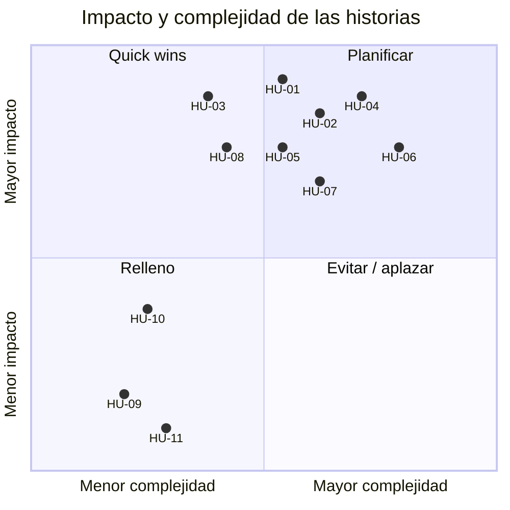

# Backlog: Tabbie Waiter App (MVP)

> Historias de usuario del MVP, cortadas a partir de las épicas E1 a E7 del [PRD](../prd/tabbie-waiter-mvp.md). La base es el PRD y el [documento de contexto](../context/panel-mozos-actual.md).

## Cómo se lee el backlog

- **Usuario:** todas las historias son del mozo. No hay historias del comensal, del simulador ni técnicas: el walking skeleton y la infraestructura quedan fuera de este backlog.
- **Una historia** es un objetivo concreto del mozo que entra en 1 o 2 días de trabajo y en una sola sesión de un agente.
- **Archivos:** cada historia está en `historias/HU-NN-<titulo-corto>.md`. El ID (`HU-01`…) ordena primero las Must y después las Should, siguiendo el recorrido del turno.
- **Cobertura:** cada RF del PRD pertenece a exactamente una historia (ver la tabla de cobertura).
- **Prioridad:** la historia hereda la prioridad de sus RF. Ninguna historia mezcla RF Must y Should.
- **RNF y reglas que la condicionan:** los RNF no son historias. Cada historia lista los que la condicionan, y también RF-9, que vale para todas las pantallas que muestran datos de comensales.
- **Complejidad:**
  - **S:** una acción o una vista acotada, sin cobros ni comportamiento entre tablets.
  - **M:** varias reglas de negocio, o acciones que cambian datos (RNF-6, RNF-9).
  - **L:** combina avisos en tiempo real, comportamiento entre tablets y más de una lista. Está en el límite de Small.
- **INVEST:** cada historia tiene su tabla con los 6 criterios. "Independiente" se evalúa respecto de las demás historias sin contar HU-01, porque todas necesitan una sesión iniciada.
- **Criterios de aceptación:** cada historia tiene primero los de su camino feliz (`HU-NN.cN`) y después los huecos aceptados (`HU-NN.hN`), con la evidencia entre paréntesis (ID de capacidad, observación, RF, RNF o decisión del README). Al final lista los huecos descartados.
- **Estimación:** complejidad relativa en la escala 1, 2, 3, 5, 8, 13, no horas ni días. Son las estimaciones de la IA, aceptadas por el humano sin planning poker. No cuentan los avisos en tiempo real, la reconexión ni la recuperación después de un corte, porque los deja el walking skeleton. Ninguna historia quedó en 13, así que no se partió ninguna.
- **Impacto:** alto, medio o bajo, según cuánto aporta la historia a operar el turno completo (M-1) y a cobrar sin errores (M-2 y M-3). Lo asignó la IA y lo aceptó el humano.
  - **Alto:** todas las Must, porque M-1 pide todos los RF Must. HU-04, HU-05, HU-07 y HU-08 además cuentan para M-2 y M-3.
  - **Medio:** HU-10, porque el simulador pide ayuda durante el turno y, sin "Atendido", el aviso queda encendido hasta el cierre de la mesa.
  - **Bajo:** HU-09 y HU-11, que no cuentan para ninguna métrica.

## Épicas e historias

| Épica | Prioridad de la épica | Historias |
|---|---|---|
| E1. Acceso del mozo | Must | [HU-01](historias/HU-01-iniciar-sesion.md) Iniciar sesión y mantenerla todo el turno (Must) [HU-09](historias/HU-09-cerrar-sesion.md) Cerrar sesión al terminar el turno (Should) |
| E2. Vista del salón en tiempo real | Must | [HU-02](historias/HU-02-mesas-activas.md) Ver las mesas activas y sus pedidos [HU-03](historias/HU-03-aviso-pedido-confirmado.md) Enterarme de cada pedido confirmado |
| E3. Gestión de pedidos | Must | [HU-04](historias/HU-04-cocina-y-cancelacion.md) Mandar a cocina y cancelar pedidos |
| E4. Pedidos de ayuda | Should | [HU-10](historias/HU-10-pedido-de-ayuda-atendido.md) Dar por atendido un pedido de ayuda |
| E5. Cobros | Must | [HU-05](historias/HU-05-cobro-manual.md) Registrar un cobro manual [HU-06](historias/HU-06-solicitudes-y-cobros.md) Ver las solicitudes y los cobros de cada mesa [HU-07](historias/HU-07-confirmar-o-eliminar-solicitud.md) Confirmar o eliminar una solicitud de cobro |
| E6. Cierre de mesa | Must | [HU-08](historias/HU-08-cerrar-mesa.md) Cerrar una mesa |
| E7. Impresora virtual de comandas | Should | [HU-11](historias/HU-11-impresora-virtual.md) Consultar la impresora virtual |

| ID | Historia | Épica | Prioridad | Complejidad | Estimación | Impacto |
|---|---|---|---|---|---|---|
| HU-01 | Iniciar sesión y mantenerla todo el turno | E1 | Must | M | 5 | Alto |
| HU-02 | Ver las mesas activas y sus pedidos | E2 | Must | M | 5 | Alto |
| HU-03 | Enterarme de cada pedido confirmado | E2 | Must | M | 3 | Alto |
| HU-04 | Mandar a cocina y cancelar pedidos | E3 | Must | M | 8 | Alto |
| HU-05 | Registrar un cobro manual | E5 | Must | M | 5 | Alto |
| HU-06 | Ver las solicitudes y los cobros de cada mesa | E5 | Must | L | 8 | Alto |
| HU-07 | Confirmar o eliminar una solicitud de cobro | E5 | Must | M | 5 | Alto |
| HU-08 | Cerrar una mesa | E6 | Must | S | 3 | Alto |
| HU-09 | Cerrar sesión al terminar el turno | E1 | Should | S | 2 | Bajo |
| HU-10 | Dar por atendido un pedido de ayuda | E4 | Should | S | 2 | Medio |
| HU-11 | Consultar la impresora virtual | E7 | Should | S | 2 | Bajo |

**Puntos:** 48 en total, 42 Must y 6 Should.

**Cantidad:** 8 historias Must y 3 Should. Supera la meta inicial (3 a 5 Must y 1 o 2 Should), por estos motivos:

- **Must:** ningún RF Must puede pasar al no-alcance, porque sin ellos no se reemplaza el panel web. Agruparlos más daría historias L o mayores que no entran en una sola sesión de un agente.
- **Should:** cada épica Should da una historia, y las tres son S.

## Matriz impacto/complejidad

- **Complejidad (eje horizontal):** sale de la estimación. Cada valor de la escala ocupa una franja del mismo ancho: 1, 2 y 3 quedan a la izquierda, y 5, 8 y 13 a la derecha.
- **Impacto (eje vertical):** el alto queda en la mitad superior; el medio y el bajo, en la inferior, con el medio más arriba.
- **Posición:** dentro de cada franja los puntos se separan solo para que se lean las etiquetas.
- **Resultado:**
  - **Quick wins:** HU-03 y HU-08.
  - **Planificar:** HU-01, HU-02, HU-04, HU-05, HU-06 y HU-07.
  - **Relleno:** HU-09, HU-10 y HU-11.
  - **Evitar / aplazar:** ninguna.

## Orden del backlog

Después del walking skeleton, las historias se hacen en este orden. Todas dependen de HU-01; la columna "Depende de" muestra las demás dependencias, tomadas de la columna Independiente de cada tabla INVEST.

| # | Historia | Grupo | Cuadrante | Puntos | Depende de |
|---|---|---|---|---|---|
| 1 | HU-01 Iniciar sesión y mantenerla todo el turno | Flujo principal | Planificar | 5 | — |
| 2 | HU-02 Ver las mesas activas y sus pedidos | Flujo principal | Planificar | 5 | — |
| 3 | HU-04 Mandar a cocina y cancelar pedidos | Flujo principal | Planificar | 8 | HU-02 |
| 4 | HU-03 Enterarme de cada pedido confirmado | Flujo principal | Quick wins | 3 | HU-02 y HU-04 |
| 5 | HU-06 Ver las solicitudes y los cobros de cada mesa | Flujo principal | Planificar | 8 | HU-02 |
| 6 | HU-08 Cerrar una mesa | Flujo principal | Quick wins | 3 | HU-02 y HU-06 |
| 7 | HU-07 Confirmar o eliminar una solicitud de cobro | Flujo principal | Planificar | 5 | HU-06 |
| 8 | HU-05 Registrar un cobro manual | Resto de las Must | Planificar | 5 | HU-02 y HU-06 |
| 9 | HU-10 Dar por atendido un pedido de ayuda | Should | Relleno | 2 | HU-02 y HU-06 |
| 10 | HU-09 Cerrar sesión al terminar el turno | Should | Relleno | 2 | HU-10 |
| 11 | HU-11 Consultar la impresora virtual | Should | Relleno | 2 | HU-02 |

- **Flujo principal:** el comensal confirma un pedido y el mozo lo ve (HU-02 y HU-03), lo manda a cocina (HU-04), cobra la solicitud del comensal (HU-06 y HU-07) y cierra la mesa (HU-08). HU-01 va primero porque todas necesitan la sesión.
  - **Cobro del flujo:** es la confirmación de la solicitud de cobro (HU-07), porque es el cobro en persona habitual.
- **Resto de las Must:** HU-05, el cobro manual sin solicitud.
- **Should:** las tres son relleno. HU-10 va primero porque tiene más impacto, y HU-09 va después porque depende de HU-10.
- **Quick wins primero:** dentro de cada grupo, un quick win va en cuanto sus dependencias están hechas.
- **Donde las dependencias cambian el orden del flujo:**
  - HU-03 es quick win y corresponde al primer paso del flujo, pero va después de HU-04, porque HU-03.h5 necesita los envíos y las cancelaciones.
  - HU-08 es quick win, pero va después de HU-06, porque su botón está en "Pagos".
  - HU-04.h7 necesita un cobro. Como HU-05 llega después, se prueba con un cobro del comensal.

## Cobertura RF → historia

| RF | Requisito (resumen) | Prioridad | Historia |
|---|---|---|---|
| RF-1 | Iniciar sesión con email y contraseña | Must | HU-01 |
| RF-2 | Rechazar a los usuarios que no son mozos | Must | HU-01 |
| RF-3 | Renovar la sesión antes de que venza | Must | HU-01 |
| RF-4 | Cerrar sesión, manteniendo las marcas de "Atendido" | Should | HU-09 |
| RF-5 | Mostrar solo las mesas ocupadas | Must | HU-02 |
| RF-6 | Pedidos por categoría en "Pendientes" e "Ingresadas" | Must | HU-02 |
| RF-7 | Comensales, total, lo pagado, tiempo de ocupación y pedido de ayuda de cada mesa | Must | HU-02 |
| RF-8 | Cronómetro de demora con los umbrales del restaurante | Must | HU-02 |
| RF-9 | Ninguna pantalla muestra datos sensibles | Must | HU-02 |
| RF-10 | Aviso con la mesa al confirmarse un pedido | Must | HU-03 |
| RF-11 | El aviso usa la hora de confirmación del pedido | Must | HU-03 |
| RF-12 | Un aviso ilegible no se muestra y se actualizan las mesas | Must | HU-03 |
| RF-13 | Mandar a cocina los pedidos confirmados de una mesa | Must | HU-04 |
| RF-14 | Cancelar uno o más pedidos de una mesa | Must | HU-04 |
| RF-15 | No cancelar pedidos con algo cobrado | Must | HU-04 |
| RF-16 | "Atendido", en "Órdenes" o en "Pagos", oculta el aviso de ayuda solo en esa tablet | Should | HU-10 |
| RF-17 | El cobro manual propone el saldo y permite propina | Must | HU-05 |
| RF-18 | El cobro manual no supera el saldo pendiente | Must | HU-05 |
| RF-19 | El cobro manual queda como efectivo y sin comensal | Must | HU-05 |
| RF-20 | Solicitudes de cobro presencial agrupadas por mesa | Must | HU-06 |
| RF-21 | Indicador de solicitudes, sin contar MercadoPago | Must | HU-06 |
| RF-22 | Una solicitud eliminada o resuelta deja de verse, también en otras tablets | Must | HU-06 |
| RF-23 | Cobros registrados y solicitudes pendientes de cada mesa | Must | HU-06 |
| RF-24 | Confirmar una solicitud de cobro presencial | Must | HU-07 |
| RF-25 | Solicitud sin comensal: no se confirma y se explica cómo cobrarla | Must | HU-07 |
| RF-26 | Eliminar una solicitud de cobro | Must | HU-07 |
| RF-27 | Cerrar solo mesas activas | Must | HU-08 |
| RF-28 | Confirmación al cerrar y advertencia de saldo pendiente | Must | HU-08 |
| RF-29 | El cierre no se repite mientras está en curso | Must | HU-08 |
| RF-30 | La impresora lista los pedidos confirmados sin mandar a cocina | Should | HU-11 |
| RF-31 | La impresora no cambia datos | Should | HU-11 |
| RF-32 | Se llega a la impresora desde una pantalla de la app | Should | HU-11 |

## Decisiones del backlog

### Navegación principal y ubicación de las acciones (RF-21, RF-32)

Igual que en el panel actual:

- **Navegación principal:** tiene "Órdenes", "Pagos" y la impresora virtual, y se ve desde cualquier pantalla de la operación.
- **"Órdenes":** muestra las mesas activas con sus pedidos (HU-02). "Registrar cobro" está en la tarjeta de cada mesa (HU-05).
- **"Pagos":** muestra las solicitudes y los cobros de cada mesa activa (HU-06). "Cerrar mesa" está al pie de los cobros de cada mesa, donde se ve lo pagado antes de cerrar (HU-08).
- **Indicador de solicitudes (RF-21):** va sobre "Pagos" en la navegación principal.
- **Impresora virtual (RF-32):** tiene un acceso fijo en la navegación principal, al mismo nivel que "Órdenes" y "Pagos".
  - **Motivo:** es una vista de todo el restaurante, no de una mesa. Así el mozo llega con un toque, sin pasar por una mesa.

### Cronómetro de demora y tiempo de ocupación (RF-7, RF-8)

Igual que en el panel actual:

- **Cronómetro de demora (RF-8):** cuenta desde el pedido confirmado más antiguo de la mesa, incluidos los que ya están en "Ingresadas", y deja de mostrarse cuando la mesa queda saldada.
- **Tiempo de ocupación (RF-7):** cada mesa muestra además cuánto tiempo lleva ocupada, en el encabezado de su tarjeta.

### Comportamientos entre tablets (RF-16, RF-22, RF-26)

- **Montaje:** dos dispositivos con el perfil de tablet de RNF-10, que pueden ser una tablet física y un emulador, o dos emuladores.
  - En cada uno hay una sesión de un mozo distinto del mismo restaurante.
  - El simulador de comensales genera los pedidos de ayuda y las solicitudes de cobro.
- **Cuentas:** los datos iniciales de la réplica traen dos restaurantes, así cualquiera, incluido el evaluador, repite las pruebas sin preparar nada. Las credenciales de prueba se documentan en el `Readme.md`.
  - El primero tiene dos mozos, mesas y menú, para las pruebas con dos tablets.
  - El segundo tiene un mozo, mesas y menú, para probar el aislamiento por restaurante (RNF-7): HU-01.h6, HU-02.h7 y HU-03.h7.
- **Criterio:** las historias afectadas (HU-06, HU-07 y HU-10) tienen un criterio "con dos tablets". La acción se hace en la tablet A y se verifica en la tablet B, con el límite de 30 segundos de RNF-2.
  - En RF-16 se esperan esos 30 segundos para confirmar que la tablet B **sigue** mostrando el aviso.
  - HU-08.h4 (una mesa que ya se cerró en otra tablet) también se prueba con este montaje.
- **Prueba:** es manual, con una captura de las dos pantallas como evidencia.
- **Motivo:** inicialmente hay una sola tablet por restaurante (PRD, sección 9), así que en el salón no se puede observar este comportamiento. Un emulador alcanza, porque se verifica lo que muestra cada app y no el hardware.

### Tamaño y resolución de la tablet (RNF-10)

- **Referencia:** tablet de 10,1" a 1920×1200 (16:10), en orientación horizontal.
- **Mínimo:** tablet de 8" a 1280×800, en horizontal. En ese tamaño todas las pantallas se ven completas, sin desplazamiento horizontal.
- **Supuesto:** se supone que es el tamaño habitual de las tablets que entrega un restaurante; se confirma cuando haya un modelo definido.

### Solicitud que no identifica al comensal (RF-25)

Toda solicitud de cobro tiene un comensal. Una llega sin comensal identificado solo por un defecto de la app del comensal, y confirmarla deja lo pagado escrito aunque falle (problema 2 del PRD). Por eso la regla es:

- **Regla:** la app no confirma la solicitud. Le explica al mozo que registre el monto como cobro manual (RF-17) y que después elimine la solicitud (RF-26).
- **Acciones:** el mozo usa el cobro manual de HU-05 y la eliminación de HU-07, cada una con su comportamiento normal.
- **Historia:** la regla pertenece a HU-07 (HU-07.h5).

### Reglas para el corte

- **Tiempo real e infraestructura:** el walking skeleton deja resueltos el canal de avisos en tiempo real, la reconexión, el aviso de que no hay conexión, la recuperación después de un corte (RNF-4) y la actualización periódica de mesas y solicitudes. Las historias usan esa base y no la construyen.
- **Solicitudes eliminadas en otras tablets:**
  - HU-06 (RF-22) se encarga de lo que se ve en la otra tablet cuando una solicitud se elimina o se resuelve, sea cual sea la causa.
  - HU-07 (RF-26) se encarga de la acción de eliminar, y verifica solo la tablet donde se elimina.
- **Datos sensibles (RF-9):** pertenece a HU-02 para la cobertura, y también figura como regla que condiciona a HU-06 y HU-07, porque muestran datos de comensales.

## Riesgos aceptados

### Dos tablets que actúan casi al mismo tiempo

- **Qué controla la app:** antes de actuar, actualiza el estado que la acción necesita: la solicitud, el saldo, los cobros del pedido o la mesa. Si la acción ya no corresponde, avisa y no actúa.
- **Qué no controla el backend:** confirmar una solicitud no revisa que siga existiendo, y el cobro manual solo se controla contra el total de la mesa, no contra el saldo.
- **Riesgo:** entre esa revisión y la acción queda un margen. Si otra tablet actúa en ese margen, el resultado puede ser un cobro duplicado, un cobro manual que supera el saldo, un pedido cancelado que acaba de recibir un cobro o una mesa que se cierra dos veces.
- **Historias afectadas:** HU-04 (HU-04.h7), HU-05 (HU-05.h1 y HU-05.h8), HU-07 (HU-07.h2) y HU-08 (HU-08.h4).
- **Por qué se acepta:** el backend no se modifica, e inicialmente hay una sola tablet por restaurante (PRD, sección 9).
- **Dónde se documenta:** en la arquitectura, en las prácticas de seguridad.

## Requisitos de prueba

Algunas pruebas necesitan cosas que todavía no existen. Se definen en la estrategia de tests y en la réplica.

| Requisito | Historias que lo usan |
|---|---|
| Datos iniciales con dos restaurantes, y dos mozos en el primero (decisión sobre los comportamientos entre tablets) | Dos restaurantes: HU-01, HU-02 y HU-03 (RNF-7). Dos mozos: HU-03, HU-06, HU-07, HU-08, HU-09, HU-10 y HU-11. |
| Un vencimiento corto, configurable, de la sesión y de las solicitudes de cobro | Sesión: HU-01 y HU-10. Solicitudes: HU-06. |
| Una forma de provocar fallos parciales al mandar a cocina y al cancelar | HU-04. |
| Una forma de crear una solicitud sin comensal identificado (RF-25), desde el simulador | HU-06 y HU-07. |
| El montaje de dos tablets (decisión sobre los comportamientos entre tablets) | HU-03, HU-06, HU-07, HU-08, HU-10 y HU-11. |
