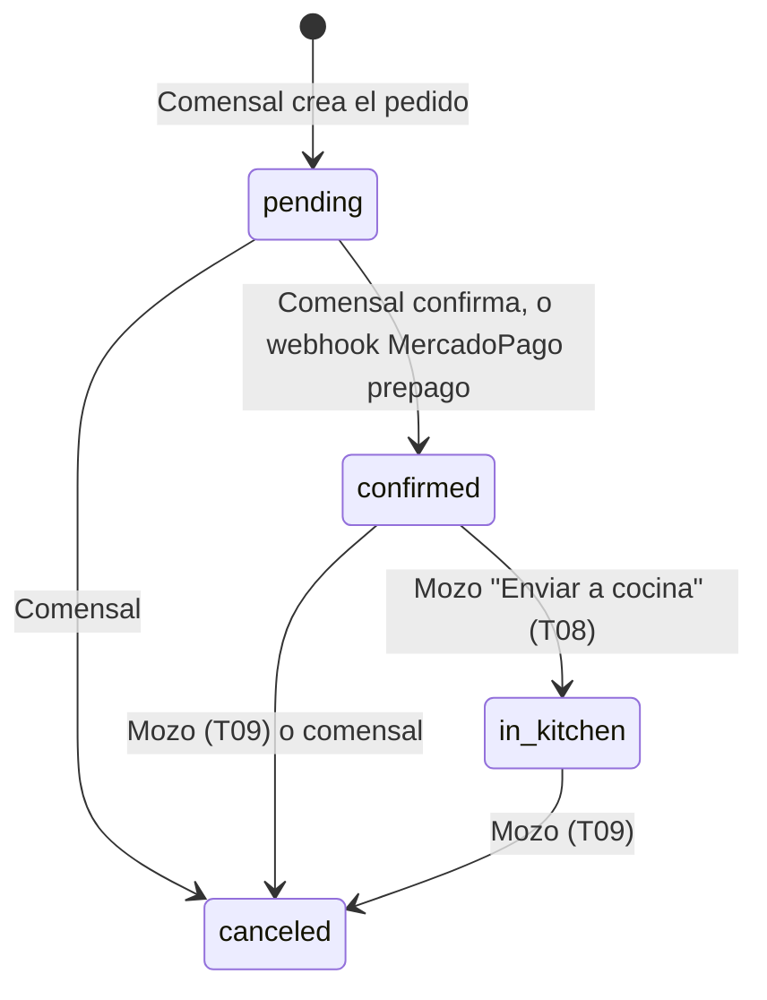
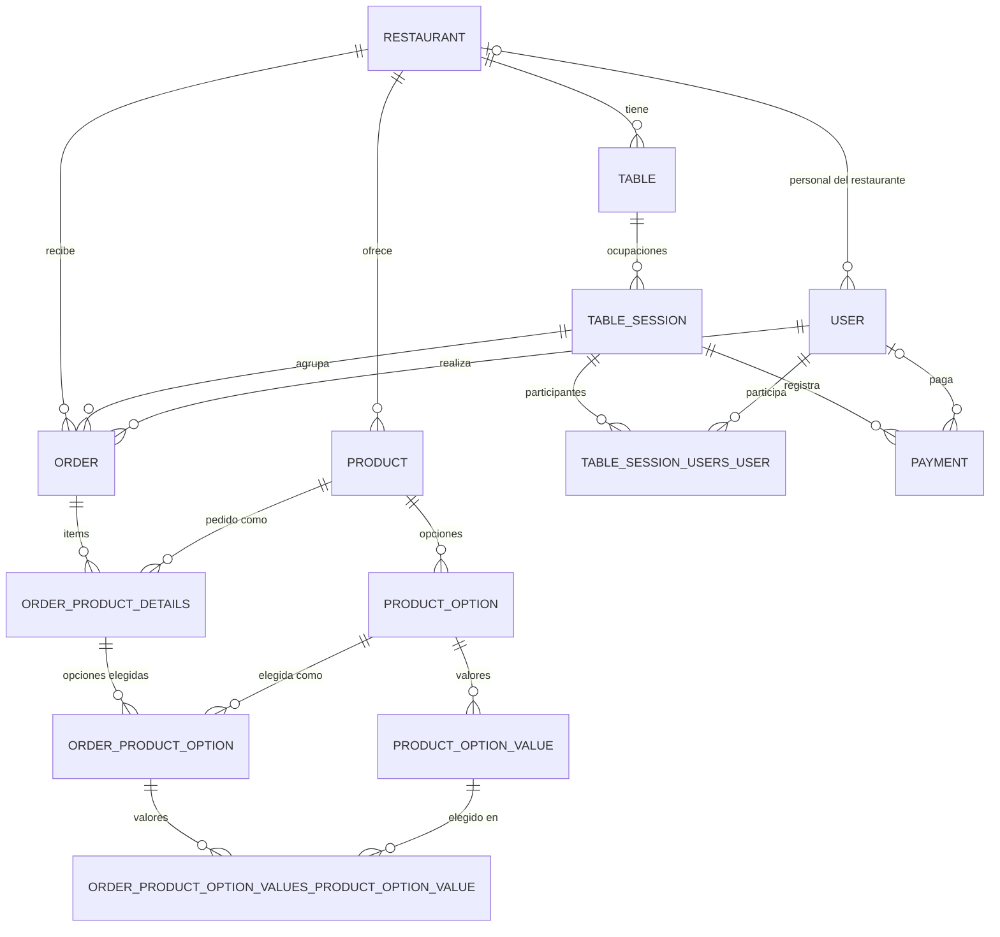

# Panel de mozos actual: documento de contexto

> Este documento describe el **sistema actual**: qué hace el mozo en el panel web y qué endpoints, eventos, entidades y almacenamiento usa ese panel. También registra cómo la **Tabbie Waiter App** usa ese mismo backend, que **no se modifica**.
>
> No es una especificación ni un PRD.

## 0. Alcance, fuentes y convenciones

**Fuentes:**

- App web (front): `C:\Repos\Tabbie\order-pay-end-user-app\order-pay-end-user-app\`, rama `main`, commit `5b3bee9` (2026-06-23).
- Backend (back): `C:\Repos\Tabbie\order-pay-backend\order-pay-backend\src\`, rama `main`, commit `c18b0f7` (2026-07-22).
- `C:\Repos\Tabbie\Documentación\Documentación teórica\Arquitectura.pdf`.

**Contexto operativo** (fuente: equipo de Tabbie):

- Lo desplegado es la rama `main` de los repositorios.
- El backend corre en una sola instancia en Railway.
- El código del backend es la fuente de verdad. `Arquitectura.pdf` describe una infraestructura anterior en AWS y no está actualizado. En particular, difiere del backend en tres puntos:
  - **Escalado:** el PDF habla de autoescalado de 1 a 3 tareas; hoy hay una sola instancia.
  - **SSE:** el PDF describe Redis Pub/Sub; el backend usa `Subject` en memoria.
  - **Tokens:** el PDF dice que en cada request se valida el JWT de Firebase con Firebase Admin. En el backend, Firebase Admin solo se usa en `POST /auth/login`, y las demás rutas validan un JWT propio.
- El panel lo usa solo el rol `waiter`, y todo usuario `waiter` se crea con un restaurante asignado.
- Para el sistema, los métodos de pago `POS` y `Cash` son equivalentes. Solo le informan al mozo cómo va a pagar el cliente.

**Puntos de entrada trazados:**

- `app/(with-header)/restaurants/[restaurantId]/waiter-panel/` (panel de mozos);
- `app/(with-header)/restaurants/[restaurantId]/virtual-ticket-printer/` (impresora virtual de tickets);
- `app/(without-header)/login/` (login).

También se trazaron sus layouts y providers: `app/(with-header)/layout.tsx`, `app/(without-header)/layout.tsx`, `app/(with-header)/restaurants/[restaurantId]/layout.tsx`, `components/auth-wrapper.tsx`, `components/shared/header.tsx`, `components/shared/footer.tsx`, `contexts/auth-context.tsx` y `contexts/restaurant-sse-provider.tsx`.

No hay `app/layout.tsx` raíz, `middleware.ts`, route handlers ni server actions. Todas las llamadas salen del navegador directamente al backend.

**Regla de alcance:** solo entra lo que aparece en la cadena *punto de entrada → llamada HTTP o SSE → controlador → servicio → entidades*. Los endpoints que **emiten** un evento que el panel escucha se nombran para explicar el origen del evento. Sus tablas no se suman al inventario, porque el mozo no los invoca.

**Abreviaturas de rutas:**

| Abreviatura | Ruta real |
|---|---|
| `FE/` | `order-pay-end-user-app/order-pay-end-user-app/` |
| `wp/` | `FE/app/(with-header)/restaurants/[restaurantId]/waiter-panel/` |
| `wpc/` | `wp/waiter-panel-components/` |
| `vtp/` | `FE/app/(with-header)/restaurants/[restaurantId]/virtual-ticket-printer/` |
| `login/` | `FE/app/(without-header)/login/` |
| `BE/` | `order-pay-backend/order-pay-backend/src/` |

**Convenciones del backend:**

- **Prefijo y guards.** No hay prefijo global de rutas ni guards globales (`BE/main.ts`, `BE/app.module.ts`).
- **`JwtAuthGuard`** (`BE/guards/auth/jwt-auth.guard.ts`) usa `JwtStrategy` (`BE/guards/auth/jwt.strategy.ts`).
  - Toma el JWT del header `Authorization: Bearer` o del query param `?token=`.
  - Con un token de usuario registrado lee `user` con su relación `restaurant` (eager). Por eso **toda fila con `JwtAuthGuard` lee `user` y `restaurant`**.
- **`RolesGuard`** (`BE/guards/roles/roles.guard.ts`) solo actúa si figura en `@UseGuards`. Un `@Roles(...)` sin `RolesGuard` no restringe.
- **Roles** (`BE/users/user-role.ts`): `user`, `admin`, `waiter`, `backoffice`. Los invitados tienen rol `user`.
- **Validación:** `ValidationPipe` usa las opciones por defecto (`BE/main.ts:39`): no transforma tipos, y los bodies tipados como objeto literal o interfaz no se validan.
- **Relaciones eager:** `User.restaurant`, `Order.items`, `OrderProductDetails.product`, `OrderProductDetails.selectedOptions`, `OrderProductOption.productOption` y `OrderProductOption.values`.
- **"Árbol de ítems"** abrevia las tablas `order_product_details`, `product`, `order_product_option`, `product_option`, `order_product_option_values_product_option_value` y `product_option_value`.

## 1. Capacidades del mozo

Cada capacidad describe cómo funciona hoy, cómo la resuelve la Waiter App, el rol, el archivo de origen y sus filas de la tabla de trazabilidad (sección 2).

**Rol:** todas las capacidades las usa el rol `waiter`.

- El `Guard` del panel actual también admite `admin` y `backoffice` (`wp/page.tsx:14`).
- La Waiter App admite **solo** `user.role === "waiter"`.
- Con cualquier otro rol, la Waiter App muestra un mensaje, cierra la sesión de Firebase y descarta el JWT.
- La Waiter App toma un único `restaurantId`, el `user.restaurantId` que devuelve `POST /auth/login`, y lo usa en todas las llamadas.
  - El panel actual mezcla ese valor con el `restaurantId` de la URL (`wp/hooks/use-order-notifications.ts:66-70`, `wp/hooks/use-active-tables.ts`).
- La Waiter App usa una única URL base del backend, configurada por ambiente, para HTTP y SSE.
  - El panel actual tiene valores por defecto distintos: `:3000` en `FE/components/auth-wrapper.tsx:146` y `login/page.tsx:140`, y `:3001` en `FE/lib/api-client.ts:4`.
- La Waiter App **no reintenta automáticamente** acciones que escriben datos:
  - acciones afectadas: `/pay`, `/add-payment`, `/cancel`, `/send-to-kitchen`, `close`;
  - ante un error o un timeout, vuelve a consultar las mesas (T05) y las solicitudes (T06) antes de permitir otro intento.
  - El panel actual reintenta una vez toda mutación fallida (`FE/lib/query-client.ts:11-13`, con timeout de 10 s en `FE/lib/api-client.ts`). En `/pay` y `/add-payment`, que no son idempotentes, eso puede registrar un pago dos veces.

### C1. Iniciar sesión

**Hoy:**

- **Login:** el usuario se autentica en Firebase con email y contraseña o con Google, y canjea el ID token por un JWT propio del backend (`POST /auth/login`).
- **Redirección:** si el rol es `waiter`, va a `/restaurants/{restaurantId}/waiter-panel`. Los demás roles van a `returnTo` o a `/restaurants/1` (`login/page.tsx:51-68`).
- **JWT:** el de un `waiter` dura `JWT_EXPIRATION_WAITERS` (16 h por defecto), y no hay endpoint de refresh (`BE/auth/auth.service.ts:20-25`). Ante un 401, el panel redirige al login (`FE/lib/api-client.ts:33-59`).
- **Almacenamiento del token:**
  - El store guarda el JWT del backend en un campo llamado `firebaseToken`.
  - Si ese campo está vacío, `getValidToken` envía un ID token de Firebase, que `JwtStrategy` rechaza (`FE/utils/auth.ts:84-112`, `login/hooks/use-auth.ts:17`).

**Waiter App:**

- Ofrece login con email y contraseña o con Google; en ambos casos el ID token incluye `email`.
- Envía siempre el JWT del backend.
- Usa el ID token de Firebase solo como body de `POST /auth/login`.
- **Renovación del JWT:** antes de que venza (según el `exp` del token) o ante un 401, pide un ID token nuevo a Firebase (`getIdToken`) y vuelve a llamar a `POST /auth/login`. Si falla, envía al mozo al login.

**Origen:** `login/page.tsx`, `login/hooks/use-auth.ts`, `FE/utils/auth.ts`, `BE/auth/auth.service.ts`.

**Filas:** T01, T19.

### C2. Continuar como invitado

**Hoy:**

- La pantalla de login permite obtener un JWT de invitado.
- `AuthWrapper` reautentica a un invitado en silencio en rutas no públicas.
- El `Guard` del panel rechaza a los invitados.

**Waiter App:** no ofrece acceso de invitado.

**Origen:** `login/page.tsx` (`handleContinueAsGuest`), `FE/components/auth-wrapper.tsx`.

**Filas:** T02, T03.

### C3. Ver las mesas activas con sus pedidos

**Hoy:**

- **Vista:** el panel muestra las mesas ocupadas, con los pedidos agrupados por categoría y por estado:
  - pestaña "Pendientes" = `confirmed`;
  - pestaña "Ingresadas" = `in_kitchen`.
- **Datos de cada mesa:** usuarios de la sesión, total, monto pagado y el pedido de ayuda.
- **Cronómetro:** cuenta desde el `confirmedAt` más antiguo de la mesa. Usa los umbrales del restaurante `yellowTicketSeconds`, `redTicketSeconds` y `redPulseTicketSeconds` (300, 420 y 600 s por defecto).
- **Filtrado en el back:** descarta los pedidos `pending` y mantiene los `canceled` (`BE/restaurants/restaurants.service.ts:92-143`).
- **Chequeo de restaurante:** rechaza solo si el usuario tiene un restaurante distinto del pedido (`BE/restaurants/restaurants.controller.ts:81-89`). Como todo `waiter` tiene restaurante, para ese rol el chequeo siempre aplica.

**Waiter App:**

- Obtiene los mismos datos de T05.
- No persiste las respuestas en el dispositivo.
- No muestra los campos sensibles que trae la respuesta (ver O4).

**Origen:** `wp/page.tsx`, `wpc/active-sessions-tab.tsx`, `wp/hooks/use-active-tables.ts`, `wpc/table-orders-card/table-orders-card.tsx`, `wpc/table-orders-card/use-elapsed-time.ts`.

**Filas:** T05, T16.

### C4. Recibir aviso de pedido confirmado

**Hoy:**

- El panel muestra el toast "Nuevo pedido en en la mesa N ✓" e invalida la consulta de mesas activas.
- **Payload del evento:** `data` es `{"body":"<JSON en string>"}`, y el contenido es `{orderId, tableNumber, tableSessionId, restaurantId, confirmedAt}` (`BE/orders/order.service.ts:517-532`).
- El panel lo parsea con un doble `JSON.parse` sin `try/catch` y espera `createdAt` en lugar de `confirmedAt` (`wp/hooks/use-order-notifications.ts:8-14`, `:59-61`).

**Waiter App:**

- Parsea `data` y después `data.body`, con manejo de errores, y usa `confirmedAt`.
- Ante un payload inválido, ignora el evento y refresca T05.

**Origen:** `wp/hooks/use-order-notifications.ts`.

**Filas:** T16.

### C5. Enviar a cocina los pedidos confirmados de una mesa

**Hoy:**

- El botón "Enviar a cocina" de la pestaña "Pendientes" manda un PUT por cada pedido `confirmed` de la mesa, con actualización optimista.
- Como body envía el objeto de configuración de axios (`wp/hooks/use-order-actions.ts:25-27`); el handler no lee body.
- El back también acepta `pending` → `in_kitchen` y en ese caso no recalcula `table_session.total` (`BE/orders/order.service.ts:537-589`). El panel solo envía pedidos `confirmed`.

**Waiter App:** `PUT /orders/:id/send-to-kitchen` sin body, solo para pedidos `confirmed`.

**Origen:** `wpc/table-orders-card/table-actions.tsx`, `wp/hooks/use-order-actions.ts`.

**Filas:** T08.

### C6. Cancelar pedidos de una mesa

**Hoy:**

- Desde el diálogo de edición se seleccionan pedidos y se cancelan ("Eliminar").
- **Motivo de cancelación:**
  - El panel envía `{body:{reason}}`, así que `reason` llega indefinido (`wpc/edit-table-dialog.tsx:68-70`).
  - El back guarda `reason || cancelReason`; para roles distintos de `user`, `cancelReason` es "El restaurante ha cancelado el pedido" (`BE/orders/order.service.ts:372-377`, `:430`).
- **Estados:** el mozo puede cancelar en cualquier estado excepto `canceled`.
- **Pagos:** al cancelar, el back no revierte `isPaid`, `quantityPaid` ni `amountPaid`. Recalcula `total` sin ese pedido, sin `await` (`BE/orders/order.service.ts:428-439`).

**Waiter App:**

- Envía `{"reason":"Cancelada por el restaurante"}` en la raíz del body, y el back lo guarda en `cancellationReason`.
- **Bloquea** la cancelación de pedidos con `isPaid = true` o con algún ítem con `quantityPaid > 0`, y explica el motivo.

**Origen:** `wpc/table-orders-card/table-header.tsx`, `wpc/edit-table-dialog.tsx`.

**Filas:** T09.

### C7. Marcar como atendido un pedido de ayuda

**Hoy:** cuando la sesión tiene `requestingHelp`, el panel muestra un banner con el botón "Atendido", que llama a `PUT /table-sessions/:id/attend`. Ese endpoint siempre falla (ver O1).

**Waiter App:**

- No llama a `/attend`.
- "Atendido" se registra **localmente en el dispositivo**, por sesión de mesa, y oculta el aviso en ese dispositivo hasta que se cierra la mesa.
- Los demás dispositivos siguen mostrando el aviso.

**Origen:** `wpc/table-orders-card/help-request-banner.tsx`, `wpc/table-orders-card/table-orders-card.tsx:68-73`.

**Filas:** T10.

### C8. Registrar un pago manual de una mesa

**Hoy:**

- **Diálogo:** "Registrar pago" propone el monto pendiente (`total - amountPaid`), permite agregar propina y envía `{amount, noTipAmount}`.
- **Validación en el back:** rechaza montos que superan el total.
- **Pago guardado:** `method = 'cash'` (en minúsculas) y sin `userId`.
- **Lo pagado y la propina:** el back suma a `table_session.amountPaid` solo el monto sin propina (`noTipAmount`). La propina (`amount - noTipAmount`) se acumula aparte en `table_session.tips`. `/pay` (C11) hace lo mismo (`BE/table-sessions/table-session.service.ts`, `addManualPayment` y `confirmPaymentRequest`).
- **Pedidos pagados:** se marcan como pagados solo cuando la mesa queda saldada (`BE/table-sessions/table-session.service.ts`, `addManualPayment`).

**Waiter App:** mismo comportamiento, sin reintentos automáticos.

**Origen:** `wpc/table-orders-card/table-actions.tsx`, `wpc/manual-payment-dialog.tsx`, `wp/hooks/use-manual-payment.ts`.

**Filas:** T11.

### C9. Ver solicitudes de pago presencial

**Hoy:**

- El panel recibe las solicitudes en tiempo real (T17) y por polling (T06). Muestra un badge con la cantidad de solicitudes que no son de MercadoPago y, en la vista "Pagos", las lista agrupadas por mesa.
- **Borrado con evento:** `DELETE /payments/in-person-requests/:id` emite `in-person-payment-request-deleted`, que el panel no escucha (`BE/payments/payment.controller.ts:244-261`).
- **Borrado sin evento:** `/pay`, `/add-payment` y el cierre de mesa borran solicitudes sin emitir ningún evento.

**Waiter App:**

- Escucha `in-person-payment-request-deleted` (`data: {requestId, restaurantId}`) y quita la solicitud de la lista.
- Después de cada acción propia, refresca T05 y T06.
- Los cambios que no emiten evento llegan por el polling de T06.

**Origen:** `wp/hooks/use-payment-notifications.ts`, `wp/hooks/use-in-person-payment-requests.ts`, `wpc/waiter-dashboard.tsx`, `wpc/payment-notifications-tab.tsx`.

**Filas:** T06, T17, T05.

### C10. Ver los pagos registrados de cada mesa

**Hoy:**

- En la vista "Pagos", el panel lista los pagos confirmados de la sesión junto con las solicitudes pendientes.
- Los pagos manuales vienen con `user: null`, y el panel los muestra como "Usuario desconocido".
- **Qué guarda cada pago:** la sesión de mesa (`sessionId`), el monto con propina (`amount`), la moneda (`currency`), el método (`method`), el comensal (`userId`, vacío en los pagos manuales), si fue prepago (`prepaid`) y la fecha (`createdAt`) (`BE/payments/payment.entity.ts`).

**Waiter App:**

- Muestra los pagos con `user` nulo como "Pago manual".
- Compara `method` sin distinguir mayúsculas.

**Origen:** `wp/hooks/use-session-payments.ts`, `wpc/table-payments-card/table-payment-card.tsx`.

**Filas:** T07.

### C11. Confirmar una solicitud de pago presencial

**Hoy:**

- **Botón:** "Confirmar Pago" llama a `POST /table-sessions/:id/pay`. Está deshabilitado para las solicitudes de MercadoPago.
- **Validación tardía:** el back escribe `amountPaid` y `tips` antes de validar `userId`. Si `Number(userId)` es `NaN`, responde 400 con los montos ya escritos (`BE/table-sessions/table-session.service.ts`, `confirmPaymentRequest`).
- **Origen del `userId` no numérico:** una solicitud trae `userId: "guest"` solo cuando la app del comensal no encuentra a su usuario en la sesión (`FE/app/(with-header)/restaurants/[restaurantId]/table/table.payment.ts:25-29`, `FE/utils/auth.ts:30-55`).

**Waiter App:**

- Antes de llamar a `/pay`, verifica que `userId` sea un número mayor que cero.
- **Si no lo es:**
  - no llama a `/pay`;
  - ofrece registrar el monto como pago manual (T11) y después eliminar la solicitud (T13);
  - en ese camino el pago queda sin usuario y con `method = 'cash'`.
- No reintenta automáticamente.

**Origen:** `wpc/table-payments-card/table-payments-item-card.tsx`, `wpc/confirm-payment-modal.tsx`, `wp/hooks/use-confirm-payment.ts`.

**Filas:** T12 (y T11, T13 en el camino alternativo).

### C12. Eliminar una solicitud de pago presencial

**Hoy:** ícono de papelera y confirmación. El back borra la clave en Redis y emite `in-person-payment-request-deleted`.

**Waiter App:** mismo comportamiento.

**Origen:** `wpc/table-payments-card/table-payments-item-card.tsx`, `wpc/table-payments-card/table-payments-delete-dialog.tsx`, `wp/hooks/use-delete-payment-request.ts`.

**Filas:** T13.

### C13. Cerrar una mesa

**Hoy:**

- El botón "Cerrar mesa" está en la vista "Pagos". El front advierte si hay saldo pendiente, pero no lo impide.
- El back no controla el saldo. Si se vuelve a cerrar una sesión ya cerrada, reescribe `closedAt` y libera la mesa aunque tenga otra sesión activa (`BE/table-sessions/table-session.service.ts:314-363`).

**Waiter App:**

- Con saldo pendiente, muestra la advertencia y pide confirmación.
- Solo ofrece cerrar sesiones que vienen en T05 (activas).
- Bloquea el botón mientras la petición está en curso y refresca T05 al terminar.

**Origen:** `wpc/table-payments-card/table-payments-footer.tsx`, `wpc/close-table-modal.tsx`, `wp/hooks/use-close-table.ts`.

**Filas:** T14.

### C14. Ver la impresora virtual de tickets

**Hoy:**

- **Contenido:** lista los pedidos `confirmed` del restaurante y abre el detalle de cada uno. No tiene acciones que escriban datos.
- **Fuente de datos:** T15 devuelve todo el historial de pedidos del restaurante, sin filtro ni paginación, cada 60 s. El front filtra los `confirmed`, así que siguen apareciendo pedidos `confirmed` de mesas ya cerradas que nunca pasaron a cocina (`BE/orders/order.service.ts:591-615`).
- **Acceso:** ninguna pantalla de la app web enlaza a esta ruta.
- **Guard:** admite `"back-office"`, que no coincide con el rol `backoffice` del back (`vtp/page.tsx:12`).

**Waiter App:**

- Incluye la impresora, solo para `waiter`.
- La arma con los pedidos `confirmed` de las mesas activas que ya trae T05.
- No usa T15.

**Origen:** `vtp/page.tsx`, `FE/components/virtual-ticket-printer.tsx`, `FE/app/(with-header)/restaurants/hooks/use-restaurant-orders.ts`, `FE/app/(with-header)/restaurants/api/api.ts`.

**Filas:** T15 (hoy), T05 (Waiter App).

### Llamadas incidentales de layout

**Hoy:** si en el navegador quedó una sesión de mesa de comensal (`localStorage["table-session"]`), los componentes compartidos hacen llamadas que el mozo no necesita:

- `Header` y `Footer` ejecutan `useOrders()` (T04).
- En la impresora virtual, `RestaurantSSEProvider` abre el stream de la sesión de mesa (T18).

**Waiter App:** no tiene layout ni estado de comensal, así que estas llamadas no existen.

**Origen:** `FE/components/shared/header.tsx:20`, `FE/components/shared/footer.tsx:39`, `FE/contexts/restaurant-sse-provider.tsx:32-36`, `FE/app/(with-header)/restaurants/[restaurantId]/orders/hooks/use-orders-sse.ts`.

## 2. Tabla de trazabilidad

Una fila por llamada o evento **del panel actual**. "J" = `JwtAuthGuard`, "R" = `RolesGuard`. Qué filas usa la Waiter App se indica en la sección 3.1.

| ID | Acción en pantalla | Archivo del front | Método + ruta / evento SSE | Controlador.método | Guards y roles | Entidades leídas | Entidades escritas |
|---|---|---|---|---|---|---|---|
| T01 | Login: "Continuar" (email) o "Continuar con Google", después de autenticarse en Firebase | `login/page.tsx`, `login/hooks/use-auth.ts` | `POST /auth/login`, body `{firebaseIdToken}` | `AuthController.login` → `AuthService.loginWithFirebaseToken` | Ninguno (público) | `user`, `restaurant` | `user` (INSERT solo en el primer login del email) |
| T02 | Login: "Continuar como invitado" | `login/page.tsx` (`fetch`) | `POST /auth/guest`, body `{guestId}` | `AuthController.loginAsGuest` → `AuthService.loginAsGuest` | Ninguno (público) | — (ver notas) | — (ver notas) |
| T03 | Reautenticación silenciosa de un invitado al montar una ruta no pública | `FE/components/auth-wrapper.tsx` (`fetch`) | `POST /auth/guest`, body `{guestId}` | `AuthController.loginAsGuest` | Ninguno (público) | — (ver notas) | — (ver notas) |
| T04 | Montaje de `Header` o `Footer` cuando hay una sesión de comensal en `localStorage` (incidental) | `FE/components/shared/header.tsx`, `FE/components/shared/footer.tsx`, `FE/app/(with-header)/restaurants/[restaurantId]/orders/hooks/use-list-orders.ts` | `GET /table-sessions/:tableSessionId/orders` | `TableSessionController.findAllBySession` → `OrderService.getAllOrdersFromSession` | Ninguno (público, ver O3) | `order`, `table_session`, `user`, `restaurant`, árbol de ítems | — |
| T05 | Montaje de las vistas "Órdenes" y "Pagos"; polling cada 30 s; refresco después de editar, pagar o cerrar | `wp/hooks/use-active-tables.ts` | `GET /restaurants/:id/tables/active` | `RestaurantsController.getActiveTables` → `RestaurantsService.findActiveTables` | J + R; `admin`, `backoffice`, `waiter` (+ chequeo de restaurante) | `user`, `restaurant`, `table`, `table_session`, `table_session_users_user`, `order`, árbol de ítems | — |
| T06 | Montaje del dashboard (badge) y de la vista "Pagos"; polling configurable | `wp/hooks/use-in-person-payment-requests.ts` | `GET /payments/in-person-requests` (rol `waiter`) | `PaymentController.getRestaurantPaymentRequests` → `InPersonRequestService.getAllRequests` | J; sin `RolesGuard` (el handler toma el restaurante del usuario) | `user`, `restaurant` (+ Redis, sección 3.3) | — |
| T07 | Vista "Pagos": polling cada 10 s por cada tarjeta de mesa | `wp/hooks/use-session-payments.ts`, `wpc/table-payments-card/table-payment-card.tsx` | `GET /table-sessions/:id/payments` | `TableSessionController.getPayments` → `TableSessionService.getSessionPayments` | J; `@Roles(admin, waiter, backoffice)` **sin** `RolesGuard` (ver O2) | `user`, `restaurant`, `payment` | — |
| T08 | Botón "Enviar a cocina": un PUT por pedido `confirmed` | `wpc/table-orders-card/table-actions.tsx`, `wp/hooks/use-order-actions.ts` | `PUT /orders/:id/send-to-kitchen` | `OrderController.sendToKitchen` → `OrderService.sendOrderToKitchen` | J + R; `admin`, `backoffice`, `waiter` (+ el pedido debe ser del restaurante del usuario) | `user`, `restaurant`, `order`, `table_session`, árbol de ítems | `order` (`status=in_kitchen`, `sentToKitchenAt`) |
| T09 | Diálogo de edición → "Eliminar" (un PUT por pedido seleccionado) | `wpc/table-orders-card/table-header.tsx`, `wpc/edit-table-dialog.tsx` | `PUT /orders/:id/cancel`, body con `reason` | `OrderController.cancelOrder` → `OrderService.cancelOrder` → `TableSessionService.calculateSessionAmountById` | J; sin `@Roles` (el rol se evalúa en el servicio) | `user`, `restaurant`, `order`, `table_session`, árbol de ítems | `order` (`status=canceled`, `canceledAt`, `cancellationReason`), `table_session` (`total`) |
| T10 | Banner de ayuda → "Atendido" | `wpc/table-orders-card/help-request-banner.tsx`, `wpc/table-orders-card/table-orders-card.tsx` | `PUT /table-sessions/:id/attend` | `TableSessionController.attendSession` (no llega a `TableSessionService.setRequestHelp`) | Ninguno; el handler lee `req.user`, que queda indefinido → HTTP 500 (ver O1) | — (ver notas) | — (ver notas) |
| T11 | Diálogo "Registrar pago" → "Registrar Pago" | `wpc/manual-payment-dialog.tsx`, `wp/hooks/use-manual-payment.ts` | `POST /table-sessions/:id/add-payment`, body `{amount, noTipAmount}` | `TableSessionController.addManualPayment` → `TableSessionService.addManualPayment` | J; `@Roles(admin, waiter, backoffice)` **sin** `RolesGuard` (ver O2) | `user`, `restaurant`, `table_session`, `table_session_users_user`, `table`, `payment` | `table_session` (`amountPaid`, `tips`, …), `payment` (INSERT, `method='cash'`, sin `userId`), `order` (`isPaid`, `paidAt`; solo si la mesa queda saldada) (+ Redis) |
| T12 | "Confirmar Pago" → modal "Confirmar" | `wpc/table-payments-card/table-payments-item-card.tsx`, `wpc/confirm-payment-modal.tsx`, `wp/hooks/use-confirm-payment.ts` | `POST /table-sessions/:id/pay`, body `{paymentRequestId, sessionId, userId, amount, noTipAmount, prepaid, method, order, orderIds, lineItemIds}` | `TableSessionController.payOrder` → `TableSessionService.confirmPaymentRequest` | J; `@Roles(admin, waiter, backoffice)` **sin** `RolesGuard` (ver O2) | `user`, `restaurant`, `table_session`, `table_session_users_user`, `table`, `order`, árbol de ítems | `table_session` (`amountPaid`, `tips`, …), `payment` (INSERT), `order` (`isPaid`, `paidAt`), `order_product_details` (`quantityPaid`, solo con `lineItemIds`) (+ Redis) |
| T13 | Ícono de papelera → "Eliminar" solicitud | `wpc/table-payments-card/table-payments-item-card.tsx`, `wpc/table-payments-card/table-payments-delete-dialog.tsx`, `wp/hooks/use-delete-payment-request.ts` | `DELETE /payments/in-person-requests/:requestId` | `PaymentController.deleteInPersonPaymentRequest` → `InPersonRequestService.deleteRequest` | J + R; `admin`, `waiter`, `backoffice` | `user`, `restaurant` | — (borra una clave en Redis y emite `in-person-payment-request-deleted`) |
| T14 | "Cerrar mesa" → modal "Confirmar" | `wpc/table-payments-card/table-payments-footer.tsx`, `wpc/close-table-modal.tsx`, `wp/hooks/use-close-table.ts` | `PATCH /table-sessions/close/:id` | `TableSessionController.close` → `TableSessionService.close` | Ninguno (público, ver O3) | `table_session`, `table`, `restaurant` | `table` (`isBusy=false`, `activeSessionId=null`), `table_session` (`closedAt`) (+ Redis) |
| T15 | Impresora virtual: montaje y polling cada 60 s | `FE/components/virtual-ticket-printer.tsx`, `FE/app/(with-header)/restaurants/hooks/use-restaurant-orders.ts`, `FE/app/(with-header)/restaurants/api/api.ts` | `GET /restaurants/:id/orders` | `OrderController.getAllOrdersById` → `OrderService.getOrdersByRestaurantId` | J + R; `admin`, `waiter`, `backoffice` (+ el restaurante debe coincidir) | `user`, `restaurant`, `order`, `table_session`, `table`, árbol de ítems | — |
| T16 | Montaje del dashboard: SSE de mozos, evento de pedido confirmado | `wp/hooks/use-order-notifications.ts` | `GET /sse/waiters?token=…`, evento **`order-confirmed-notification`** | `SseController.waitersSse` → `SseService.getWaitersStream` | J (token por query); sin roles; usa el restaurante del usuario | `user`, `restaurant` (al conectar) | — |
| T17 | Montaje del dashboard: segunda conexión SSE de mozos, evento de solicitud de pago | `wp/hooks/use-payment-notifications.ts` | `GET /sse/waiters?token=…`, evento **`in-person-payment-request`** | `SseController.waitersSse` → `SseService.getWaitersStream` | Igual que T16 | `user`, `restaurant` (al conectar) | — |
| T18 | Impresora virtual con una sesión de comensal en `localStorage` (incidental; desactivado en `/waiter-panel`) | `FE/contexts/restaurant-sse-provider.tsx`, `FE/app/(with-header)/restaurants/[restaurantId]/orders/hooks/use-orders-sse.ts` | `GET /table-sessions/:tableSessionId/subscribe?token=…`, evento **`table-session-events`** (`data.type`: `new-order`, `order-confirmed`, `order-updated`, `order-canceled`, `order-to-kitchen`, `order-paid`, `table-closed`) | `TableSessionController.stream` → `TableSessionService.subscribeToTableSession` | Ninguno (público, ver O3; el `token` se ignora) | — (ver notas) | — |
| T19 | Login con email o Google; verificación de la sesión (`onAuthStateChanged`, `getIdToken`) | `login/page.tsx`, `FE/contexts/auth-context.tsx`, `FE/utils/auth.ts` | Firebase Auth SDK (servicios de Google) | — (servicio externo, ver notas) | — | — (ver notas) | — |

**Notas de la tabla (filas sin controlador o sin entidades):**

- **T02 y T03:** el servicio firma un JWT de invitado sin acceder a la base (`BE/auth/auth.service.ts:135-160`).
- **T10:** el handler falla antes de llegar al servicio (O1).
- **T18:** el handler no tiene guard ni consulta la base; solo se suscribe a un `Subject` en memoria (`BE/table-sessions/table-session.service.ts:442-452`).
- **T19:** es tráfico del SDK de Firebase hacia Google, sin controlador propio.

**Origen de los eventos que escucha el panel.** Los endpoints que emiten estos eventos no los invoca el mozo, así que sus tablas no se suman al inventario.

- **`order-confirmed-notification`:** lo emite `OrderService.confirmOrder` (`BE/orders/order.service.ts:517-532`). Se dispara desde:
  - `PUT /orders/:id/confirm` (J + R, `admin`, `user`);
  - `POST /table-sessions/:id/confirm` (J);
  - el webhook de MercadoPago en el flujo prepago.
- **`in-person-payment-request`:** lo emite `PaymentController.notifyInPersonPaymentRequest` (`BE/payments/payment.controller.ts:180-192`) en `POST /payments/in-person-request` (J), que invoca el comensal. Además guarda la solicitud en Redis.
- **`in-person-payment-request-deleted`:** lo emite `PaymentController.deleteInPersonPaymentRequest` (`BE/payments/payment.controller.ts:254-258`) en T13.
- **`table-session-events`:** lo emiten `OrderService`, `TableSessionService` y `MercadoPagoService.updateTableSession` al crear, editar, confirmar, cancelar o enviar a cocina un pedido, al registrar pagos y al cerrar la mesa.

## 3. Inventario

### 3.1 Endpoints y eventos usados

**HTTP del backend:**

| # | Método y ruta | Fila | Panel actual | Waiter App |
|---|---|---|---|---|
| 1 | `POST /auth/login` | T01 | Sí | Sí; también para renovar el JWT |
| 2 | `POST /auth/guest` | T02, T03 | Sí | No |
| 3 | `GET /table-sessions/:tableSessionId/orders` | T04 | Incidental | No |
| 4 | `GET /restaurants/:id/tables/active` | T05 | Sí | Sí; también alimenta la impresora virtual |
| 5 | `GET /payments/in-person-requests` | T06 | Sí | Sí |
| 6 | `GET /table-sessions/:id/payments` | T07 | Sí | Sí |
| 7 | `PUT /orders/:id/send-to-kitchen` | T08 | Sí | Sí, sin body |
| 8 | `PUT /orders/:id/cancel` | T09 | Sí | Sí, con `reason` en la raíz del body |
| 9 | `PUT /table-sessions/:id/attend` | T10 | Sí (siempre falla) | No |
| 10 | `POST /table-sessions/:id/add-payment` | T11 | Sí | Sí |
| 11 | `POST /table-sessions/:id/pay` | T12 | Sí | Sí |
| 12 | `DELETE /payments/in-person-requests/:requestId` | T13 | Sí | Sí |
| 13 | `PATCH /table-sessions/close/:id` | T14 | Sí | Sí |
| 14 | `GET /restaurants/:id/orders` | T15 | Sí | No |

**Streams y eventos SSE:**

| Stream | Evento | Fila | Panel actual | Waiter App |
|---|---|---|---|---|
| `GET /sse/waiters?token=<jwt>` | `order-confirmed-notification` | T16 | Sí (conexión 1) | Sí |
| `GET /sse/waiters?token=<jwt>` | `in-person-payment-request` | T17 | Sí (conexión 2) | Sí |
| `GET /sse/waiters?token=<jwt>` | `in-person-payment-request-deleted` | — | No (el back lo emite, pero el panel no lo escucha) | Sí |
| `GET /table-sessions/:tableSessionId/subscribe?token=<jwt>` | `table-session-events` | T18 | Incidental | No |

En la Waiter App, los tres eventos de `/sse/waiters` llegan por **una sola conexión**.

**Servicio externo:** Firebase Authentication (SDK en el navegador): `signInWithEmailAndPassword`, `signInWithPopup` (Google), `getIdToken` y `onAuthStateChanged` (T19). Lo usan el panel actual y la Waiter App. En el back, `POST /auth/login` verifica el ID token con Firebase Admin.

### 3.2 Tablas usadas (13)

Es la unión exacta de las entidades leídas y escritas de la sección 2.

Con las filas que usa la Waiter App (T01, T05 a T09, T11 a T14, T16 y T17), el conjunto de tablas es el mismo.

| Tabla | Entidad (archivo) | Leída en | Escrita en |
|---|---|---|---|
| `user` | `User` (`BE/users/user.entity.ts`) | T01, T04, T05, T06, T07, T08, T09, T11, T12, T13, T15, T16, T17 | T01 |
| `restaurant` | `Restaurant` (`BE/restaurants/restaurant.entity.ts`) | T01, T04, T05, T06, T07, T08, T09, T11, T12, T13, T14, T15, T16, T17 | — |
| `table` | `Table` (`BE/tables/table.entity.ts`) | T05, T11, T12, T14, T15 | T14 |
| `table_session` | `TableSession` (`BE/table-sessions/table-session.entity.ts`) | T04, T05, T08, T09, T11, T12, T14, T15 | T09, T11, T12, T14 |
| `table_session_users_user` (intermedia M:N `TableSession.users` ↔ `User`) | `@JoinTable` en `TableSession` | T05, T11, T12 | — |
| `order` | `Order` (`BE/orders/order.entity.ts`) | T04, T05, T08, T09, T12, T15 | T08, T09, T11, T12 |
| `order_product_details` | `OrderProductDetails` (`BE/orders/order-product-details.entity.ts`) | T04, T05, T08, T09, T12, T15 | T12 |
| `order_product_option` | `OrderProductOption` (`BE/orders/order-product-option.entity.ts`) | T04, T05, T08, T09, T12, T15 | — |
| `order_product_option_values_product_option_value` (intermedia M:N `OrderProductOption.values` ↔ `ProductOptionValue`) | `@JoinTable` en `OrderProductOption` | T04, T05, T08, T09, T12, T15 | — |
| `product` | `Product` (`BE/products/product.entity.ts`) | T04, T05, T08, T09, T12, T15 | — |
| `product_option` | `ProductOption` (`BE/product-options/product-options.entity.ts`) | T04, T05, T08, T09, T12, T15 | — |
| `product_option_value` | `ProductOptionValue` (`BE/product-option-values/product-option-values.entity.ts`) | T04, T05, T08, T09, T12, T15 | — |
| `payment` | `Payment` (`BE/payments/payment.entity.ts`) | T07, T11 | T11, T12 |

Quedan fuera, porque no aparecen en la cadena:

- `product_availability_period` y su tabla intermedia `product_availability_periods_product_availability_period`;
- `feedback`;
- `association_rule_set` y `association_rule`.

Los nombres de las tablas salen de las entidades del backend y de sus `@JoinTable()`.

### 3.3 Almacenamiento fuera de la base relacional

**Redis (backend).** El cliente se define en `BE/redis/redis.module.ts` y lo usa únicamente `BE/payments/in-person-request.service.ts`.

| Clave | Qué guarda | TTL | Operaciones en la cadena del mozo |
|---|---|---|---|
| `in-person-request:restaurant-<restaurantId>:<requestId>` | JSON `InPersonPaymentRequestDto`: `{id, userId, userName, restaurantId, tableNumber, tableSessionId, amount, noTipAmount, method, prepaid?, orderIds?, lineItemIds?}`. Lo escribe el comensal con `POST /payments/in-person-request`. | `REDIS_EXPIRATION_TIME`, 3600 s por defecto | **T06:** `SCAN` + `GET`. **T12:** `DEL` de `paymentRequestId`; además, `SCAN`/`GET`/`DEL` de las solicitudes de la sesión si queda saldada y `prepaid` es falso. **T11:** `SCAN`/`GET`/`DEL` de las solicitudes de la sesión si queda saldada. **T13:** `DEL` de la clave. **T14:** `SCAN`/`GET`/`DEL` de las solicitudes de la sesión. |
| Mismo prefijo; `requestId` con forma `mp-<userId>-<sessionId>-<timestamp>` | Solicitud generada al iniciar un checkout de MercadoPago (`BE/payments/Payment Types/MercadoPago/mercadopago.service.ts:99-110`). No emite SSE. | 60 s | Aparece en T06. No cuenta en el badge y "Confirmar Pago" está deshabilitado para ella. |

**Valores del campo `method`.** Viaja desde la solicitud en Redis hasta el panel (T06, T17). El panel lo reenvía en T12, y el back lo guarda tal cual en `payment.method`, sin validarlo.

| Valor | Quién lo genera |
|---|---|
| `POS` | Los dos flujos del comensal: `FE/app/(with-header)/restaurants/[restaurantId]/table/table.payment.ts:34` y `FE/components/In_person_payment_dialog.tsx:72` |
| `Cash` | Los mismos dos flujos del comensal |
| `Mercadopago` | Solicitudes de checkout de MercadoPago (`BE/payments/Payment Types/MercadoPago/mercadopago.service.ts:108`) |
| `cash` | `/add-payment` (T11), escrito directamente en `payment.method` |

Son los valores del enum `PaymentMethod` (`BE/payments/payment-method.enum.ts`, `FE/types/payment-method.ts`), más el `cash` en minúsculas de T11.

**Memoria del proceso (backend):**

- `SseService.restaurantStreams`: `Map<restaurantId, Subject>` que alimenta `/sse/waiters` (`BE/sse/sse-service.ts`).
- `TableSessionService.tableStreams`: `Map<tableSessionId, Subject>` que alimenta `/table-sessions/:id/subscribe` (`BE/table-sessions/table-session.service.ts`).

No hay caché de lecturas ni colas.

**Navegador (panel actual):**

| Almacenamiento | Clave | Qué guarda | Origen |
|---|---|---|---|
| `sessionStorage` | `auth-storage` | Estado de zustand: `{firebaseToken, backendJwt, user, userType, userEmail, userId, guestId}`. El campo `firebaseToken` contiene el `access_token` del backend. | `FE/stores/auth-store.ts` |
| `localStorage` | `guest-id` | `{state:{guestId}}`, respaldo del id de invitado | `FE/stores/auth-store.ts` |
| `localStorage` | `auth_cache` | `{isAuthenticated, timestamp}`, con TTL `NEXT_PUBLIC_AUTH_CACHE_TTL` (5 min por defecto) | `FE/config/auth.config.ts` |
| `localStorage` | `table-session` | `{currentSession, hasAnsweredSurvey}` de un comensal; dispara T04 y T18 | `FE/stores/table-session-store.ts` |
| IndexedDB (Firebase SDK) | gestionado por el SDK | Sesión de Firebase Auth | `FE/firebase.js` |
| Memoria (react-query) | claves `["active-tables", id]`, `["in-person-payment-requests"]`, `["tableSessionPayments", id]`, `["orders", id]` y la de pedidos del restaurante | Caché de las respuestas de T04 a T07 y de T15 | hooks citados en la sección 2 |

**Dispositivo (Waiter App):** guarda solo:

- la sesión de autenticación (sesión de Firebase y JWT del backend);
- las marcas locales de "Atendido" por sesión de mesa (C7).

No persiste respuestas del backend.

## 4. Ciclo de un pedido visto por el mozo

**Estados del pedido** (`BE/orders/order-status.ts`, `FE/types/order-status.ts`): `pending`, `confirmed`, `in_kitchen` y `canceled`.

- Para el mozo hay dos estados operativos: `confirmed` ("Pendientes") e `in_kitchen` ("Ingresadas").
- No hay estados posteriores (listo, servido o entregado) ni estado por ítem, ni dentro ni fuera del sistema.

| Transición | Quién la provoca | Detalle |
|---|---|---|
| → `pending` | Comensal | `POST /orders`. El mozo no ve pedidos `pending`, porque T05 los filtra en el back. |
| `pending` → `confirmed` | Comensal o webhook de MercadoPago (prepago) | `PUT /orders/:id/confirm` admite solo `admin` y `user`: el mozo no confirma pedidos (`BE/orders/order.controller.ts:69-74`). La confirmación emite `order-confirmed-notification` (T16) y fija `confirmedAt`, que es la base del cronómetro. |
| `confirmed` → `in_kitchen` | Mozo (T08) | Fija `sentToKitchenAt`. |
| `confirmed` o `in_kitchen` → `canceled` | Mozo (T09) | `cancellationReason` = "Cancelada por el restaurante". En la Waiter App, solo si el pedido no tiene nada pagado (C6). |
| `pending` o `confirmed` → `canceled` | Comensal | No puede cancelar un pedido `in_kitchen` ni hacerlo pasados 5 minutos de `sentToKitchenAt` (`OrderService.canCancelOrder`). |

**Pago del pedido.** Es ortogonal al estado: `order.isPaid` / `paidAt` y `order_product_details.quantityPaid`.

- Lo marcan T12 (por `lineItemIds`, por `orderIds`, por usuario o por saldo total), T11 (solo cuando la mesa queda saldada) y el webhook de MercadoPago.
- La sesión se considera saldada cuando `amountPaid >= total - 0.01`.
- `total` cuenta solo pedidos que no estén `pending` ni `canceled` (`TableSessionService.calculateSessionAmount`).

**Mesa y sesión, en lo que toca al mozo:**

- Una mesa ocupada tiene `table.isBusy = true` y `table.activeSessionId` apuntando a una `table_session` con `closedAt` nulo. La apertura la hace el comensal al unirse, fuera de la cadena del mozo.
- El comensal pone `table_session.requestingHelp` en `true` (`PUT /table-sessions/:id/request-help`). El flag no se puede volver a `false` (O1).
- El mozo cierra la mesa con T14: `closedAt` = ahora, `isBusy = false` y `activeSessionId = null`.

**Ciclo de una solicitud de pago presencial:**

1. El comensal la crea: clave en Redis y evento `in-person-payment-request` (T17).
2. Termina por una de estas vías:
   - el mozo la confirma (T12): se borra la clave y se crea una fila en `payment`;
   - el mozo la elimina (T13), lo que emite `in-person-payment-request-deleted`;
   - vence el TTL;
   - se cierra la mesa (T14);
   - la mesa queda saldada (T11 o T12).

## 5. Tiempo real

**Cómo emite el backend:**

- Usa `Subject` de RxJS en memoria de su única instancia (`BE/sse/sse-service.ts:12-39`, `BE/table-sessions/table-session.service.ts:64-65`). Todo evento llega a todos los clientes suscritos al restaurante.
- No hay heartbeat ni replay: un evento emitido sin suscriptores, o durante una desconexión, se pierde.
- Un reinicio o redeploy cierra todas las conexiones.
- El token viaja en la URL del stream. Con un token vencido, el back responde 401 antes de abrir el stream, y el `EventSource` del navegador deja de reintentar.

**Lo que llega por eventos al panel actual:**

| Stream | Evento | Qué hace el panel | Reconexión |
|---|---|---|---|
| `/sse/waiters` (conexión 1) | `order-confirmed-notification` | Toast e invalidación de las mesas activas (refetch de T05) | No: en `onerror` cierra la conexión |
| `/sse/waiters` (conexión 2) | `in-person-payment-request` | Inserta la solicitud en la caché de T06 y muestra un toast | No |
| `/table-sessions/:id/subscribe` (solo impresora, incidental) | `table-session-events` | Actualiza la caché de pedidos del comensal | Reintenta cada 3 s |

**Lo que no llega por eventos:** creación, edición o cancelación de pedidos, envío a cocina, pagos (`/pay`, `/add-payment`, webhook), cierre de mesa y pedidos de ayuda. Todo esto se ve solo por polling.

**Lo que se consulta periódicamente en el panel actual:**

| Consulta | Fila | Frecuencia | Cuándo corre |
|---|---|---|---|
| Mesas activas | T05 | 30 s | Mientras está montada la vista "Órdenes" o "Pagos" |
| Solicitudes de pago presencial | T06 | `max(5 s, NEXT_PUBLIC_PAYMENT_REQUESTS_AUTOMATIC_REFRESH_INTERVAL)`, 30 s por defecto | Mientras está montado el dashboard |
| Pagos de la sesión | T07 | 10 s, una consulta por cada mesa visible | Mientras está montada la vista "Pagos" |
| Pedidos del restaurante | T15 | 60 s | Mientras está montada la impresora virtual |

Los intervalos se detienen al desmontar el componente y cuando la pestaña no está visible.

**Waiter App:**

- **Conexión:** abre una sola conexión a `/sse/waiters` y escucha `order-confirmed-notification`, `in-person-payment-request` e `in-person-payment-request-deleted`.
- **Reconexión:** ante un error, cierra la conexión y la reabre con espera creciente, siempre con un JWT vigente (renovado según C1).
- **Recuperación tras un corte:** al reconectar, refresca T05 y T06 para recuperar lo que se haya perdido durante el corte.
- **Polling:** mantiene el de T05, T06 y T07. La impresora virtual no tiene polling propio, porque usa los datos de T05.

## 6. Mapa de entidades

Incluye las entidades del inventario (sección 3.2), con las tablas intermedias M:N como nodos. Sin columnas.

Además de estas relaciones, `table.activeSessionId` es una columna simple (no una relación declarada) que apunta a la sesión activa.

## 7. Observaciones

Son huecos del backend que siguen abiertos. La Waiter App no los corrige, porque el backend no se modifica.

**O1. El pedido de ayuda no se puede apagar.**
- `PUT /table-sessions/:id/attend` no tiene guard, así que `req.user` queda indefinido y la línea 97 lanza un `TypeError` (HTTP 500).
- Ningún otro endpoint pone `requestingHelp` en `false`: el flag queda en `true` hasta que se cierra la mesa.
- El flag no tiene marca de tiempo, así que un segundo pedido de ayuda del cliente no se distingue del primero.
- **Efecto en la Waiter App:** "Atendido" es local a cada dispositivo (C7), y un nuevo pedido de ayuda de la misma mesa no se detecta.
- **Evidencia:** `BE/table-sessions/table-session.controller.ts:91-133`, `BE/table-sessions/table-session.service.ts` (`setRequestHelp`).
- (observado en el código, sin verificar en ejecución)

**O2. Roles no aplicados en endpoints de pagos.**
- `POST /table-sessions/:id/pay`, `POST /table-sessions/:id/add-payment` y `GET /table-sessions/:id/payments` tienen `@Roles(admin, waiter, backoffice)` pero no `RolesGuard`.
- Cualquier token válido, incluido el de un invitado, puede usarlos, y no se verifica que la sesión pertenezca al restaurante del usuario.
- **Efecto en la Waiter App:** ninguno funcional.
- **Evidencia:** `BE/table-sessions/table-session.controller.ts:140-187`, `BE/guards/roles/roles.guard.ts`.
- (observado en el código, sin verificar en ejecución)

**O3. Endpoints públicos en la cadena.**
- No tienen guard:
  - `PATCH /table-sessions/close/:id`, que cierra cualquier sesión y libera la mesa;
  - `GET /table-sessions/:id/orders`, que devuelve pedidos con el email de los usuarios;
  - `GET /table-sessions/:id/subscribe`, que ignora el `token`.
- **Efecto en la Waiter App:** ninguno funcional. La app envía su JWT igualmente.
- **Evidencia:** `BE/table-sessions/table-session.controller.ts:69-72`, `:135-138`, `:189-194`.
- (observado en el código, sin verificar en ejecución)

**O4. Datos sensibles en respuestas.**
- T05 devuelve `users[].restaurant` y `orders[].user.restaurant` como filas completas de `restaurant` cuando el usuario tiene restaurante. Esas filas incluyen `mercadoPagoToken` y `mercadoPagoRefreshToken`.
- T05 también devuelve los emails de los usuarios.
- No hay serialización que excluya campos.
- **Efecto en la Waiter App:** no persiste las respuestas ni muestra esos campos (C3), pero los recibe.
- **Evidencia:** `BE/restaurants/restaurants.service.ts:92-143`, `BE/main.ts`.
- (observado en el código, sin verificar en ejecución)

## 8. Preguntas abiertas

No quedan preguntas abiertas.
